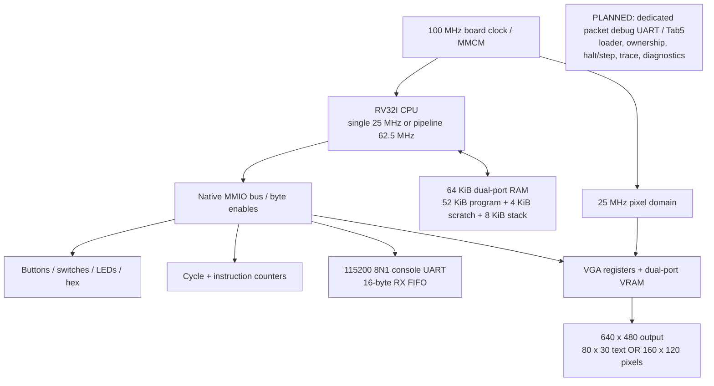

# Architecture sheet

The printable [one-page architecture sheet](images/phase7/architecture-sheet.pdf) describes
the implemented FPGA computer and labels the planned Tab5 work separately.

The single-cycle CPU remains the default and the pipeline's reference. Pipeline IF/ID/EX/MEM/WB
valid bits, forwarding, load-use stalls and flushes prevent wrong-path side effects.
RV32M, CSRs, traps and interrupts are not implemented. FENCE is a no-op; ECALL/EBREAK halt.
Both CPUs execute the same freestanding RV32I/ILP32 C images through the custom startup/linker
and compatible libgcc. Program entry and reset PC are zero.

Phase 7 changes C, tooling, tests and documentation. It adds no hardware module, clock,
memory-map address or resource allocation. Games compute their state on the FPGA CPU;
host code computes independent expectations only for verification.

The text and pixel modes are exclusive in RTL. Snake draws its own 8 x 8 pixel-font HUD.
Life has two 2,400-byte state grids in main RAM, separate from the 9,600-byte VGA framebuffer.
VGA pixels stay at 25 MHz while CPU clocks vary; mode changes use an acknowledged
frame-boundary handshake and displayed-vblank status crosses to the CPU through two flops.

Simulation and routed FPGA evidence are in the [Phase 7 record](phases/PHASE7_DEMOS.md).
Physical VGA observation, unattended cold-power demos, photos/video and an independent rebuild
remain pending. JTAG programming loads volatile configuration; flash boot is separate work
that needs verified hardware and authorization.
