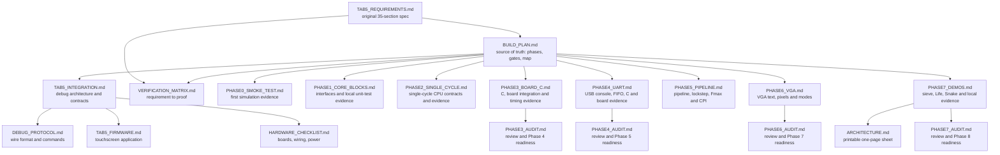

[Project README](../README.md) › **Docs index**

# Design documents

This folder holds the project's design record: the build plan, the architecture and protocol
contracts, the hardware checklist, and the evidence for passed tests. Start here to find the
right document for a question.

> [!NOTE]
> All of these documents exist now. **The designs they describe are 📋 PLANNED** unless a document
> says otherwise. Phases 0–4 have passed their recorded gates. Phase 4 includes routed CPU
> timing and observed USB UART operation. Phase 5 passed on the board, and hosted CI passed for
> Phases 3, 4 and 5 on `main`. Phase 6 VGA is implemented locally; its monitor gate is unrun. Status labels
> are defined in the [root README](../README.md#2-project-status).

The [single-cycle debug simulation record](tab5/TAB5_SIMULATION_DEBUG.md) covers the local
packet engine, CPU controls, loader, trace/counters, hardware BIST/faults, host CLI and Tab5
packet backend. It records tested software separately from unrun physical/pipeline gates.

---

## 1. The documents and how they relate

The diagram shows which document builds on which. The original requirements feed the build plan,
which the detailed contracts elaborate.

The documents are grouped by folder:

| Folder | Holds |
| --- | --- |
| `docs/` | This index and [BUILD_PLAN.md](BUILD_PLAN.md), the source of truth |
| [`phases/`](phases/) | One record per phase (design, contracts, evidence) and the audit that closed it |
| [`tab5/`](tab5/) | The Tab5 debug track: architecture, wire protocol, firmware, hardware checklist, verification matrix and the original requirements |
| [`reports/`](reports/) | Reviewed Vivado timing, utilization and DRC reports, one folder per phase |
| [`images/`](images/) | Diagrams used by the READMEs |

| Document | Kind | Read it for |
| --- | --- | --- |
| [BUILD_PLAN.md](BUILD_PLAN.md) | Plan | Phases 0–7 and Tab5 milestones T0–T13, every gate, design decisions, memory map, test strategy, C flow, risks, open questions. **Its checkboxes are the record of progress.** |
| [PHASE0_SMOKE_TEST.md](phases/PHASE0_SMOKE_TEST.md) | Simulation evidence | Working VS Code task, counter behavior, 25 passing checks, deliberate failure, observed Ubuntu tool versions and output location |
| [PHASE1_CORE_BLOCKS.md](phases/PHASE1_CORE_BLOCKS.md) | Interfaces and verification | Six implemented CPU-block tasks, seven passing benches, decoder policy, register-file timing and the passed gate |
| [PHASE2_SINGLE_CYCLE.md](phases/PHASE2_SINGLE_CYCLE.md) | Design and verification | Single-cycle CPU, RAM edge schedule, retirement and stop contract, test environment, 63 passing tests |
| [PHASE2_AUDIT.md](phases/PHASE2_AUDIT.md) | Historical audit | Requirement-by-requirement review, fixes and verification; the Phase 2 CI gate subsequently passed |
| [PHASE3_BOARD_C.md](phases/PHASE3_BOARD_C.md) | Interfaces and hardware evidence | 25 MHz SoC, board controls, C startup/metadata, 95/40 checks, routed reports and observed Fibonacci gate |
| [PHASE3_AUDIT.md](phases/PHASE3_AUDIT.md) | Audit | Whole-repository review after Phase 3: requirement check, ranked findings, changes, verification and Phase 4 readiness |
| [PHASE4_UART.md](phases/PHASE4_UART.md) | Interfaces and hardware evidence | Console UART/FIFO, C printf and hello, 101/58 checks, routed timing/DRC and actual COM8 greeting/counter/echo |
| [PHASE4_AUDIT.md](phases/PHASE4_AUDIT.md) | Audit | Whole-repository review after Phase 4: requirement check, ranked findings, stronger UART tests, verification and Phase 5 readiness |
| [PHASE5_PIPELINE.md](phases/PHASE5_PIPELINE.md) | Design and hardware evidence | Five-stage pipeline, forwarding/hazard units, lockstep and hazard zoo, 261/59 checks, clock sweep (Fmax 62.5 MHz), board CPI and the passed gate |
| [PHASE6_VGA.md](phases/PHASE6_VGA.md) | Interfaces and FPGA evidence | VGA timing, text and framebuffer memories, mode handshake, C library and demo, 271/67 checks, routed timing at 25 and 62.5 MHz, and the unrun monitor gate |
| [PHASE6_AUDIT.md](phases/PHASE6_AUDIT.md) | Audit | Whole-repository review after Phase 6: requirement check, ranked findings, stronger VGA tests, documentation fixes, verification and Phase 7 readiness |
| [PHASE7_DEMOS.md](phases/PHASE7_DEMOS.md) | Local demo implementation and evidence | Primes/Life/Snake, controls, reference tests, pin captures, FPGA reports and remaining physical/independent-rebuild acceptance |
| [PHASE7_AUDIT.md](phases/PHASE7_AUDIT.md) | Audit | Whole-repository review after Phase 7: requirement check, ranked findings, stronger demo benches, documentation fixes, verification and Phase 8 readiness |
| [ARCHITECTURE.md](ARCHITECTURE.md) | Architecture sheet | Implemented CPU/RAM/MMIO/peripherals, planned Tab5 separation and printable one-page PDF |
| [TAB5_INTEGRATION.md](tab5/TAB5_INTEGRATION.md) | Architecture | What the FPGA and Tab5 each do, the debug-only Wishbone bus, RAM ownership, halt/step/breakpoint semantics, program loading, trace and counters, BIST and fault injection, block RAM budget |
| [TAB5_SIMULATION_DEBUG.md](tab5/TAB5_SIMULATION_DEBUG.md) | Local implementation and verification | Single-cycle debug modules, exact typed payload profile, loader/trace/BIST/fault contracts, Python-to-RTL workflow, Tab5 backend, resource evidence and remaining gates |
| [DEBUG_PROTOCOL.md](tab5/DEBUG_PROTOCOL.md) | Interface specification | Packet framing, sessions and safe retries, status codes, the command table, payload layouts, capability bits and state machines |
| [TAB5_FIRMWARE.md](tab5/TAB5_FIRMWARE.md) | Firmware design | Framework decision, firmware modules and tasks, data-provenance labels, screens, microSD layout, reproducible builds |
| [HARDWARE_CHECKLIST.md](tab5/HARDWARE_CHECKLIST.md) | Checklist | Manufacturer references, the unknown device revisions, candidate (unapproved) wiring, portable power and flash-boot gates |
| [VERIFICATION_MATRIX.md](tab5/VERIFICATION_MATRIX.md) | Traceability | REQ-01 to REQ-35 mapped to milestones and evidence; the V-* test work packages; what a gate evidence record must contain |
| [TAB5_REQUIREMENTS.md](tab5/TAB5_REQUIREMENTS.md) | Requirements | The owner's original Tab5 proposal, preserved word for word as the statement of intended functionality |

---

## 2. Reading order

1. **[BUILD_PLAN.md](BUILD_PLAN.md)** first: everything else elaborates part of it.
2. **[TAB5_INTEGRATION.md](tab5/TAB5_INTEGRATION.md)** for anything touching debug, loading or
   diagnostics.
3. **[DEBUG_PROTOCOL.md](tab5/DEBUG_PROTOCOL.md)**, **[TAB5_FIRMWARE.md](tab5/TAB5_FIRMWARE.md)** and
   **[HARDWARE_CHECKLIST.md](tab5/HARDWARE_CHECKLIST.md)** for their specific subsystem.
4. **[VERIFICATION_MATRIX.md](tab5/VERIFICATION_MATRIX.md)** to see how each requirement will be proven.
5. **[TAB5_REQUIREMENTS.md](tab5/TAB5_REQUIREMENTS.md)** for the original intent behind any decision.

| If your question is… | Go to |
| --- | --- |
| "What do I do next?" | [Build plan: next task](BUILD_PLAN.md#15-smallest-next-implementation-task) |
| "What address is that device at?" | [Build plan: memory map](BUILD_PLAN.md#6-memory-map) |
| "How does HALT or STEP work?" | [Integration: CPU debug contract](tab5/TAB5_INTEGRATION.md#6-cpu-architectural-debug-contract) |
| "What does opcode `0x0041` do?" | [Protocol: commands](tab5/DEBUG_PROTOCOL.md#5-commands-and-state-permissions) |
| "Can I wire the Tab5 yet?" | [Hardware: T0 electrical gate](tab5/HARDWARE_CHECKLIST.md#t0-electrical-gate) |
| "How will REQ-nn be proven?" | [Verification matrix](tab5/VERIFICATION_MATRIX.md#2-complete-proposal-traceability) |

---

## 3. Diagrams

| Image | Shows | Note |
| --- | --- | --- |
| [images/pipeline.png](images/pipeline.png) | The 5-stage pipeline with forwarding paths and the hazard unit | Current |
| [images/architecture.png](images/architecture.png) | CPU, memory-mapped bus, RAM, board I/O, UART and VGA | Initial-plan artwork; it predates the Tab5 debug path |
| [images/roadmap.png](images/roadmap.png) | The eight core phases and their gates | Initial-plan artwork; the T0–T13 milestones are only in the build plan |

The Mermaid diagrams in [BUILD_PLAN.md](BUILD_PLAN.md) supersede the two initial-plan images.

---

## 4. Files with special editing rules

Two Markdown files are records whose **meaning** must not change. Both have been restyled for
easier reading, under strict limits:

| File | Rule | Why |
| --- | --- | --- |
| [TAB5_REQUIREMENTS.md](tab5/TAB5_REQUIREMENTS.md) | Every sentence of the original is kept word for word. Only layout was added: navigation, grouping into lists, and links to the verification matrix. | It is the owner's original proposal and the record of intent. Rewording it would change the requirements every other document traces back to. |
| [AGENTS.md](../AGENTS.md) | Rules may be regrouped and made easier to find, never weakened or removed. | It is the repository's working rulebook. Changing its wording changes how work is done, so a rule change is made only on purpose. |

---

## 5. Keeping the docs honest

- Tick a build-plan checkbox only when its work is done, and distinguish a finished task from a
  passed gate.
- Update the relevant document in the same change as any interface, architecture, tooling or
  workflow change.
- Phase 0 evidence is in [the build plan](BUILD_PLAN.md#phase-0-fresh-start) and
  [PHASE0_SMOKE_TEST.md](phases/PHASE0_SMOKE_TEST.md). Reviewed out-of-context CPU/RAM utilization
  reports are available through the [Phase 2 record](phases/PHASE2_SINGLE_CYCLE.md#synthesis-evidence).
  Routed SoC reports and the owner-reported C board observation are saved in
  [PHASE3_BOARD_C.md](phases/PHASE3_BOARD_C.md). Board photos/video remain pending.
- Phase 1 interfaces and results are in [PHASE1_CORE_BLOCKS.md](phases/PHASE1_CORE_BLOCKS.md). Its
  gate passed on November 7, 2026.
- Phase 2 WSL and passed CI evidence are in [PHASE2_SINGLE_CYCLE.md](phases/PHASE2_SINGLE_CYCLE.md).
  The [audit](phases/PHASE2_AUDIT.md) preserves that snapshot's results.
- Phase 3 passed locally, on the board and in GitHub Actions run #11. Its report distinguishes simulation, routed timing and owner observation.
- Phase 4 passed locally, through the physical USB UART and in hosted CI run #16;
  [the report](phases/PHASE4_UART.md) records observed serial bytes and new FPGA reports.

**Next step:** open the [build plan](BUILD_PLAN.md).

## Phase 6 VGA implementation

[PHASE6_VGA.md](phases/PHASE6_VGA.md) records the optional display implementation, MMIO/clock contracts, integrated verification and the unrun monitor gate.
