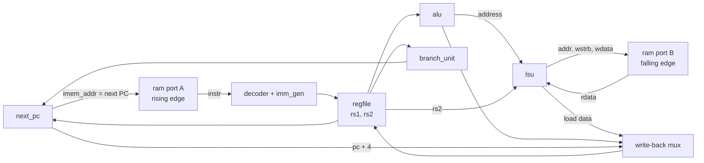

[Project README](../../README.md) › [Docs index](../README.md) › **Phase 2 single-cycle CPU**

# Phase 2 single-cycle CPU: design, contracts and verification

This page records the single-cycle RV32I CPU: its new blocks, the clock-edge schedule it relies
on, the retirement and stop contract that tests and later debugging share, how test programs
run, and the evidence that it works.

> [!NOTE]
> **Status: ✅ IMPLEMENTED in simulation; gate passed November 7, 2026.**
> All 10 Phase 2 tasks are done. Every unit bench, all 13 directed programs and all 40 supported
> rv32ui programs pass with Verilator 5.020 and RISC-V GCC 13.2 in WSL: Ubuntu. Another 27
> utility and harness checks pass, in WSL and on [GitHub Actions run #9](https://github.com/Nishant150876/risc-v-computer/actions/runs/42410438947). The [audit report](PHASE2_AUDIT.md) records the fixes and remaining limits. Status labels are defined in the
> [root README](../../README.md#2-project-status).

<details open>
<summary><b>On this page</b></summary>

1. [Run every test](#1-run-every-test)
2. [Files and interfaces](#2-files-and-interfaces)
3. [Clock-edge schedule](#3-clock-edge-schedule)
4. [Retirement and stop contract](#4-retirement-and-stop-contract)
5. [Test programs](#5-test-programs)
6. [Recorded verification (November 7, 2026)](#6-recorded-verification-november-7-2026)
7. [Known limitations](#7-known-limitations)
8. [Gate and next step](#8-gate-and-next-step)

</details>

---

## 1. Run every test

**One-time setup in Ubuntu (WSL):**

```bash
sudo apt install gcc-riscv64-unknown-elf     # assembler and linker for the test programs
git submodule update --init sw/riscv-tests    # fetches the pinned official rv32ui suite
```

Then press **Ctrl+Shift+B** in VS Code, or from the repository root:

```bash
python3 scripts/run_tests.py
python3 -m unittest discover -s scripts/tests -v
```

Current final line: `101/101 passed` (20 unit benches and 81 program runs, including C).
The second command runs 58 utility and CPU harness tests, including expected failure cases.
The historical Phase 2 snapshot below passed 63 regression runs and 27 Python checks;
[Phase 3](PHASE3_BOARD_C.md) records the current additions and board evidence.

| To run | Command |
| --- | --- |
| Only the official tests | `python3 scripts/run_tests.py rv32ui` |
| One program, with its register dump | `python3 scripts/run_tests.py cpu_tb:directed/fib -v` |
| A trace of every instruction | `<build>/cpu_tb/Vcpu_tb +program=<file.mem> +trace` (a failing program prints this exact command) |
| A waveform for GTKWave | add `+vcd=build/cpu.vcd` to that command |

A missing/incomplete toolchain or submodule shows as a `FAIL` row with the problem in the detail
column. The runner verifies the pinned suite's complete 42-file inventory before selecting the
40 supported tests, so an empty or partial directory cannot silently shrink the regression.

---

## 2. Files and interfaces

| Source | Interface and responsibility | Test |
| --- | --- | --- |
| [next_pc.sv](../../rtl/core/next_pc.sv) | `pc`, `rs1`, `imm`, `jump`, `branch_taken`, `rst`, `hold` -> `pc_plus4`, `target`, `redirect`, `misaligned`, `next`. Branch/JAL target `pc + imm`; JALR `(rs1 + imm)` with bit 0 cleared; reset gives `RESET_PC` (0); hold keeps `pc`. | [next_pc_tb.sv](../../tb/core/next_pc_tb.sv) |
| [lsu.sv](../../rtl/core/lsu.sv) | Lane steering between the CPU and a 32-bit byte-enabled port: store data replicated to lanes plus `mem_wstrb`; load lane select plus sign/zero extension; `misaligned` with the access suppressed. | [lsu_tb.sv](../../tb/core/lsu_tb.sv) |
| [ram.sv](../../rtl/mem/ram.sv) | 64 KB, 16K x 32-bit block RAM. Port A: read-only fetch, rising edge. Port B: read-first data port with byte enables, falling edge (`PORTB_NEGEDGE=1`) or rising edge (`0`, for the pipeline). Optional `INIT_FILE` for `$readmemh`. | [ram_tb.sv](../../tb/mem/ram_tb.sv) |
| [cpu_single.sv](../../rtl/core/cpu_single.sv) | `clk`, `rst`; instruction port `imem_addr/imem_rdata`; data port `dmem_re/dmem_wstrb/dmem_addr/dmem_wdata/dmem_rdata`; observation outputs `retire` (`retire_t`), `halted`, `stop_cause`. No address map inside: the bus arrives in Phase 3. | [cpu_tb.sv](../../tb/system/cpu_tb.sv) plus every program in `sw/tests/` and rv32ui |
| [rv32i_pkg.sv](../../rtl/core/rv32i_pkg.sv) | Adds `stop_cause_t` and `retire_t` (section 4). | Used by all of the above |
| [regfile.sv](../../rtl/core/regfile.sv) | **Changed:** no reset port (decision below). | [regfile_tb.sv](../../tb/core/regfile_tb.sv) |

> [!IMPORTANT]
> **Decision (November 7, 2026): the register file has no reset.** RISC-V does not require
> registers to clear, and Vivado measured 992 flip-flops for the reset version, which also
> prevents LUTRAM. Startup code clears every register it relies on: the test environment clears
> x1–x31 and Phase 3's `crt0.S` must set SP and anything else it needs. `regfile_tb` now compares
> only registers that have been written.
> The audit confirmed the current block uses 65 logic LUTs, 48 memory LUTs and no flip-flops;
> see [the synthesis evidence](#synthesis-evidence).



---

## 3. Clock-edge schedule

The plan named falling-edge RAM reads as the initial candidate, to be proven before integration.
[`ram_tb`](../../tb/mem/ram_tb.sv) proves the functional edge ordering with a 40 ns simulated period
(the 25 MHz target). This is not physical timing closure; the half-cycle paths must meet setup
and hold in the Phase 3 integrated build.

| When | What happens |
| --- | --- |
| Rising edge | `PC <= next PC`. Port A latches the word at that same next PC, so the new instruction is valid at the start of its own cycle. The register file writes the previous instruction's result. |
| First half (20 ns) | Decode, register read and ALU produce the data address and store data. |
| Falling edge | Port B reads (loads) or writes (stores) that address. |
| Second half (20 ns) | Load lane select and extension; next PC and write-back settle for the rising edge. |

> [!NOTE]
> **Revision of the timing decision, made on purpose.** Clocking *both* ports on the falling edge
> does not work: the instruction would only appear mid-cycle, leaving no time to form a dependent
> load address before the same falling edge. The working schedule keeps both ports synchronous
> (block RAM inference is unchanged) but feeds port A the **next** PC on the rising edge, and
> keeps only the data port on the falling edge. `ram_tb` also shows that a rising-edge data port
> (pipeline mode) returns the same load a full cycle late.

What `ram_tb` checks: port A changes only at a rising edge; a fetched word that *is* an address
produces valid load data before the next rising edge, for 64 consecutive cycles; a store at a
falling edge is seen by the very next fetch and the next load; all 16 byte-enable patterns;
read-first behavior; `$readmemh` including an `@address` record; address bits above 15 ignored;
disabled read/write ports hold state; and all byte-enable patterns work in both B clock modes.
The default 16,384-word configuration is verified. Other `WORDS` values need a power-of-two
depth and valid address slices; arbitrary depths and a one-word RAM are not supported contracts.

**Alignment:** PC and every fetch are 4-byte aligned (reset is 0, and misaligned targets stop the
CPU). RAM uses byte address bits [15:2] as the word index and ignores bits [1:0]; the LSU picks
the lanes.

---

## 4. Retirement and stop contract

One `retire_t` record is valid for exactly one clock per completed instruction, including stores,
branches and instructions that write no register. This is the architectural boundary for tests
now, and for counters, trace, lockstep and Tab5 debugging later.

| Field | Meaning |
| --- | --- |
| `valid` | This instruction completes at the coming rising edge. |
| `pc`, `instr` | The instruction. |
| `next_pc` | The PC of the next instruction to execute (also after ECALL/EBREAK). |
| `rd_we`, `rd`, `rd_wdata` | The register write; `rd_we` is false for rd = x0 and for instructions that write nothing. |
| `mem_re`, `mem_wstrb`, `mem_addr`, `mem_wdata` | The load or store: byte address, written lanes and lane-aligned store data. Zero when unused. |

| Stop cause | Retires? | State change | PC after the stop |
| --- | :-: | --- | --- |
| `STOP_ECALL`, `STOP_EBREAK` | Yes, once | Normal | `pc + 4` |
| `STOP_ILLEGAL` | No | None | The faulting instruction |
| `STOP_MISALIGNED_FETCH` (taken branch/jump target with bit 1 set) | No | None (no link write) | The faulting instruction |
| `STOP_MISALIGNED_LOAD` (LH/LHU odd, LW not 4-aligned) | No | None (no rd write) | The faulting instruction |
| `STOP_MISALIGNED_STORE` (SH odd, SW not 4-aligned) | No | No byte written | The faulting instruction |

- `halted` stays set until reset. Only reset restarts the CPU.
- A not-taken branch with a misaligned target is not a fault. JALR's bit-0 clearing is not a fault.
- FENCE retires as a no-op. These stops are the project's execution environment, not RISC-V traps.
- CPU reset restores PC/stop state and suppresses side effects while held. It does not clear
  x1–x31 or RAM; startup owns their initialization. Hold reset across complete clock edges before
  releasing it. Cancelling an already accepted falling-edge store is not a rollback operation.

`cpu_tb` enforces the contract on every cycle: each retired `pc` equals the previous `next_pc`;
the written register holds `rd_wdata` after the edge; and at the end the register file equals a
shadow copy built **only** from retirement records, so no write can bypass the record.
It also compares actual falling-edge data accesses with the following retirement record and
checks the real register-file write enable. After any stop, four complete cycles must remain
inactive with a stable PC and stop cause. A failure result is rejected immediately, even if a
program would later overwrite it with pass.

---

## 5. Test programs

| Location | What it is |
| --- | --- |
| [sw/tests/env/riscv_test.h](../../sw/tests/env/riscv_test.h) | Replaces riscv-tests' stock environment, which needs CSRs. Clears x1–x31, then reports by storing to `0xF000_0000`: `1` = pass, `(test << 1) | 1` = fail, then ECALL. |
| [sw/tests/env/check.h](../../sw/tests/env/check.h) | `CHECK(n, reg, value)` and `TEST_END` for directed tests. |
| [sw/tests/env/link.ld](../../sw/tests/env/link.ld) | Links code and data into the 64 KB RAM from address 0. |
| [scripts/bin2mem.py](../../scripts/bin2mem.py) | Raw binary -> one little-endian 32-bit word per line for `$readmemh`. |
| `sw/tests/isa/*.S`, `sw/tests/faults/*.S` | 13 directed programs (below). |
| `sw/riscv-tests/` | The official suite as a git submodule; `isa/rv32ui/*.S` are run. |

| Directed program | Covers |
| --- | --- |
| `alu_reg`, `alu_imm` | Every register and immediate ALU instruction, overflow, shift amounts, rd = x0, rd = rs, dependent chains |
| `load_store` | Every size at every legal offset, extension, single-lane stores, negative offsets, store-then-load, linker data |
| `branch` | All six branches taken and not taken, signed/unsigned disagreement, backward loop, skipped instructions |
| `jump` | JAL/JALR link values, JALR bit-0 clearing, rd = rs1, nested calls with a stack |
| `upper` | LUI, and AUIPC checked against link-time addresses built without AUIPC |
| `system` | FENCE variants as no-ops, EBREAK as the stop (cause checked), and an immediately following store that must stay disabled |
| `fib` | fib(1)–fib(20) at `0x2000`, checked word by word against [fib.expect](../../sw/tests/isa/fib.expect) |
| `fault_*` (5) | Illegal instruction, misaligned load, store, branch and JALR targets: correct stop cause, no retirement, memory checked afterwards |

**Per-program options:** a line `// cpu_tb: +expect=<file> +expect_stop=<CAUSE>` in a program is
passed to `cpu_tb`. `+expect` files list `<address> <value>` pairs (hex) that must be in RAM at
the end; they are written by hand or by a separate script, never by the CPU.
Blank lines are allowed; every other line must contain exactly two values. A malformed or
empty expectation file fails. Before image loading, the bench fills RAM with `0xA5A5_A5A5`:
each test must initialize any location it expects to be zero. This is a testbench poison,
not a hardware RAM initialization requirement.

**rv32ui coverage:** 40 of the suite's 42 programs run. Two are outside this project's RV32I
contract and are skipped by name in `run_tests.py`:

- `fence_i` needs FENCE.I (the Zifencei extension), which is not part of RV32I.
- `ma_data` needs misaligned loads and stores to work or to trap; this CPU stops instead, as
  documented above, and the directed `fault_misaligned_*` programs test that contract.

---

## 6. Recorded verification (November 7, 2026)

Source snapshot: the `phase-2` branch, based on `c989dba`, preserving the owner's uncommitted
Phase 2 implementation plus the [audit refinements](PHASE2_AUDIT.md). riscv-tests is a registered
submodule at
`3df703cd52d5f0d8224e3c50bf03c6cb70efff98`. Tools: Verilator 5.020, `riscv64-unknown-elf-gcc`
13.2.0, WSL: Ubuntu 24.04, `--binary --timing --assert -Wall` with no warnings.

| Run | Result |
| --- | --- |
| `next_pc_tb` | 20,023 checks pass: sequential and wrap, branch/JAL/JALR targets with B/J offset extremes, bit-0 clearing, both low target bits checked for alignment, reset and hold priority, 20,000 random cases against a ripple-carry reference. Seed `0bad2026`. |
| `lsu_tb` | 20,184 checks pass: every size x offset x signedness, reserved-size suppression, simultaneous read/write inputs, store lanes checked byte by byte through a memory model, alignment contract, 20,000 random cases. Seed `1a5e2026`. |
| `ram_tb` | 371 checks pass (section 3). |
| `regfile_tb` | 6,140 checks pass under the no-reset contract. |
| Phase 0/1 benches | `alu`, `branch_unit`, `decoder`, `imm_gen`, `counter`, `basys3_top` unchanged and passing. |
| Directed programs | 13/13 pass. |
| rv32ui | 40/40 pass. |
| **Total** | **63/63 passed** |
| Utility / harness tests | **27/27 passed**, separately via `python3 -m unittest discover -s scripts/tests -v`. This builds the real CPU bench and checks failure paths as well as positive cases. |

### Bug-injection check

The original development record reported 16 single-line bugs injected one at a time and the
full regression run each time: **15 were caught; 1 was missed.** That record is preserved below;
the audit did not rerun all 16 historical experiments. One of them
(`EBREAK reported as ECALL`) was missed on the first run, so `system.S` now also requires the
EBREAK stop cause; the table shows the result after that fix.

<details>
<summary><b>The 16 injected changes</b></summary>

| Block | Injected bug | Caught by |
| --- | --- | --- |
| LSU | LB zero-extends | `load_store`, rv32ui `lb`, `ld_st`, … |
| LSU | LH zero-extends | `load_store`, rv32ui `lh`, `ld_st`, … |
| LSU | LH always reads the low half | `load_store`, `fault_misaligned_load`, rv32ui `ld_st`, … |
| LSU | SH always writes the low lanes | `load_store`, `fault_misaligned_store`, rv32ui `ld_st`, … |
| LSU | No halfword alignment check | `lsu_tb`, `fault_misaligned_load` |
| next_pc | JALR keeps bit 0 | `next_pc_tb`, `jump` |
| next_pc | Misaligned flagged even when not taken | 52 rows |
| next_pc | Branch target off by 4 | `next_pc_tb`, `branch`, `fib` |
| CPU | Store byte enables not gated by commit | Missed in the original run; caught by the audit's halted-store case |
| CPU | A faulting instruction still writes rd | `fault_misaligned_jump` (shadow register check) |
| CPU | Link value is `pc` instead of `pc + 4` | Verilator `-Wall` (unused `pc_plus4`) |
| CPU | ECALL does not stop | 48 rows (the pass code falls into the fail code) |
| CPU | AUIPC uses `pc + 4` | `upper`, `jump`, `fault_misaligned_jump`, … |
| CPU | A fault still advances the PC | every `fault_*` program (fault PC check) |
| CPU | EBREAK reported as ECALL | `system` (after adding `+expect_stop=EBREAK`) |
| RAM | Byte lanes all follow strobe 0 | `ram_tb`; Verilator `-Wall` in `cpu_tb` |

The original explanation of the store-gating mutation was incorrect: after ECALL/EBREAK the
next decoded instruction may be a store. The LSU's alignment guard does not suppress that
aligned store. The updated `system` test and halted-bus checks expose the missing commit gate.

</details>

The audit separately built seven mutations in temporary copies and observed each fail:
remove the store halt gate, remove the load halt gate, remove the register write commit gate,
corrupt retired store data, restore the incomplete target alignment check, omit terminal
retirement, and falsely retire a fault. No mutated
source was left in the project. See the [audit evidence](PHASE2_AUDIT.md#e-verification-results).

### Synthesis evidence

Windows Vivado 2025.2 ran `scripts/vivado/synth_blocks.tcl` before and after the audit. All nine blocks
synthesize with no latches. The script now checks actual `RAMB*` cells and requires 16 RAMB36s
for the default RAM; its earlier `BLOCKRAM` property filter falsely printed zero.

These are **packed site counts from `report_utilization`**, not the hierarchical cell counts
in the script's console summary:

| Block | Logic LUTs | Memory LUTs | Flip-flops | RAMB36 | Latches |
| --- | ---: | ---: | ---: | ---: | ---: |
| `alu` | 362 | 0 | 0 | 0 | 0 |
| `branch_unit` | 72 | 0 | 0 | 0 | 0 |
| `decoder` | 70 | 0 | 0 | 0 | 0 |
| `imm_gen` | 32 | 0 | 0 | 0 | 0 |
| `regfile` | 65 | 48 | 0 | 0 | 0 |
| `next_pc` | 132 | 0 | 0 | 0 | 0 |
| `lsu` | 73 | 0 | 0 | 0 | 0 |
| `ram` | 0 | 0 | 0 | 16 | 0 |
| `cpu_single` (without RAM) | 1,313 | 48 | 36 | 0 | 0 |

Reviewed reports: [RAM](../reports/phase2/ram_utilization.rpt),
[register file](../reports/phase2/regfile_utilization.rpt),
[CPU without RAM](../reports/phase2/cpu_single_utilization.rpt). Out-of-context counts cannot be
summed into an integrated placed design or used to claim CPU timing closure. The audit made
no speculative datapath optimization; the register-file reset decision predates it.

The unchanged blink top was also rebuilt with `scripts/vivado/build.tcl`: WNS **+7.066 ns**, WHS
**+0.268 ns**, `== TIMING MET`. It still contains no CPU, and the board was not reprogrammed.

---

## 7. Known limitations

These describe the Phase 2 snapshot. The bus, integrated timing and C startup items were
subsequently implemented and verified in [Phase 3](PHASE3_BOARD_C.md); undefined unwritten
state and the two-state simulator limitation still apply.

| Item | Detail | Next step |
| --- | --- | --- |
| No bus yet | `cpu_tb` routes `0x0000_0000–0x0000_FFFF` to RAM and treats `0xF000_0000` as the result word; any other load or store fails the test. | Phase 3 `bus.sv` |
| Synthesis scope | All nine CPU/memory blocks synthesize without latches. RAM uses 16 RAMB36s and the reset-free register file uses LUTRAM. These are out-of-context results. | Integrate and constrain the CPU in Phase 3 |
| Timing | The half-cycle paths (fetch -> data address, load -> write-back) are unmeasured. | Phase 3: Vivado timing at 25 MHz |
| Undefined state | Unwritten registers/RAM have no guaranteed power-up value. Verilator is a two-state simulator; RAM poison and explicit startup initialization expose accidental zero assumptions, but do not prove X/Z propagation. | `crt0.S` and board reset/initialization checks in Phase 3; optional four-state simulation |

---

## 8. Gate and next step

> **Gate:** all of rv32ui and every directed test pass in simulation.

**The Phase 2 gate passed on November 7, 2026.** WSL passed 63/63 plus 27 utility/harness
checks, and [GitHub Actions run #9](https://github.com/Nishant150876/risc-v-computer/actions/runs/42410438947) on `main` (commit `a909c3f`) passed the same workflow.

**Subsequent result:** [Phase 3](PHASE3_BOARD_C.md) now runs C on the board and passed its
physical gate. [Phase 4 UART](PHASE4_UART.md) and [Phase 5 pipeline](PHASE5_PIPELINE.md) have also passed;
[Phase 6 VGA](PHASE6_VGA.md) is implemented with its monitor gate unrun.

---

**Related:** [Build plan, Phase 2](../BUILD_PLAN.md#phase-2-single-cycle-cpu-in-simulation) · [Phase 1 blocks](PHASE1_CORE_BLOCKS.md) · [rtl/README.md](../../rtl/README.md) · [tb/README.md](../../tb/README.md) · [sw/README.md](../../sw/README.md) · [Docs index](../README.md)
