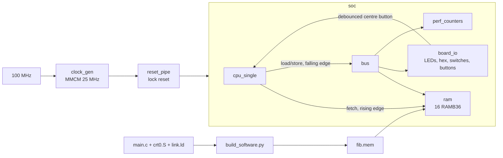

[Project README](../../README.md) › [Docs index](../README.md) › **Phase 3 audit**

# Phase 3 repository audit — November 7, 2026

> [!IMPORTANT]
> **Verdict: READY FOR Phase 4.** All nine Phase 3 tasks have evidence, and the physical gate
> passed: the board showed `1A6D` for fib(20). This review found no correctness bug in the
> RTL. It added one integration bench, hardened the software build, and corrected the
> documentation. Final results: **95/95 regression runs**, **40/40 Python tests**,
> **18/18 RTL modules and 19/19 benches lint-clean**, **43/43 Mermaid diagrams parse**.
> **Update:** committed as `ba05705`; [GitHub Actions run #11](https://github.com/Nishant150876/risc-v-computer/actions/runs/42422996823) passed on `main`.

This review covers the whole repository as it stands after Phase 3, with the Phase 3 source
still uncommitted. It does not start Phase 4. The architecture, memory map, instruction
policy, reset contracts and the owner-approved reset-free register file are unchanged.

**Historical snapshot:** the later commit/CI update above supersedes the uncommitted/CI-unrun
wording and publication steps retained below. Those steps are a record, not authorization
for another Git delivery. [Phase 4](PHASE4_UART.md) subsequently implemented the console and
reset-stage recommendation F1, with new routed timing/DRC and physical UART evidence.

<details open>
<summary><b>On this page</b></summary>

- [A. Repository understanding](#a-repository-understanding)
- [B. Phase 3 requirement check](#b-phase-3-requirement-check)
- [C. Problems found](#c-problems-found)
- [D. Changes made](#d-changes-made)
- [E. Verification results](#e-verification-results)
- [F. Recommendations not implemented](#f-recommendations-not-implemented)
- [G. Phase 4 readiness](#g-phase-4-readiness)

</details>

---

## A. Repository understanding

The repository builds an RV32I computer for the Basys 3. The working CPU is the single-cycle
reference (`cpu_single`). Phase 3 wraps it in a board system: a 25 MHz MMCM clock, 64 KiB of
dual-port block RAM, a small data bus, board I/O, two counters and a C build flow. The
five-stage pipeline, UART, VGA and the Tab5 debugger are still planned.



| Area | What it does | Depends on it |
| --- | --- | --- |
| `rtl/core/` | Shared package, ALU, register file, immediate generator, decoder, branch unit, next PC, load/store unit, `cpu_single` | `soc`, `cpu_tb`; the pipeline will reuse the blocks |
| `rtl/mem/ram.sv` | 64 KiB RAM: port A fetch on the rising edge, port B data on the falling edge | `soc`, `cpu_tb` |
| `rtl/io/` | `bus` (address decode, falling-edge MMIO capture), `board_io`, `debounce`, `perf_counters` | `soc`, `cpu_tb` (board mode) |
| `rtl/top/` | `clock_gen` (MMCM or a `VERILATOR` model), `soc`, `basys3_soc` (board top), `basys3_top` (Phase 0 blink) | `build.tcl`, board benches |
| `sw/common/`, `sw/programs/` | C startup, linker script with reserved scratch and stack, MMIO names, the Fibonacci gate program and a runtime smoke test | `build_software.py`, `run_tests.py`, `build.tcl` |
| `scripts/` | Regression runner, image converter, C builder with ELF checks, Vivado build/program, block synthesis | CI, VS Code tasks, the docs |
| `tb/` | 17 unit benches and 2 program benches (`cpu_tb`, `board_c_tb`) | `run_tests.py`, Python harness tests |

---

## B. Phase 3 requirement check

Each row is a [BUILD_PLAN](../BUILD_PLAN.md#phase-3-on-the-board-running-c) task, checked
against the code, not against its checkbox.

| Requirement | Status | Evidence | Remaining issue |
| --- | --- | --- | --- |
| `fpga/basys3.xdc`: clock, reset, LEDs, switches, buttons, display, UART | ✅ Verified | 52 SoC pins and 18 blink pins, all unique, compared by script with the downloaded Digilent master XDC: 0 mismatches. | None |
| MMCM 25 MHz, reset synchronizer, debouncer | ✅ Verified | 100 × 10 / 40 = 25 MHz, VCO 1 GHz (in range). `clock_gen_tb`, `debounce_tb`, `basys3_soc_tb`. Vivado: 40.000 ns generated clock. | `REQP-1839` DRC warnings (C2) |
| `bus.sv`: devices at `0x8000_0000` and above | ✅ Verified | `bus_tb` (45 checks): boundaries, holes, all strobes, sampled MMIO reads | None |
| `board_io.sv`: LEDs, switches, buttons, 7-segment at about 1 kHz | ✅ Verified | 6,250 clocks per digit = 1,000 frames/s. `board_io_tb` checks every glyph on every digit. `board_c_tb` checks the real pins. | Outputs are combinational (F4) |
| Cycle and retired-instruction counters | ✅ Verified | `perf_counters_tb` (wrap, stop, reset priority); `runtime_smoke` reads both | 32-bit wrap after about 172 s (planned for T9) |
| `crt0.S`, `link.ld`, `mmio.h`, `bin2mem.py` | ✅ Verified | `runtime_smoke` proves BSS, data, SP/GP/TP and `libgcc`. Linker asserts plus ELF checks in `build_software.py`. | None |
| Linker bounds, image metadata, reset-held RAM ownership, separate CPU reset | ✅ Verified | `test_software.py` (real linker rejects overflow); `soc_tb` holds a pending store, primes a fresh fetch and faults on out-of-RAM fetch | Actual loader is T3/T5 work |
| Every C program runs in `cpu_tb` first | ✅ Verified | 23 Fibonacci inputs and `runtime_smoke` in `cpu_tb`, plus the new full-top run | None |
| Timing: no negative slack at 25 MHz | ✅ Verified | Routed WNS +0.828 ns, WHS +0.122 ns, no unconstrained internal endpoints | Small margin (C3) |
| **Gate:** switches=20 shows `1A6D` | ✅ Passed | Owner observed `1A6D` and `0000`. The image rebuilt in a second, independent Linux setup is byte-identical (192 bytes, CRC-32 `34dff2d3`). | None: CI run #11 passed |

The Phase 1 and Phase 2 blocks were re-read line by line. Their widths, signedness, shift
masking, x0 handling, sign extension, illegal-instruction detection and stop rules match the
RISC-V specification and the [Phase 2 audit](PHASE2_AUDIT.md). All 40 supported rv32ui
programs still pass.

---

## C. Problems found

Ranked from most to least important. None is a functional bug in the RTL.

| # | Severity | Problem | Action |
| --- | --- | --- | --- |
| C1 | Medium | Phase 3 source is uncommitted, so hosted CI has never run it. It sits on a temporary local branch. | Resolved: committed to `main`, CI run #11 passed |
| C2 | Medium | Routed DRC reports 20+ `REQP-1839` warnings: logic from `reset_pipe_reg[1]`, which has an asynchronous set, reaches RAM address, enable and write pins. The handoff report said only "ordinary warnings". | Documented in [PHASE3_BOARD_C.md](PHASE3_BOARD_C.md#6-recorded-verification--november-7-2026); fix in F1 |
| C3 | Medium | The worst setup path has only 0.828 ns of its 20 ns half cycle left. It runs from the fetch RAM, through decode, register read, ALU and the `commit` fault logic, to the RAM port B enable. The router briefly reached −0.243 ns before it converged. Phase 4 logic on this path could break timing. | F2 |
| C4 | Medium | Verification gap: the real C image never ran on `soc` or `basys3_soc` in simulation. `cpu_tb` builds its own memory system, and `soc_tb` uses an 8-word hand image. The `soc` fetch mux, RAM enable gating and the button reset path were never exercised by C. `cpu_tb` also stops at the first display write, so live switch changes were never simulated. | Fixed (D1) |
| C5 | Low | `build_software.py` wrote its new outputs only after a successful build, so a failed rebuild left the previous `.mem` and `.json` in place. | Fixed (D2) |
| C6 | Low | [PHASE3_BOARD_C.md](PHASE3_BOARD_C.md) named the temporary local branch. | Fixed (D4) |
| C7 | Low | Test counts in 11 documents became stale once tests were added. | Fixed (D4) |

Things checked and found correct: no latches (lint and Vivado agree), no width warnings, every
`always_comb` assigns all outputs, `x0` is never written, a CPU reset cannot cancel a store
already accepted, MMIO read data cannot change between the falling edge and write-back,
and out-of-range fetches stop with an illegal instruction instead of wrapping around RAM.

---

## D. Changes made

| # | Files | What changed | Why | Verified by |
| --- | --- | --- | --- | --- |
| D1 | New `tb/system/board_c_tb.sv`; `scripts/run_tests.py` | A second program bench runs the compiled Fibonacci image on the complete `basys3_soc` top. It poisons RAM, starts at switches=20 (`1A6D`), changes the switches eight times while the CPU runs (0, 1, 7, 19, 21, `FFFF`, 20, then 5 after a centre-button restart) and checks LEDs, the hex register and each scanned digit's segment pins. The runner now supports more than one program bench (`Program.bench`); the board run appears as `board_c_tb:c/fib_board`. | Closes C4: the simulated version of the physical gate. | 95/95; five RTL mutations (button reset removed, wrong `A` glyph, stuck switches, button resets I/O, reversed digits) each make it fail |
| D2 | `scripts/build_software.py` | Delete the previous outputs before building. | Closes C5: a failed build can never leave an old image beside the error. | New test fails without the fix and passes with it |
| D3 | `scripts/tests/test_cpu_harness.py`, `test_tools.py`, `test_software.py` | Four tests: `board_c_tb` fails without `+program`; it fails on an image that shows `1A6D` but ignores the switches; board-image selection in the runner; stale outputs removed. | Proves the new bench can fail, so a green result means something. | 40/40 |
| D4 | 11 Markdown files | Counts updated to 95 and 40; `board_c_tb` described in the test and script guides; `REQP-1839` disclosed with an explanation; branch name removed; this page added and linked. | Docs must match the code. | 818 local links and anchors resolve; 43/43 Mermaid diagrams parse; `git diff --check` clean |

No RTL file changed, so the routed timing, the bitstream and the board observation stay valid.

---

## E. Verification results

Run on a clean Linux checkout of the working tree with Verilator 5.020 and RISC-V GCC 13.2.0,
the same versions as WSL and CI.

| Check | Result |
| --- | --- |
| Baseline before changes: `python3 scripts/run_tests.py` | 94/94 passed |
| Baseline: `python3 -m unittest discover -s scripts/tests` | 36/36 passed |
| Final `run_tests.py` (`--binary --timing --assert -Wall`) | **95/95 passed** |
| Final Python unittest discovery | **40/40 passed** |
| Standalone lint, every RTL module as top, `-Wall` | **18/18**, no warnings |
| Lint of every bench | **19/19**, no warnings |
| Mutations on the new bench | 5/5 killed. A sixth (counters run during reset) is equivalent: reset has priority, so behavior does not change. |
| XDC pins vs downloaded Digilent master | 52 SoC + 18 blink pins, 0 mismatches, no duplicates |
| Fibonacci image reproduction | 192 bytes, CRC-32 `34dff2d3`, SHA-256 `0918fab4…74097`, identical to the image in the board bitstream |
| `py_compile` of all 6 Python files | Passed |
| `tasks.json` and CI YAML parse | Passed |
| Mermaid 11.4.1 parse | **43/43** in 24 files |
| Local Markdown links and anchors | **818/818** resolve |
| `git diff --check` | Clean |

Not run: Vivado (synthesis, timing, DRC) and the board. No RTL changed, so the recorded
Vivado results still apply. GitHub Actions has not run because nothing is committed.

---

## F. Recommendations not implemented

Each needs Vivado or a board check, or belongs to a later phase.

| # | Recommendation | Why it is not done here |
| --- | --- | --- |
| F1 | Clear `REQP-1839` by adding one plain register after `reset_pipe` in `basys3_soc.sv` (`always_ff @(posedge clk_cpu) rst_q <= reset_pipe[1];` with an initial value of 1, then use `rst_q`). Reset then asserts one cycle later, with no async set on the RAM-control path. | Changes the bitstream: needs a Vivado rebuild, the DRC re-checked and the board gate repeated. |
| F2 | Recover timing margin before Phase 4 adds logic. Option: drive RAM port B's read enable from the address decode only, not from `commit`, because RAM reads have no side effects. Keep writes gated by `commit`. | Speculative until Vivado shows the new worst path. Phase 4's UART receive register may make reads side-effecting, so the rule must cover RAM only. |
| F3 | Let `build.tcl` read the WSL distribution name from an environment variable instead of the fixed `Ubuntu`. | Untestable here; it works on the current machine. |
| F4 | Register `seg`, `an` and `dp` before the pins. This removes switching glitches and lets the outputs use IOB flip-flops. | Cosmetic for a human-viewed display; changes the bitstream. |
| F5 | CPU-only reset does not restore modified `.data` initializers. Programs that change initialized globals must not depend on them after a button restart. | Documented contract; a reloader is T3/T5 work. |

---

## G. Phase 4 readiness

**READY FOR Phase 4.** Every Phase 3 task has code and test evidence, routed timing is met,
and the documented gate passed on the board. This audit changed no RTL, so that evidence
still applies.

Do these first, from WSL in the repository folder:

1. Move the uncommitted work onto `main`. The current branch has no commits of its own
   (it points at `38adb6c`, the same commit as `main`), so the changes simply come along:

   ```bash
   git checkout main
   ```

   Then delete the temporary Phase 3 branch with `git branch -D <branch>`.

2. Run the tests once more, then commit and push:

   ```bash
   python3 scripts/run_tests.py && python3 -m unittest discover -s scripts/tests
   git add -A
   git status --short
   git commit -m "Phase 3: board system and C on the Basys 3"
   git push origin main
   ```

3. Confirm that the GitHub Actions run on `main` is green (95/95 and 40/40).

Optional: apply F1 and F2 at the start of Phase 4, while timing margin matters most.

---

**Related:** [Phase 3 board and C](PHASE3_BOARD_C.md) · [Build plan](../BUILD_PLAN.md#phase-3-on-the-board-running-c) · [Phase 2 audit](PHASE2_AUDIT.md) · [Tests](../../tb/README.md) · [Docs index](../README.md)

**Next step:** [Phase 4 UART](../BUILD_PLAN.md#phase-4-uart-text-to-your-laptop).
