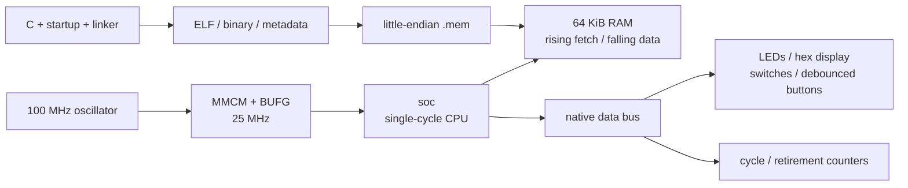

[Project README](../../README.md) › [Docs index](../README.md) › **Phase 3 board and C**

# Phase 3: C running on the Basys 3

> [!IMPORTANT]
> **Gate passed November 7, 2026.** The FPGA was programmed with the compiled C Fibonacci
> image. The owner confirmed **`1A6D` with input 20** (SW4 and SW2 on, other switches off),
> and **`0000` with input 0**. This is an owner-reported physical observation, separate from
> simulation and timing analysis. The source is on `main` (commit `ba05705`) and [GitHub Actions run #11](https://github.com/Nishant150876/risc-v-computer/actions/runs/42422996823) passed.

## 1. What now exists

The Phase 2 single-cycle CPU is unchanged. A board system adds synchronous RAM, a native data
bus, board registers, counters, input filtering, an MMCM and the C startup/build flow. The
original [blink top](../../rtl/top/basys3_top.sv) remains a separate build target.



| Source | Responsibility | Self-checking bench |
| --- | --- | --- |
| [clock_gen.sv](../../rtl/top/clock_gen.sv) | `MMCME2_BASE`: 100 MHz × 10 / 40 = 25 MHz, 1 GHz VCO, buffered feedback/output. A `VERILATOR`-only functional model supplies simulation clock/lock behavior. | [clock_gen_tb.sv](../../tb/top/clock_gen_tb.sv) |
| [debounce.sv](../../rtl/io/debounce.sv) | Two synchronization stages and an independent consecutive-sample counter for every button; default 250,000 samples at 25 MHz = 10 ms. | [debounce_tb.sv](../../tb/io/debounce_tb.sv) |
| [board_io.sv](../../rtl/io/board_io.sv) | LED/hex registers, two-stage switch synchronization, five debounced buttons, active-low hex display scanning. | [board_io_tb.sv](../../tb/io/board_io_tb.sv) |
| [bus.sv](../../rtl/soc/bus.sv) | Exact RAM/MMIO decode, byte-enable forwarding, falling-edge MMIO read capture. | [bus_tb.sv](../../tb/soc/bus_tb.sv) |
| [perf_counters.sv](../../rtl/io/perf_counters.sv) | Active CPU cycles and actual instruction retirements, 32-bit modulo counters. | [perf_counters_tb.sv](../../tb/io/perf_counters_tb.sv) |
| [soc.sv](../../rtl/soc/soc.sv) | CPU/RAM/bus/I/O integration, reset separation, reset-held memory interlock and instruction-fetch priming. | [soc_tb.sv](../../tb/soc/soc_tb.sv) |
| [basys3_soc.sv](../../rtl/top/basys3_soc.sv) | Physical board top and clock-lock reset boundary; UART TX stays idle until Phase 4. | [basys3_soc_tb.sv](../../tb/top/basys3_soc_tb.sv), and [board_c_tb.sv](../../tb/system/board_c_tb.sv) with the real Fibonacci image |

The display advances one digit every 6,250 CPU clocks: 4,000 digit selections per second,
or 1,000 complete four-digit frames. Digit 0 is the rightmost digit; the decimal point is off.
Counters provide clock enables; the FPGA clock itself comes from the MMCM.

## 2. Bus and counter contract

The CPU map is preserved. The Phase 3 bus implements these addresses:

| Byte address | Register | Behavior |
| --- | --- | --- |
| `0x0000_0000–0x0000_FFFF` | RAM | Unified code/data/stack, native byte enables |
| `0x8000_0000` | LEDs | Write-only low 16 bits; byte lanes 0/1 update independently |
| `0x8000_0004` | Hex display | Write-only low 16 bits, four hexadecimal digits |
| `0x8000_0008` | Switches | Read-only synchronized 16-bit value, upper bits zero |
| `0x8000_000C` | Buttons | Read-only: bit 0 centre, 1 up, 2 left, 3 right, 4 down |
| `0x8000_0020` | Cycles | Read-only active CPU cycles |
| `0x8000_0024` | Instructions retired | Read-only actual retirement events |

- Reads of write-only registers return zero. Writes to read-only registers have no effect.
- Unimplemented addresses return zero on data reads and discard writes. They never alias RAM.
  The optional boot ROM, UART and VGA addresses are reserved, not implemented slaves.
- An instruction fetch outside aligned 64 KiB RAM supplies an illegal instruction and stops
  the CPU. There is no privileged address-fault/trap implementation.
- `0xF000_0000` remains the testbench-only result sink. Hardware does not implement it.
- RAM and MMIO side effects use the falling edge. MMIO read values are captured on that edge,
  so a counter changing at the following rising edge cannot change a load's write-back data.
- Counters stop when the CPU stops or is reset. ECALL/EBREAK count as one retirement each.
  CPU reset clears both counters. Unsigned subtraction handles one 32-bit wrap.

The C definitions are in [mmio.h](../../sw/common/mmio.h). Defining a future address there does
not advertise that its peripheral exists.

## 3. Reset and memory ownership preparation

| Control | Effect |
| --- | --- |
| Clock loss/startup | The top asserts its reset boundary asynchronously on lost MMCM lock, then deasserts after two CPU rising edges. Ordinary internal reset inputs remain synchronous. |
| Debounced centre button / `cpu_reset_req` | Reset CPU PC/stop state and run counters. Keep the MMCM, board I/O and RAM alive. The button does not reset its own debouncer. |
| `mem_hold_req` | Synchronous request to hold the CPU in reset and disable both CPU RAM ports. `mem_hold_ack` waits two rising edges, including an intervening quiet falling edge. |
| Release from memory hold | Keep CPU reset asserted while fetching address 0, then execute the fresh instruction. No stale prefetch may run. |

The interlock is tested with quiet ports, retained RAM/peripheral state and a bench-only
instruction replacement while held. It exposes **no runtime loader or third RAM port**.
T3 must add the explicit debug ownership/transfer adapter; T5 must add image validity and
actual RAM readback verification before any external program load can run.

Reset does not roll back a store already accepted at an earlier falling edge. A future owner
must wait for acknowledgment before touching RAM. CPU-only reset does not clear x1–x31,
erase RAM, or restore modified `.data` initializers. Startup initializes the ABI and clears
`.bss`; reloading initialized data remains an image-loader responsibility.

## 4. C startup, linker and image metadata

| File | What it does |
| --- | --- |
| [crt0.S](../../sw/common/crt0.S) | Entry 0; set GP, 16-byte-aligned SP and TP; clear aligned BSS; call `main`; preserve its return status in a0 and stop with EBREAK if it returns. No CSR setup. |
| [link.ld](../../sw/common/link.ld) | Link text/rodata/data below `0xD000`; reserve scratch `0xD000–0xDFFF` and stack `0xE000–0xFFFF`, initial SP `0x10000`; export bounds and reject overlaps. |
| [build_software.py](../../scripts/build_software.py) | Build with `-march=rv32i -mabi=ilp32`, freestanding, no hosted library, explicit compatible `libgcc`; emit ELF, map, disassembly, binary, `.mem` and JSON metadata. |
| [bin2mem.py](../../scripts/bin2mem.py) | Little-endian bytes to 32-bit `$readmemh` words, padding only the last word. |

The metadata is derived from the actual ELF symbols and binary. It checks ELF32/little-endian
RISC-V/soft-float/no-compressed flags, entry 0, image size, word-aligned BSS, reserved bounds,
CRC-32 and SHA-256. It records image length, BSS, heap, scratch and stack. This is developer
build metadata; the final versioned Tab5 manifest and runtime loader checks remain T5 work.

The gate image is [fib/main.c](../../sw/programs/fib/main.c): read all 16 switches, compute
fib(n) for 0–20, mirror the input on LEDs and show the result in hex. Larger inputs show
`FFFF`. [runtime_smoke/main.c](../../sw/programs/runtime_smoke/main.c) additionally checks BSS,
initialized data, actual 16-byte stack alignment/bounds, GP/TP initialization, call/return,
RV32I `libgcc` division/multiplication and counter reads.

## 5. Build, simulate and program

From the repository root in WSL:

```bash
python3 scripts/build_software.py fib
python3 scripts/run_tests.py
python3 -m unittest discover -s scripts/tests -v
```

The regression is **95/95**: 17 unit benches and 78 program runs (13 directed assembly,
40 supported rv32ui, 23 Fibonacci input cases, one C runtime test and one board-top run).
Python checks are **40/40**. The unchanged board ELF runs in `cpu_tb`; no alternate
simulation-only C binary replaces the board code. The running Fibonacci loop is checked after
a real retired display write, while the runtime test returns through startup and halts
normally.

`board_c_tb` then runs the same image on the complete `basys3_soc` top. It starts at
switches=20 (`1A6D`), changes the switches eight times while the program runs (0, 1, 7, 19,
21, `FFFF`, 20, then 5 after a centre-button restart) and checks the LEDs, the hex register
and the segment pins of every scanned digit. This is the simulated version of the physical
gate.

On Windows with Vivado on PATH:

```bash
vivado -mode batch -nojournal -nolog -source scripts/vivado/build.tcl
vivado -mode batch -nojournal -nolog -source scripts/vivado/program.tcl
```

The default top is **`basys3_soc`**. Build first invokes WSL to compile Fibonacci and passes
the `.mem` path into the RAM initialization parameter. It validates the generated 40 ns
clock, 16 RAMB36s and setup/hold slack before writing the bitstream. Build/program are
separate actions. JTAG configuration is volatile; no flash programming was performed.

To build or program the original blink, add `-tclargs basys3_top` to the corresponding
command. It uses [basys3_blink.xdc](../../fpga/basys3_blink.xdc); the SoC uses the full
[basys3.xdc](../../fpga/basys3.xdc). Every pin in both files was compared with the official
[Digilent master XDC](https://github.com/Digilent/digilent-xdc/blob/master/Basys-3-Master.xdc).
The MMCM follows [AMD's MMCME2_BASE primitive](https://docs.amd.com/r/en-US/ug953-vivado-7series-libraries/MMCME2_BASE).
No external wiring or Tab5 electrical approval is implied.

## 6. Recorded verification — November 7, 2026

Source: local working tree based on `38adb6c`, without commits or publication.
Tools: Verilator 5.020 and RISC-V GCC 13.2.0 in WSL Ubuntu; Windows Vivado 2025.2;
part `xc7a35tcpg236-1`.

| Check actually run | Result |
| --- | --- |
| Full `run_tests.py`, `--binary --timing --assert -Wall` | **94/94 passed** at handoff; **95/95** after the [audit](PHASE3_AUDIT.md) added `board_c_tb` |
| Python unittest discovery | **36/36 passed** at handoff, including invalid ELF/linker/image and board-harness failures; **40/40** after the audit |
| Standalone RTL lint | **18/18 modules passed** `--lint-only --timing --assert -Wall`, without warnings |
| Active memory-hold case | Final SoC/top rerun **2/2 passed**; a pending store is suppressed before acceptance, both RAM ports remain quiet, and restart fetch is fresh |
| Native C images | Fibonacci 0–20, invalid 21/65535, and runtime smoke all pass in `cpu_tb` |
| Linker negative case | Oversized BSS rejected by the real linker; no memory image emitted |
| Pin comparison | **52 SoC pins / 18 blink pins**, all unique and matching the official master |
| Full routed SoC timing | **WNS +0.828 ns, WHS +0.122 ns**, all constraints met; critical setup paths have 20 ns rising-to-falling requirements |
| Clock coverage | Generated CPU period **40.000 ns**; zero unclocked or unconstrained internal endpoints, multiple clocks or timing loops |
| Routed resources | **1,403 LUTs** (1,359 logic + 44 memory), **320 flip-flops**, **16 RAMB36**, **0 latches** |
| Bitstream | Successfully written; 0 errors/critical warnings. Ordinary warnings include intentional constant UART/DP, unused bits/receiver and RAM byte-write decomposition. |
| Routed DRC | 0 errors. **20+ `REQP-1839` warnings** (report limit reached): RAM address/enable/write pins are reached through logic from `reset_pipe_reg[1]`, which has an asynchronous set. See the note below. |
| FPGA vs simulated image | Byte-identical, **192 bytes**, CRC-32 **`34dff2d3`**, SHA-256 **`0918fab468066521360c324fcca7ec1ae55fecb9c95a51815a8d16b4b4e74097`** |
| Volatile board programming | `xc7a35t_0`, startup status HIGH, programming command succeeded |
| Original blink target | `build.tcl -tclargs basys3_top` completed successfully; not programmed over the running CPU image |
| Physical gate | Owner confirmed `1A6D` for n=20 and `0000` for n=0 after programming |
| Phase 3 hosted CI | **Passed**: [GitHub Actions run #11](https://github.com/Nishant150876/risc-v-computer/actions/runs/42422996823) on `main`, commit `ba05705` |

Handoff checks also parsed all six Python files, validated the shared task JSON and CI YAML,
checked 23 Markdown files and their local links/anchors, and passed `git diff --check`.
Mermaid fences/links were checked structurally; no diagram parser/render check was run.

Reviewed reports: [timing](../reports/phase3/timing_summary.rpt),
[resources](../reports/phase3/utilization.rpt), [clocks](../reports/phase3/clocks.rpt),
[constraint coverage](../reports/phase3/check_timing.rpt), [DRC](../reports/phase3/drc.rpt).
Only line endings/trailing whitespace are normalized for Git; report data is unchanged.
Missing input/output delay notices are intentional for synchronized human inputs and human
indicator outputs, which have explicit false paths. No internal endpoint is left unconstrained.

> [!NOTE]
> **About `REQP-1839`.** The async set fires only if the MMCM loses lock after startup. At
> configuration the register already starts at `11`, so normal power-up and the centre button
> never take this path. If lock is lost, the clock is already unreliable and RAM contents should
> be reloaded anyway. The warning is real but low risk. The clean fix is one ordinary register
> after `reset_pipe` (assert one cycle later, no async set). It needs a Vivado rebuild and a new
> board check, so it is listed as a recommendation in the [Phase 3 audit](PHASE3_AUDIT.md).

Local logs are in ignored `build/phase3/`; regression output is in
`/home/nishant/.cache/risc-v-computer/phase3/`. The first FPGA attempt rejected Tcl loops in
the XDC; explicit assignments and separate blink constraints resolved it. No failed design
was programmed. The hardware display result was reported by the owner, not inferred from
programming success. Power, maximum CPU frequency and a complete performance benchmark were
not measured.

## 7. Next boundary

All nine Phase 3 tasks and the physical gate have evidence. The subsequent
[Phase 4 UART](PHASE4_UART.md) now also passed; this page preserves the Phase 3 snapshot.
Pipeline, Tab5 firmware, debug commands, BIST, fault injection, portable power and flash boot
remain their later gates. Basys/Tab5 revision and power identification remain open for T0.

---

**Related:** [Build plan](../BUILD_PLAN.md) · [Phase 3 audit](PHASE3_AUDIT.md) · [Phase 2 reference](PHASE2_SINGLE_CYCLE.md) ·
[Hardware/constraints](../../fpga/README.md) · [Software](../../sw/README.md) · [Tests](../../tb/README.md)
