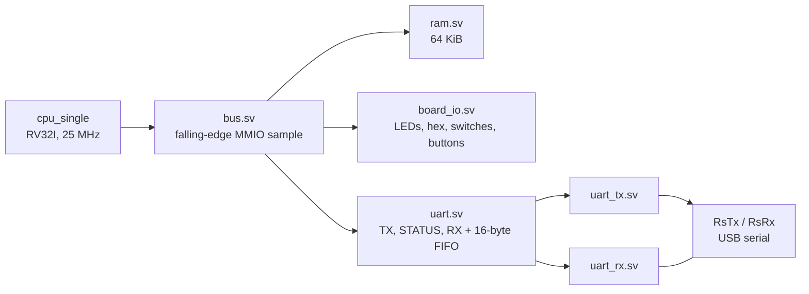

[Project README](../../README.md) › [Docs index](../README.md) › **Phase 4 audit**

# Phase 4 repository audit — November 8, 2026

> [!IMPORTANT]
> **Verdict: READY FOR Phase 5.** All five required Phase 4 tasks have evidence, and the
> physical gate passed on November 7: the board printed `hello, world`, advanced its counter
> and echoed typed text exactly. This review found **no correctness bug** in the RTL, C or
> host script. It strengthened two UART testbenches and brought the documentation in line with them.
> Final results: **101/101 regression runs**, **58/58 Python tests**, **21/21 RTL modules and
> 23/23 benches lint-clean**, **45/45 Mermaid diagrams parse**, **890/890 local links resolve**.

This review covers the whole repository as committed on branch `phase-4` (`004ef9b`). It does
not start Phase 5. No RTL file changed, so the routed timing, DRC and board evidence in
[PHASE4_UART.md](PHASE4_UART.md#5-verification-record) still describe the current hardware.

<b>On this page</b>

- [A. Repository understanding](#a-repository-understanding)
- [B. Phase 4 requirement check](#b-phase-4-requirement-check)
- [C. Problems found](#c-problems-found)
- [D. Changes made](#d-changes-made)
- [E. Verification results](#e-verification-results)
- [F. Recommendations not implemented](#f-recommendations-not-implemented)
- [G. Phase 5 readiness](#g-phase-5-readiness)

---

## A. Repository understanding

The working CPU is still the single-cycle reference, `cpu_single`. It runs at 25 MHz inside
`soc`, which holds 64 KiB of dual-port block RAM, the native bus, board I/O, performance
counters and, new in Phase 4, the console UART. `basys3_soc` adds the MMCM clock, the reset
stages and the board pins.

| Part | What it does | Checked by |
| --- | --- | --- |
| `uart_tx.sv` | 8N1 frame, 217 clocks per bit, ignores a start while busy | `uart_tx_tb`: all 256 bytes, exact frame length, busy rejection, reset |
| `uart_rx.sv` | Two-flop synchronizer, start check at mid-bit, data and stop samples, break recovery | `uart_rx_tb`: loopback, baud error, sampling point, false start, break, reset |
| `uart.sv` | MMIO registers, 16-byte receive FIFO, sticky overrun and framing flags | `uart_tb`: directed cases plus seeded random traffic |
| `bus.sv`, `soc.sv`, `basys3_soc.sv` | Decode `0x8000_0010`–`0x8000_001B`, wire the pins, plain reset stage | `bus_tb`, `soc_tb`, `basys3_soc_tb`, `board_uart_tb` |
| `sw/common/uart.c`, `printf.c` | `putc`, `puts`, `getc`, `uart_try_getc`, `printf` (%d %u %x %s %c %%) | `cpu_tb:c/printf_smoke`, `cpu_tb:c/hello` |
| `sw/programs/hello` | Greeting, one-second counter, echo | `board_uart_tb` on the full top, then the board |
| `scripts/uart_check.py` | Windows serial checker for greeting, counter and echo | 14 fake-port unit tests, then COM8 |

Two contracts matter most for Phase 5:

- **An RX read has a side effect.** Reading `0x8000_0018` pops the FIFO and clears the
  sticky flags. `cpu_single` only issues a bus read for an instruction that commits
  (`dmem_re = commit && lsu_re`), so a faulting load never pops a byte. The pipeline must keep
  this: only a valid, non-flushed load in MEM may read the UART, exactly once.
- **The UART survives a CPU-only reset.** It is reset by system reset only, so bytes typed
  while the centre button is held are kept.

## B. Phase 4 requirement check

| Requirement ([BUILD_PLAN](../BUILD_PLAN.md#phase-4-uart-text-to-your-laptop)) | Status | Evidence | Remaining issue |
| --- | --- | --- | --- |
| `uart_tx.sv`, 115200 8N1, 217 clocks per bit; bench decodes every byte | ✅ Done | `uart_tx_tb` PASS, 256 frames, exact 10-bit frame length | None |
| `uart_rx.sv`, 2-flop synchronizer, mid-bit sampling; 256-value loopback | ✅ Done | `uart_rx_tb` PASS, 1,282 bytes; ±4.5% baud now proves the sample point | None |
| UART registers on the bus per the memory map | ✅ Done | `uart_tb` PASS (1,327 MMIO checks), `bus_tb`, `soc_tb` PASS | Byte reads of `0x19`–`0x1B` pop a byte and return zero (documented; see F3) |
| `putc`, `puts`, `getc`, small `printf` | ✅ Done | `cpu_tb:c/printf_smoke` PASS: limits, `(null)`, unknown conversions, return count, `getc` | `puts` appends CR LF, not LF (documented) |
| Laptop side over the existing USB cable | ✅ Done | COM8 checker passed on November 7: 41/41 text and 256/256 binary bytes | None |
| Optional ROM bootloader | ⏸ Deferred by the owner | Not required by the gate | Stays optional |
| **Gate:** "hello, world", live counter, echo | ✅ Passed November 7 | [Physical record](PHASE4_UART.md#5-verification-record); `board_uart_tb` repeats it in simulation | Hosted CI has not run on `phase-4` yet |

## C. Problems found

Ranked by severity. None is a functional bug in the hardware or software.

| # | Severity | Finding | Action |
| --- | --- | --- | --- |
| C1 | Medium (verification gap) | `uart_rx_tb` only tested ±2% baud. A receiver sampling at a quarter or three-quarter bit also passed, so "mid-bit sampling" was never actually checked. Confirmed by injecting both bugs: both survived. | Fixed (D1) |
| C2 | Low (verification gap) | `uart_tb` was fully directed. No test mixed arrivals and reads at random offsets, or random burst sizes with bad frames. | Fixed (D2) |
| C3 | Low (rule) | `PHASE4_UART.md` named the old local branch, which contained a tool name the project rules forbid. | Fixed before `phase-4` was pushed |
| C4 | Low (docs) | `PHASE4_UART.md` said the Mermaid blocks were not parser-checked. They are now: all 44 parse. | Fixed (D3) |
| C5 | Low (maintenance) | `.cursorrules` is still tracked at the repository root. It is unused by the build and tests. | Deleted November 9, 2026 (F5) |

## D. Changes made

| # | Files | What changed | Why | Verified by |
| --- | --- | --- | --- | --- |
| D1 | `tb/io/uart_rx_tb.sv` | Added sender rates of ±4.5% (all 256 bytes each) to the existing ±2%. Byte counts in later checks updated. | At ±4.5% every sample still lands inside its bit only if sampling is near mid-bit. | Passes on the real RTL. With the start-bit timer changed to a quarter bit, then three-quarter bit, the bench now fails (both bugs survived the old bench). |
| D2 | `tb/io/uart_tb.sv` | Seeded xorshift traffic (seed `da7a2026`): 64 random bytes with a polling reader at random offsets, then 12 random bursts of 0–40 frames, about 1 in 8 with a bad stop, read only after the burst. Expected values come from the bytes the bench drove, not from the RTL. A coverage check fails if no burst overflowed or had a bad frame. | Exercises FIFO order, wrap, drop-newest, both sticky flags and empty reads in combinations the directed cases do not reach. | Passes (1,327 MMIO checks). Seven injected FIFO/flag bugs, including a 15-deep FIFO and lost pops, all fail it. |
| D3 | `docs/phases/PHASE4_UART.md`, `tb/README.md` | Test descriptions now match D1/D2; Mermaid parser evidence recorded. | Docs must match the code. | Link and Mermaid checks below |
| D4 | `docs/phases/PHASE4_AUDIT.md`, `docs/README.md` | This report and its index entry. | Record of the review. | Link check |

No RTL, C, Python or script file changed.

## E. Verification results

All runs in Ubuntu 24.04 with Verilator 5.020, RISC-V GCC 13.2.0 and Python 3.12, the same
tool versions as WSL and CI.

| Check | Result |
| --- | --- |
| `python3 scripts/run_tests.py` before changes | 101/101 passed |
| `python3 scripts/run_tests.py` after changes | **101/101 passed** |
| `python3 -m unittest discover -s scripts/tests` | **58/58 OK** |
| `verilator --lint-only -Wall --timing --assert`, each RTL module as top | **21/21 clean** |
| Same lint, each testbench as top | **23/23 clean** |
| Bug injection on `uart.sv` / `uart_rx.sv` (9 mutants) | 9/9 caught by the updated benches; 2 had survived the old `uart_rx_tb` |
| Local Markdown links and anchors | **890/890 resolve** across 26 documents |
| Mermaid 11.4.1 parser | **45/45 parse**, including the one in this report |
| `git diff --check` | Clean |
| Vivado synthesis, timing, board | **Not re-run.** No RTL changed, so the November 7 reports still apply. |
| GitHub Actions on `phase-4` | **Not checked** in this review |

## F. Recommendations not implemented

These are intentionally left alone: none fixes a bug, and each RTL change would make the
saved timing and board evidence stale until Vivado and the board are re-run.

1. **F1: drive `RsTx` straight from a flip-flop.** In `uart_tx.sv`, `frame` is all ones whenever
   the transmitter is idle, so `tx = busy ? frame[0] : 1` equals `tx = frame[0]`. That removes
   one LUT and makes the pin a direct register output. Behaviour is identical. Worth doing next
   time the RTL is rebuilt anyway.
2. **F2: timing margin.** WNS is only +0.367 ns. The critical path is fetch → decode → ALU
   address → MMIO read mux → `mmio_data` on the falling edge. Phase 5 replaces this schedule.
3. **F3: byte reads of the RX register.** `lb` from `0x8000_0019`–`0x8000_001B` pops a byte but
   returns zero. This is documented. Software uses 32-bit reads, so it is harmless today.
4. **F4: names and terminal comfort.** `putc(int)` and `puts` share names with C library
   functions but not their signatures or newline rules. That is safe with `-ffreestanding
   -fno-builtin`, but would clash if `<stdio.h>` were ever included. Also, `hello` echoes Enter
   as a bare CR, so PuTTY returns to the start of the line without a new line. Echoing CR as
   CR LF would read better but changes the checked output.
5. **F5: remove `.cursorrules`.** It was tracked but unused. Deleted November 9, 2026.
6. **F6: run CI on `phase-4`.** The workflow runs on every push. Confirm its result before
   merging.

## G. Phase 5 readiness

**READY FOR Phase 5.** Every required Phase 4 task has passing tests, the physical gate
passed, and this review found no correctness bug. The UART tests are now stronger than when
the gate was recorded. Before merging `phase-4` into `main`, check its GitHub Actions run.

---

**Related:** [Phase 4 UART](PHASE4_UART.md) · [Phase 3 audit](PHASE3_AUDIT.md) ·
[Build plan](../BUILD_PLAN.md) · [Tests](../../tb/README.md)

**Next step:** [Phase 5 pipeline](../BUILD_PLAN.md#phase-5-the-5-stage-pipeline).
