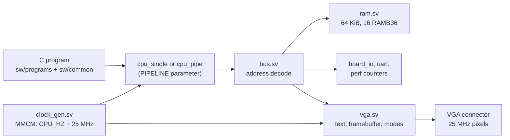

[Project README](../../README.md) › [Docs index](../README.md) › **Phase 6 audit**

# Phase 6 repository audit — November 8, 2026

> [!IMPORTANT]
> **Verdict: NOT READY FOR Phase 7.** All five Phase 6 tasks that can be checked without a
> monitor have evidence, and this review found **no correctness bug** in the VGA RTL, bus, C
> library or scripts. The Phase 6 gate ("one C program prints text and draws pixels on a
> monitor") and the color-bar task both need a physical VGA display, which is not available
> yet. That observation is the only blocker.
> Final results: **271/271 regression runs**, **67/67 Python tests**, **42/42 benches
> lint-clean**, **48/48 Mermaid diagrams parse**, **all local links resolve**.

This review covers the whole working tree on top of `dbc1864` (the committed Phase 5 source),
including the uncommitted Phase 6 files. It does not start Phase 7. **No RTL file changed**, so
the routed timing, DRC and utilization in [PHASE6_VGA.md](PHASE6_VGA.md#7-verification-record)
and [the reports](../reports/phase6/README.md) still describe the current hardware.

<b>On this page</b>

- [A. Repository understanding](#a-repository-understanding)
- [B. Phase 6 requirement check](#b-phase-6-requirement-check)
- [C. Problems found](#c-problems-found)
- [D. Changes made](#d-changes-made)
- [E. Verification results](#e-verification-results)
- [F. Recommendations not implemented](#f-recommendations-not-implemented)
- [G. Phase 7 readiness](#g-phase-7-readiness)

---

## A. Repository understanding

- **Core (`rtl/core`).** The Phase 1 blocks (`rv32i_pkg`, `alu`, `regfile`, `imm_gen`,
  `decoder`, `branch_unit`) feed two CPUs: the single-cycle reference (`cpu_single`) and the
  five-stage pipeline (`cpu_pipe` with `forward` and `hazard`). Both share the package's
  retirement and stop-cause types, which the lockstep bench compares.
- **System (`rtl/soc`, `rtl/top`).** `soc.sv` joins a CPU, RAM, the bus and peripherals.
  `basys3_soc.sv` adds the MMCM, one reset synchronizer per clock and the board pins.
- **Display (`rtl/io/vga*.sv`).** A timing generator, two dual-clock memories (text with a font
  ROM, and a 4-bpp framebuffer), and a wrapper with the CPU registers, the toggle handshake that
  changes mode at the start of vertical blank, the palette and registered pins.
- **Software (`sw`).** `crt0.S`, the linker script, UART/printf and now `vga.c`. Programs are
  built by `build_software.py`, which records image metadata and the configured CPU clock.
- **Verification (`tb`, `scripts`).** `run_tests.py` discovers every bench, assembles or
  compiles every program, and runs them on the right harness. Python tests cover the tools,
  the harness failure paths and the VGA C library under sanitizers. CI runs both on every push.

Phase 6 fits the plan as the optional display track after the pipeline. Phase 7's Game of Life
and game demos draw on the VGA framebuffer; the Tab5 milestones do not depend on Phase 6.

## B. Phase 6 requirement check

| Phase 6 task | Status | Evidence | Remaining |
| --- | --- | --- | --- |
| `vga_timing.sv`, 640 × 480 at 60 Hz, active-low syncs | ✅ Implemented and tested | `vga_timing_tb`: every coordinate, porch and sync width across two frames, mid-frame reset | 59.52 Hz with a 25 MHz clock; monitor acceptance unrun |
| Color bars on the monitor first | ⬜ Not done | Bars are the reset mode and are checked pin-for-pin in `vga_tb` and `board_vga_tb` | Needs a monitor |
| Text mode, 80 × 30, 8 × 16 public-domain font, dual-port buffer | ✅ Implemented and tested | `vga_text_tb` (now every cell), `font2mem.py --check`, Python glyph-bit test, full-screen text in `board_vga_tb` | None in simulation |
| Pixel mode, 160 × 120, 4 × 4 blocks, 4 bpp (9.6 KB) | ✅ Implemented and tested | `vga_fb_tb`: all 2400 words, all 19200 logical pixels at four corners each | None in simulation |
| Vertical-blank status bit synchronized to the CPU clock | ✅ Implemented and tested | Two ASYNC_REG flops after the display delay; `vga_tb` now checks the latency against the pins | None in simulation |
| Software: `vga_putc`, `vga_printf`, `set_pixel`, `clear` | ✅ Implemented and tested | Native MMIO-model test under ASan/UBSan; real `vga_demo` on both CPUs and at 62.5 MHz | None in simulation |
| **Gate:** one C program prints text and draws pixels on a monitor | ⬜ Not passed | `vga_demo` does both, checked on simulated pins (921,600 pixels per configuration) | Needs a monitor |

Routed timing passes for single-cycle 25 MHz (WNS +0.396 ns) and pipeline 62.5 MHz
(WNS +0.313 ns) with zero DRC violations. Inter-clock paths are only the five handshake
endpoints, with +5.0 ns or more slack at 62.5 MHz.

## C. Problems found

Ranked by severity. None is a functional bug in RTL or C.

| # | Severity | Problem | Where |
| --- | --- | --- | --- |
| 1 | High (documentation) | The Phase 5 board results (10/10 tasks, Fmax 62.5 MHz, CPI 1.317, 1.90×) never reached the docs. BUILD_PLAN still said Phase 5 was 7/10 with the board pending, and the Phase 6 text said "neither Phase 5 nor Phase 6 is marked passed". | BUILD_PLAN, README, PHASE5_PIPELINE, AGENTS, tb/sw/docs READMEs |
| 2 | Medium (documentation) | About a dozen pages still said Phase 4 or Phase 5 "hosted CI is unrun". CI runs #16 (Phase 4 merge) and #18 (Phase 5) both passed. | README, BUILD_PLAN, AGENTS, rtl/sw/scripts/docs READMEs, PHASE4_UART, TAB5_INTEGRATION |
| 3 | Medium (verification) | Nothing checked *when* STATUS bit 0 changes. Reading raw `vblank` instead of the delayed pin-aligned copy (four pixel clocks early) passed every bench. | `tb/io/vga_tb.sv` |
| 4 | Medium (verification) | `vga_text_tb` rendered only the first word and the last cell. A lane error on some middle rows passed the unit bench. | `tb/io/vga_text_tb.sv` |
| 5 | Medium (rules) | A repository file named the local feature branch after an editor tool, which breaks the project's no-tool-names rule. | AGENTS.md, PHASE6_VGA.md |
| 6 | Low (documentation) | The Phase 6 record and the docs index did not follow the house style. The index did not list Phase 5 or Phase 6, and the record used process wording ("owner authorized", "separate draft") plus a personal home path. | PHASE6_VGA.md, docs/README.md |
| 7 | Low (documentation) | The "today it ends with" test counts in README, scripts/README and tb/README were from Phase 4 or Phase 5. Older phase pages still said "Phase 5 has not started". | Several READMEs and phase records |

## D. Changes made

| Files | What changed | Why | Verified by |
| --- | --- | --- | --- |
| `tb/io/vga_tb.sv` | Tracks when the pins enter and leave vertical blank, then polls STATUS and asserts that bit 0 changes no earlier than the pins and no later than 84 ns (2 synchronizer flops plus one bus read). It also checks the other STATUS bits while polling. | Finding 3 | Passes on both bus edges (measured latency 40–42 ns). The raw-vblank mutant now fails; the original bench passed it. |
| `tb/io/vga_text_tb.sv` | Writes a different glyph pattern to all 2400 cells, reads every word back and checks all 8 columns of one row per cell (19,200 extra samples). Timeout raised to 10 ms simulated. | Finding 4 | A row-dependent lane-swap mutant now fails; the original bench passed it. |
| BUILD_PLAN, README, PHASE5_PIPELINE, AGENTS, tb/sw/docs READMEs | Merged the Phase 5 board-result updates into the current files with a three-way merge. Phase 6 text was kept and corrected. | Finding 1 | Conflicts resolved by hand; link and Mermaid checks |
| README, BUILD_PLAN, AGENTS, rtl/sw/scripts/docs READMEs, PHASE4_UART, TAB5_INTEGRATION, PHASE1/2 records | Linked CI runs #16 and #18, updated current counts to 271/67, and marked "Phase 5 has not started" as historical. | Findings 2, 7 | Link check |
| PHASE6_VGA.md | Rewritten in house style: status callout, numbered sections, data-path and handshake diagrams, controls table, collapsible details, explicit remaining-gate checklist, Related and Next step. Every technical fact kept. | Findings 5, 6 | Link and Mermaid checks |
| docs/README.md | Added PHASE5_PIPELINE, PHASE6_VGA and this audit to the map and table. | Finding 6 | Link check |
| PHASE6_AUDIT.md | This report. | Requested | — |

No RTL, C, Python, Tcl, XDC or workflow file changed.

## E. Verification results

All runs used Verilator 5.020 and RISC-V GCC 13.2 on Ubuntu 24.04, the same versions as CI.

| Check | Before changes | After changes |
| --- | --- | --- |
| `python3 scripts/font2mem.py --check` | Pass | Pass |
| `python3 scripts/run_tests.py` | **271/271** | **271/271** (32 unit benches, 239 program runs) |
| `python3 -m unittest discover -s scripts/tests -v` | **67/67** | **67/67** |
| Every bench `verilator --lint-only --timing --assert -Wall` | 42/42 | **42/42** |
| RTL tops `basys3_soc`, `vga`, `vga_text`, `vga_fb`, `vga_timing` with `--lint-only -Wall` | Clean | Clean (no RTL change) |
| Mutation checks against the VGA benches | — | 6 of 6 mutants caught (raw vblank, early hsync, CONTROL accepted while pending, mode change at frame start, text row stride, text lane swap) |
| Python `py_compile` of every script | Pass | Pass |
| Local Markdown links and anchors | — | 1010 links, 0 broken |
| Mermaid diagrams (mermaid 11.4.1) | — | 48 parse, 0 errors |
| `git diff --check` and trailing whitespace in new files | — | Clean |

Not available here: Vivado (no synthesis or timing rerun; not needed because no RTL changed),
the board and a VGA monitor, and hosted CI for the Phase 6 work (not committed yet).

## F. Recommendations not implemented

- **Framebuffer BRAM count (optional).** `vga_fb` uses 4 RAMB36 for 2400 × 32 bits, which
  would fit in 3. BRAM use is 22 of 50, so there is no pressure. Changing it needs a Vivado run
  to prove the result, so it is left as a note.
- **CDC constraints (optional).** The five handshake endpoints are timed as related MMCM clocks
  (+5.0 ns slack at 62.5 MHz). That is correct for these clocks. If a future CPU clock gives a
  tighter edge alignment, add `set_max_delay -datapath_only` on those paths instead of an
  asynchronous clock group.
- **Text color (Phase 7 or later).** Text is white on black only. Per-cell color attributes
  would be a feature, not a fix.
- **Branch name.** The local feature branch still carried a tool name. Commit on `main`
  and delete it so the name never reaches GitHub.

## G. Phase 7 readiness

**NOT READY FOR Phase 7.** The build plan says each gate must pass before the next phase
starts, and the Phase 6 gate needs a monitor observation that has not happened. Everything
that can be checked without a monitor passes.

To close Phase 6:

1. Commit the Phase 6 work and confirm hosted CI passes.
2. Program `vga_demo` and look at the color bars on a VGA monitor or an active
   VGA-to-HDMI converter.
3. Check text, the pixel pattern (red, green, blue and white corners), 4 × 4 scaling and the
   SW0/SW1 mode changes. Record the result in [PHASE6_VGA.md](PHASE6_VGA.md#8-remaining-gate).

---

**Related:** [Phase 6 VGA](PHASE6_VGA.md) · [Phase 5 pipeline](PHASE5_PIPELINE.md) ·
[Phase 4 audit](PHASE4_AUDIT.md) · [Build plan](../BUILD_PLAN.md) · [Tests](../../tb/README.md)

**Next step:** close the [Phase 6 monitor gate](PHASE6_VGA.md#8-remaining-gate), then start
[Phase 7](../BUILD_PLAN.md#phase-7-demos-and-polish).
