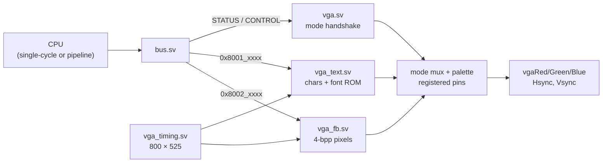
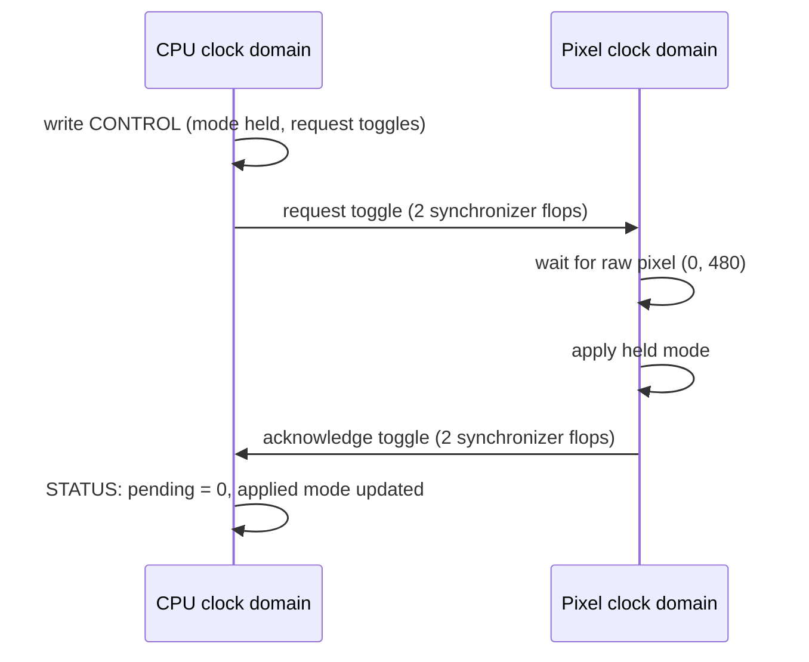

[Project README](../../README.md) › [Docs index](../README.md) › **Phase 6 VGA**

# Phase 6: VGA text and graphics

The computer drives the Basys 3 VGA connector: an 80 × 30 text screen, a 160 × 120
16-color framebuffer and a color-bar test pattern, all selected from C. This page records
the interfaces, the contracts software relies on and the evidence collected so far.

> [!NOTE]
> **Status (November 8, 2026): 🚧 implemented and verified in simulation and routed timing;
> the monitor gate is unrun.** Every VGA bench and the real `vga_demo` C program pass on the
> full board top for both CPUs. Vivado meets timing for the single-cycle CPU at 25 MHz and the
> pipeline at 62.5 MHz, with pixels fixed at 25 MHz and zero DRC violations. No VGA monitor
> is available yet, so nothing has been observed on a screen and **Phase 6 is not passed**.
> The single-cycle CPU remains the default; neither CPU nor main RAM changed.

<details>
<summary><b>On this page</b></summary>

1. [Implementation](#1-implementation)
2. [Timing and pixel pipeline](#2-timing-and-pixel-pipeline)
3. [CPU memory map and access timing](#3-cpu-memory-map-and-access-timing)
4. [Reset and clock-domain contracts](#4-reset-and-clock-domain-contracts)
5. [Colors and font](#5-colors-and-font)
6. [Software and board workflow](#6-software-and-board-workflow)
7. [Verification record](#7-verification-record)
8. [Remaining gate](#8-remaining-gate)

</details>

## 1. Implementation



The left side runs on the CPU clock and the right side on the 25 MHz pixel clock. The two
display memories are true dual-port block RAMs, one port per clock.

| File | Responsibility | Self-checking test |
| --- | --- | --- |
| [vga_timing.sv](../../rtl/io/vga_timing.sv) | 800 × 525 counters; 640 × 480 visible; active-low syncs | [vga_timing_tb.sv](../../tb/io/vga_timing_tb.sv): every coordinate, porch and sync over two frames, mid-frame reset |
| [vga_text.sv](../../rtl/io/vga_text.sv) | 2400 character bytes, synchronous dual-clock RAM, synchronous font ROM | [vga_text_tb.sv](../../tb/io/vga_text_tb.sv): both CPU edges, every byte mask, bounds, glyph orientation, all 2400 cells |
| [vga_fb.sv](../../rtl/io/vga_fb.sv) | 9600 packed framebuffer bytes, CPU readback and 4 × 4 scanout | [vga_fb_tb.sv](../../tb/io/vga_fb_tb.sv): all 2400 words, all 19200 logical pixels at four corners each |
| [vga.sv](../../rtl/io/vga.sv) | Bus interface, mode handshake, palette, aligned RGB/sync output and vblank synchronization | [vga_tb.sv](../../tb/io/vga_tb.sv), [vga_pipe_tb.sv](../../tb/io/vga_pipe_tb.sv): every output pin on every pixel clock across mode changes |
| [font2mem.py](../../scripts/font2mem.py) | Offline, deterministic conversion of the vendored public-domain font | [test_vga.py](../../scripts/tests/test_vga.py) |
| [font_rom.mem](../../rtl/mem/font_rom.mem) | 256 glyphs × 16 bytes, MSB at left | Converter checks every glyph bit; literal A/F/!/? row tests verify orientation |
| [vga.c](../../sw/common/vga.c), [vga.h](../../sw/common/vga.h) | Text console, formatting, scrolling, clear, pixels and mode selection | Native C MMIO model under ASan/UBSan; actual RV32I board simulations |
| [vga_demo/main.c](../../sw/programs/vga_demo/main.c) | A real C program renders text, pixels and bars | [board_vga_tb.sv](../../tb/system/board_vga_tb.sv), [board_vga_pipe_tb.sv](../../tb/system/board_vga_pipe_tb.sv), [board_vga_fast_tb.sv](../../tb/system/board_vga_fast_tb.sv) |

The bus, SoC, board top, clock manager, constraints, Vivado script, test runner and CI
workflow have matching integration edits. The CPU implementations and main RAM are unchanged
from the committed Phase 5 source.

## 2. Timing and pixel pipeline

| Horizontal region | Pixel coordinates | Clocks |
| --- | --- | --- |
| Visible | 0..639 | 640 |
| Front porch | 640..655 | 16 |
| Active-low sync | 656..751 | 96 |
| Back porch | 752..799 | 48 |

| Vertical region | Lines | Lines per frame |
| --- | --- | --- |
| Visible | 0..479 | 480 |
| Front porch | 480..489 | 10 |
| Active-low sync | 490..491 | 2 |
| Back porch | 492..524 | 33 |

- The pixel clock is **25 MHz**, from MMCM `CLKOUT1` through its own BUFG, independent of
  `CPU_HZ`. The CPU clock stays on `CLKOUT0`; its default is 25 MHz.
- Refresh is `25,000,000 / (800 × 525) = 59.5238 Hz`, a nominal 60 Hz mode. This is not the
  exact 25.175 MHz / 59.94 Hz VGA timing, and no monitor has been tested with it yet.
- The functional simulation clock model supports CPU 25, 50 or 62.5 MHz, always with 25 MHz
  pixels. Other hardware MMCM settings still need their own Vivado evidence.
- CPU-only reset resets neither the clock manager nor the VGA block.

Text scanout reads a character word, then a glyph row, then its bit. Framebuffer scanout reads
a word, extracts a nibble and delays it to match. The wrapper registers RGB on the next edge:
**four sampling edges** from a raw coordinate to its physical output. Hsync, vsync, visibility,
mode and color bars get the same delay, so every porch boundary lines up on the pins.

## 3. CPU memory map and access timing

| Address | Access | Contract |
| --- | --- | --- |
| `0x8000_0028` | Read | Bit 0 displayed vblank, bit 1 pending mode request, bits 3:2 last acknowledged mode; others zero |
| `0x8000_002C` | Read/write | Bits 1:0 requested mode (0 text, 1 pixels, 2 color bars, 3 black); lane-0 writes only, ignored while pending; reads return the requested value |
| `0x8001_0000..0x8001_095F` | Read/write | 2400 character bytes; row-major 80 × 30, unsigned ASCII |
| `0x8001_0960..0x8001_0FFF` | Reserved | Reads zero, writes ignored |
| `0x8002_0000..0x8002_257F` | Read/write | 9600 framebuffer bytes, eight 4-bit pixels per 32-bit word |
| `0x8002_2580..0x8002_3FFF` | Reserved | Reads zero, writes ignored |

> [!NOTE]
> The build plan left two details open, and this phase fixes them: a new CONTROL register
> selects the display mode, and both display memories can be read back (for scrolling and
> packed-pixel updates). Existing addresses and RAM reservations do not move. The
> [canonical map](../BUILD_PLAN.md#6-memory-map), [mmio.h](../../sw/common/mmio.h), RTL,
> library and tests all use this contract.

- **Pixel address.** For framebuffer pixel `(x, y)` the word address is
  `BASE + y*80 + (x/8)*4` and the nibble shift is `(x%8)*4`. The leftmost pixel is bits 3:0.
- **Byte writes.** A native byte strobe updates two pixels. `set_pixel` does a word
  read-modify-write so the seven neighbors are kept. Software access is single-writer.
- **Ports.** Each display memory has one CPU port and one pixel read port. Both reads are
  synchronous. There is no asynchronous memory, no extra main-RAM port and no debug shortcut.
- **Edges.** CPU access uses falling edges for `cpu_single` and rising edges for `cpu_pipe`,
  matching the main RAM and bus schedule.
- **Read path.** The bus selects the VRAM's registered result directly instead of registering
  it a second time, so a load followed by its user still works. Only STATUS/CONTROL reads use
  the existing MMIO capture register.
- **Isolation.** Reserved regions cannot alias character memory, framebuffer, main RAM, UART or
  board I/O.

## 4. Reset and clock-domain contracts



- The display starts in **color bars**, which exercises timing and all RGB channels before C runs.
- A CPU write holds the requested two-bit mode stable, toggles a request and waits for an
  acknowledgement. Pixel logic applies the held mode only at raw `(0, 480)`, then acknowledges.
  STATUS reports the acknowledged mode; it never samples a changing multi-bit bus.
- Vblank passes through two CPU flops **after** the four-edge display delay, so it describes the
  blank on the output pins, not an early raw timing signal.
- CPU and pixel global resets must be asserted together. The board top has a separate
  async-assert, synchronous-release lock synchronizer for each clock, each followed by a plain
  reset register for BRAM controls. CPU-only reset blocks bus requests and keeps VGA state.
- RAM and font contents are an FPGA configuration-time image. Reset clears pipeline and control
  registers, not thousands of memory words. Software clears buffers when it needs to.
- A CPU write and a scanout read of the same word in the same cycle have no defined scanout
  result. Write during a bounded blank or while that memory's mode is hidden.

> [!WARNING]
> **Single buffering does not promise tear-free updates.** Vertical blank lasts 45 × 800 pixel
> clocks = 1.44 ms. The status bit is a delayed observation and does not reserve that interval,
> and large drawing jobs take longer. The demo therefore selects BLACK, fills both hidden
> memories, then switches to TEXT. Its later mode changes happen in blank and neither
> displayed memory changes during the demonstration.

## 5. Colors and font

Pixel indices use the conventional 16-color palette (12-bit RGB):

| Index | RGB | Index | RGB |
| --- | --- | --- | --- |
| 0 | `000` | 8 | `555` |
| 1 | `00A` | 9 | `55F` |
| 2 | `0A0` | A | `5F5` |
| 3 | `0AA` | B | `5FF` |
| 4 | `A00` | C | `F55` |
| 5 | `A0A` | D | `F5F` |
| 6 | `A50` | E | `FF5` |
| 7 | `AAA` | F | `FFF` |

Text is white on black, one ASCII byte per cell. The public-domain font is pinned and vendored
with its attribution; [font provenance and generation](../../rtl/mem/fonts/README.md) gives the
source hash and the doubled 8 × 8 → 8 × 16 conversion. Regenerating needs no package or network.

## 6. Software and board workflow

The library supports CR/LF, backspace within the current row, four-column tabs, wrapping,
scrolling and `%d %u %x %s %c %%`. Unsupported characters display `?`; a null `%s` prints
`(null)`. Decimal conversion uses shifts and subtraction, including `INT32_MIN`, so it needs no
hardware multiply or divide. Invalid coordinates, colors, modes and cursors are rejected.

### Build and verify

```bash
python3 scripts/font2mem.py --check
python3 scripts/run_tests.py vga --jobs 1
python3 -m unittest discover -s scripts/tests -v
python3 scripts/run_tests.py
python3 scripts/build_software.py vga_demo --cpu-hz 25000000
```

The single-cycle FPGA build command is:

```powershell
vivado -mode batch -nojournal -nolog -source scripts/vivado/build.tcl -tclargs basys3_soc vga_demo single 25
```

- The script passes an absolute `FONT_FILE` path and the configured CPU frequency to the
  software builder.
- It checks the CPU and pixel clock periods, main RAM's 16 RAMB36s (separately from the VGA
  memories) and nonnegative setup/hold slack. Any routed DRC violation stops the bitstream.
- An optional fifth argument picks an output folder inside ignored `build/`. `program.tcl`
  still reads `build/vivado/`, so rebuild there before programming.

### On the board (not yet run)

1. Program with the existing `program.tcl -tclargs basys3_soc`.
2. Connect the VGA connector to a monitor, or to an active VGA-to-HDMI converter.
3. Turn on SW1 to hold the color bars; the brief startup bars may finish before the monitor
   locks on.
4. Turn SW1 off. Expect `hello, world` and the text screen, alternating with the pixel pattern
   about every two configured CPU seconds.

| Control | Effect |
| --- | --- |
| SW1 | Color bars (takes priority) |
| SW0 | Pixels |
| Both off | Automatic text/pixel alternation |
| LEDs `6006`, hex `6404` | Initialization complete |

The four logical corners of the pixel pattern are red, green, blue and white. Text and
graphics are separate modes, not an overlay.

<details>
<summary><b>Preview without a monitor</b></summary>

After `run_tests.py vga` builds the board bench, run its cached binary from the repository root
with `+program=<absolute-vga_demo.mem> +frames=<existing-absolute-directory>`. The 25 MHz bench
needs an image built with `--cpu-hz 25000000`. Convert the captured files:

```bash
python3 scripts/vga_preview.py build/phase6/frames/mode0.ppm build/phase6/frames/text.png
python3 scripts/vga_preview.py build/phase6/frames/mode1.ppm build/phase6/frames/pixels.png
python3 scripts/vga_preview.py build/phase6/frames/mode2.ppm build/phase6/frames/bars.png
```

These are **simulated output pins**, not a physical monitor observation.

</details>

## 7. Verification record

| Check actually run | Result |
| --- | --- |
| `python3 scripts/run_tests.py` (Verilator 5.020) | **271/271 passed**: 32 unit benches and 239 program runs, including 40 rv32ui programs on each CPU and in lockstep |
| `python3 -m unittest discover -s scripts/tests -v` | **67/67 passed**, including the VGA C library under ASan/UBSan and the harness failure paths |
| Every bench with `verilator --lint-only --timing --assert -Wall` | **42/42 elaborations clean**, with no disabled warnings |
| `python3 scripts/font2mem.py --check` | Reproduced the 4096-byte pinned font exactly |
| Actual C demo on the full board top in simulation | Text, all scaled framebuffer pixels and bars checked: 921600 active output pixels per configuration, at single 25 MHz, pipeline 25 MHz and pipeline 62.5 MHz |
| `board_vga_tb +frames=...` and `vga_preview.py` | Captured simulated RGB pins into PPM/PNG; text, pixels and bars inspected |
| Vivado 2025.2, single-cycle 25 MHz CPU / 25 MHz pixels | WNS **+0.396 ns**, WHS **+0.074 ns**, 1682 LUTs, 570 FF, 22 RAMB36, 0 DSP |
| Vivado 2025.2, pipeline 62.5 MHz CPU / 25 MHz pixels | WNS **+0.313 ns**, WHS **+0.024 ns**, 1585 LUTs, 940 FF, 22 RAMB36, 0 DSP |
| Routed DRC and timing coverage, both configurations | **0 DRC violations; 0 unclocked or unconstrained internal endpoints** |
| Hosted CI, FPGA programming, physical monitor | **Not run** for Phase 6 |

[Reviewed reports](../reports/phase6/README.md) are tracked in the repository. Raw logs,
images and bitstreams stay under ignored `build/phase6/`.

<details>
<summary><b>Reset/enable correction found during implementation</b></summary>

The first routed design reported five `REQP-1839` warnings: Vivado's BRAM power optimizer
inserted look-ahead read enables driven by the asynchronous pixel-reset synchronizer. A plain
reset register and unconditional RTL memory reads alone did not prevent that transformation.

The corrected RTL leaves pixel RAM/ROM reads unconditional, clamps blanking addresses to zero,
and resets only the validity/output pipeline. The build also applies `set_power_opt
-exclude_cells` to the six VGA BRAMs, which keeps those read controls while allowing normal
optimization elsewhere. This is the per-memory exclusion described in
[AMD's opt_design reference](https://docs.amd.com/r/2025.1-English/ug835-vivado-tcl-commands/opt_design).
No warning is suppressed or reclassified; both final routed DRC reports have zero violations.

The first 62.5 MHz attempt also had -0.249 ns setup slack. The corrected final build passes
at 62.5 MHz. No higher clock was tried with VGA, so this is a verified operating point, not a
new Fmax measurement.

</details>

**Memory use.** The logical payload is 2400 text + 4096 font + 9600 framebuffer = 16096
bytes outside main RAM. Physically that is six VGA RAMB36s plus main RAM's sixteen: 22 of 50
BRAM tiles. Payload bytes and block allocation are reported separately on purpose.

## 8. Remaining gate

> [!IMPORTANT]
> **Gate:** one C program prints text and draws pixels on a monitor. Not passed yet.

Before Phase 6 can be marked passed:

- [ ] Commit the work and confirm hosted CI passes.
- [ ] Program the board with `vga_demo` and observe the color bars on a monitor (BUILD_PLAN
  task "Color bars on the monitor first").
- [ ] Observe text, the pixel pattern, its colors and 4 × 4 scaling, and the switch-selected mode
  changes on the same monitor.

Phase 6 is optional in the plan, and Phase 7's games depend on it. Tab5 work (T0–T13) does not.

---

**Related:** [Build plan](../BUILD_PLAN.md#phase-6-vga-output) · [Phase 5 pipeline](PHASE5_PIPELINE.md) ·
[Reports](../reports/phase6/README.md) · [RTL](../../rtl/README.md) · [Software](../../sw/README.md) ·
[Tests](../../tb/README.md)

**Next step:** connect a VGA monitor (or active VGA-to-HDMI converter), program `vga_demo` and
run the checks in [section 8](#8-remaining-gate).
