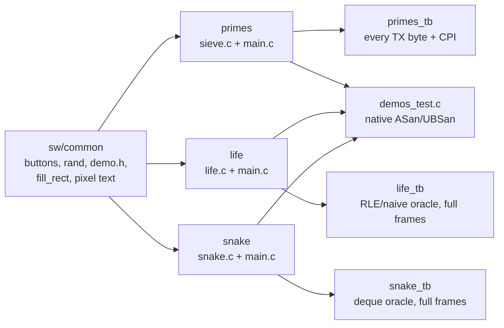

[Project README](../../README.md) › [Docs index](../README.md) › **Phase 7 audit**

# Phase 7 repository audit — November 8, 2026

> [!IMPORTANT]
> **Verdict: NOT READY FOR Phase 8.** The four Phase 7 tasks that can be checked without
> hardware have evidence, and this review found **no correctness bug** in the demo engines,
> the C libraries, the RTL or the scripts. The Phase 7 gate ("all three demos run from a cold
> power-on, and someone else could rebuild everything from the README alone") has not been
> attempted, and the README-photos and video tasks are still open. The Phase 6 monitor gate
> is also still unrun. The build plan defines no Phase 8; the next planned work is the Tab5
> track (T0 onward).
> Final results: **277/277 regression runs**, **80/80 Python tests**, **48/48 benches
> lint-clean**, **50/50 Mermaid diagrams parse**, **all local links resolve**.

This review covers the whole working tree on top of `b84f8d4` (the committed Phase 6
source), including every uncommitted Phase 7 file. **No RTL, constraint or Phase 7 C source
changed**, so the six routed builds in [the Phase 7 reports](../reports/phase7/README.md)
still describe the current hardware and images. Their input fingerprint
(`build-inputs.sha256`) still verifies against the tree.

<b>On this page</b>

- [A. Repository understanding](#a-repository-understanding)
- [B. Phase 7 requirement check](#b-phase-7-requirement-check)
- [C. Problems found](#c-problems-found)
- [D. Changes made](#d-changes-made)
- [E. Verification results](#e-verification-results)
- [F. Recommendations not implemented](#f-recommendations-not-implemented)
- [G. Phase 8 readiness](#g-phase-8-readiness)

## A. Repository understanding

The computer is an RV32I CPU (single-cycle by default, or the 5-stage pipeline) on a Basys 3.
Both CPUs share the Phase 1 blocks (`rv32i_pkg`, `alu`, `regfile`, `imm_gen`, `decoder`,
`branch_unit`) and the Phase 2 `next_pc`/`lsu`. `soc.sv` and `bus.sv` connect 64 KiB of
dual-port RAM, board I/O, cycle/instret counters, the UART and the VGA block.
`basys3_soc.sv` adds the MMCM clocks (CPU 25 or 62.5 MHz, pixels 25 MHz) and pins.

Phase 7 is software only:

- Each engine (`sieve.c`, `life.c`, `snake.c`) is freestanding and has no MMIO, so the
  same file runs natively under sanitizers and on the FPGA CPU.
- Each `main.c` owns the board: buttons, switches, timer pacing, drawing and LEDs.
- The board benches run the real ELF on the full `basys3_soc` top for both CPUs and compare
  pins against independent models (trial division, a naive Life rule plus a canonical RLE,
  and a deque Snake). `demo_board.svh` shares only wiring, capture and button taps.

## B. Phase 7 requirement check

| Requirement ([build plan](../BUILD_PLAN.md#phase-7-demos-and-polish)) | Status | Evidence | Remaining |
| --- | --- | --- | --- |
| Life on the framebuffer; switches pick the pattern, a button restarts | ✅ Implemented, simulated | `life_tb` and `life_pipe_tb` pass: four full frames, glider x4, RLE gun, R-pentomino, held/restart buttons, 0.25 s cadence, redraw within blank | Not seen on a monitor |
| Prime sieve over UART with a cycle count | ✅ Implemented, simulated | `primes_tb` and `primes_pipe_tb` pass: all 6,094 TX bytes, canonical CPI line, EBREAK, LED/HEX | No physical capture yet |
| One playable game with the buttons | ✅ Implemented, simulated | `snake_tb` and `snake_pipe_tb` pass: six full frames, 125 ms timer, growth, queued/reversed turns, pause, wall death, restart | Playability not observed |
| README with diagrams, memory map, build/run, results, performance table and photos | 🚧 In progress | Everything except photos is present | Board and screen photos |
| Timing and utilization reports in `docs/` | ✅ Done | Six routed builds in [reports/phase7](../reports/phase7/README.md); inputs fingerprint verifies | None |
| 60-second video, one-page architecture sheet, hardest-bug write-up | 🚧 In progress | [Architecture sheet](../ARCHITECTURE.md) and PDF; bug candidate and shot list in [PHASE7_DEMOS.md](PHASE7_DEMOS.md#5-previews-and-presentation-material) | Video and personal write-up |
| **Gate:** cold power-on demos and an independent rebuild | ❌ Not attempted | An automated source-only C rebuild matched all six image hashes | Flash boot, physical runs, another person rebuilding |

The Phase 1 blocks were rechecked because they underpin both CPUs. None changed since the
Phase 6 audit, and their unit benches still pass: `alu_tb`, `regfile_tb` (both `BYPASS`
settings), `imm_gen_tb`, `decoder_tb` and `branch_unit_tb`, plus the 40 official `rv32ui`
programs on both CPUs and in lockstep.

## C. Problems found

| # | Severity | Problem | Where |
| --- | --- | --- | --- |
| 1 | Medium (verification) | `primes_tb` parsed the CPI with `%d`, so `1.5` and `1.005` looked the same. A firmware that dropped the zero padding printed `CPI 1.0` on the single-cycle CPU and **passed**. | `tb/system/primes_tb.sv` |
| 2 | Medium (verification) | The Life blank budget was checked only by the program's own overrun flag. A redraw slowed to 40,990 cycles (the blank is 36,000 at 25 MHz) with that flag broken **passed** every frame comparison. | `tb/system/life_tb.sv` |
| 3 | Medium (rules) | Four files named the local branch after an editor tool, which breaks the project's no-tool-names rule. The local branch itself still has that name. | AGENTS.md, reports/phase7/README.md, builds.json, PHASE6_AUDIT.md |
| 4 | Low (correctness, from Phase 4/5) | `hello` and `cpi_report` hard-coded 25,000,000 cycles as one second, so a 62.5 MHz pipeline build ticked every 0.4 s. Phase 7's `RVC_CPU_HZ` made the fix available. | `sw/programs/hello`, `sw/programs/cpi_report` |
| 5 | Low (documentation) | Process wording that the Phase 6 audit had removed came back in six places ("owner authorized", "Do not program hardware ... based only on this local implementation request"). | README.md, BUILD_PLAN.md, AGENTS.md, PHASE7_DEMOS.md, tb/README.md |
| 6 | Low (documentation) | The Phase 7 record had no breadcrumb, status callout or page index, unlike every other phase record. | PHASE7_DEMOS.md |

No hidden logic bug, latch, width or signedness problem was found. Points checked and found
correct include the Life three-plane neighbor count (8 wraps to 0 harmlessly), word-edge
carries, Snake's departing-tail rule and ring indexing, `vga_expand_bits`, `fill_rect`
clipping at `INT_MIN`/`INT_MAX`, and the sieve's `p <= 100` bound.

## D. Changes made

| Files | Change | Why | Verified by |
| --- | --- | --- | --- |
| `tb/system/primes_tb.sv` | Also require the line to equal `cycles %d instret %d CPI %d.%03d\r\n` exactly | Problem 1 | The unpadded mutant now fails; the real program passes on both CPUs |
| `tb/system/life_tb.sv` | Assert every 2,400-store redraw spans less than `CPU_HZ x 36000 / 25 MHz` cycles | Problem 2 | The slow-redraw mutant now fails; the real program passes on both CPUs |
| AGENTS.md, two report files, PHASE6_AUDIT.md | Replace the tool-named branch with the baseline commit | Problem 3 | A case-insensitive search for the tool name finds nothing |
| `hello/main.c`, `cpi_report/main.c`, PHASE5_PIPELINE.md | Use `RVC_CPU_HZ` from `demo.h`; note the change beside the Phase 5 board record | Problem 4 | 25 MHz images byte-identical to before; the 62.5 MHz hello image now waits 62,500,000 cycles |
| README.md, BUILD_PLAN.md, AGENTS.md, PHASE7_DEMOS.md, tb/README.md | Remove process wording; add the house-style header; describe the two new bench checks | Problems 5 and 6 | Link and Mermaid checks |

`mmio.h` and `demo.h` were deliberately left untouched so the recorded Vivado input
fingerprint stays valid. `hello` and `cpi_report` are not inputs to the Phase 7 builds.

## E. Verification results

| Check | Result |
| --- | --- |
| `python3 scripts/run_tests.py` on the original tree | **277/277 passed** (Verilator 5.020, RISC-V GCC 13.2.0) |
| `python3 scripts/run_tests.py` after the changes | **277/277 passed** |
| `python3 -m unittest discover -s scripts/tests` | **80/80 passed** (includes ASan/UBSan engine tests) |
| `verilator --lint-only --timing --assert -Wall`, every bench | **48/48 clean** |
| `font2mem.py --check --c-header sw/common/vga_font8x8.inc` | Pass |
| `sha256sum -c docs/reports/phase7/build-inputs.sha256` | All inputs match |
| Mutation: unpadded CPI in `primes` | Old bench PASS, new bench FAIL |
| Mutation: slow Life redraw with the overrun flag disabled | Old bench PASS, new bench FAIL |
| Markdown links and anchors | All resolve |
| Mermaid 11.4.1 parser | 50/50 parse |
| `git diff --check` | Clean |

Not run here: Vivado (no rebuild was needed because no build input changed), the board,
a monitor, and hosted CI for these uncommitted changes.

## F. Recommendations not implemented

- **Commit on `main` and delete the tool-named local branch** so the name never reaches GitHub,
  then confirm hosted CI.
- **`.cursorrules`** was a tracked file named after an editor. Deleted November 9, 2026.
- **Snake redraw budget.** Snake still relies on its own overrun flag. Its redraws are small,
  but a bench measurement like Life's would make the check independent.
- **A 62.5 MHz `hello` board bench** would prove the new real-second counter. It costs one
  simulated second at 62.5 MHz, so it was not added to the default regression.
- **Dense C style.** The Phase 7 C often puts several statements on one line. It is correct
  and tested; reformatting would only add churn.
- **Flash boot.** The cold-power gate needs configuration-flash programming on a verified
  board revision and flash part. That is a hardware session, not a code change.

## G. Phase 8 readiness

**NOT READY FOR Phase 8.** Code, simulation and routed timing are in good shape, but the
documented Phase 7 gate needs physical evidence that does not exist yet:

1. Program configuration flash and run each demo from a cold power-on.
2. Observe Life and Snake on a VGA monitor (this also closes the Phase 6 gate).
3. Capture the primes output from the board with `primes_check.py`.
4. Take board and screen photos, record the 60-second video and write the hardest-bug story.
5. Have someone else rebuild everything from the README alone.

The build plan has no Phase 8. After this gate, the next planned work is the
[Tab5 track](../BUILD_PLAN.md#10-tab5-milestones-portable-control-and-diagnostics).
