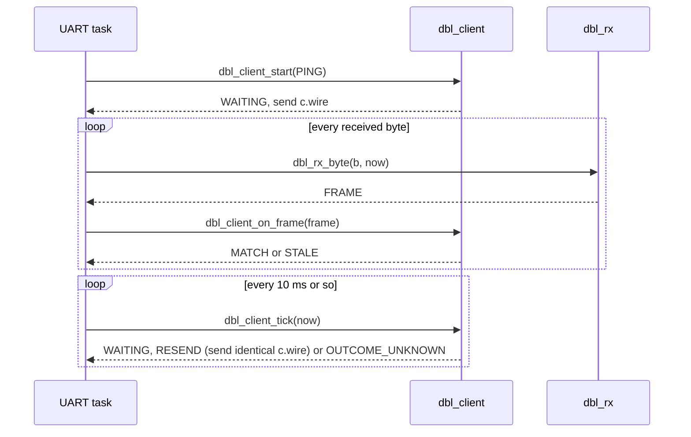

[Project README](../../../../README.md) › [firmware/tab5](../../README.md) › **components/dbglink/**

# `dbglink`: debug-link codec and client for the Tab5

This ESP-IDF component is the Tab5 side of the [debug protocol](../../../../protocol/README.md):
frame encode/decode, a byte-at-a-time receiver and a non-blocking client that retries safely.
Read this page to see the API and how it is tested.

> [!NOTE]
> **Status: 🚧 IN PROGRESS.** The code is written and passes every golden vector and a
> C-versus-Python comparison on the development computer. It has not been built with ESP-IDF or
> run on the Tab5 yet, and no firmware uses it. Status labels are defined in the
> [root README](../../../../README.md#2-project-status).

---

## 1. Files

| File | Job |
| --- | --- |
| `include/dbglink.h` | Public API |
| `include/dbglink_schema.h` | Generated from [`protocol/schema.json`](../../../../protocol/schema.json) by `scripts/gen_protocol.py`; do not edit |
| `dbglink.c` | CRC-32 (16-entry table), COBS, frame pack/parse, stream receiver that decodes COBS as bytes arrive |
| `dbglink_client.c` | One-request-outstanding client with identical retries |
| `test/host_test.c` | Native test program, driven by `host/tests/test_c_codec.py` |
| `CMakeLists.txt` | `idf_component_register` |

Plain C99, no heap, no I/O and no ESP-IDF calls, so the same files build natively for tests.
Memory on a 64-bit host: `dbl_rx_t` is 348 bytes and `dbl_client_t` 344 bytes.

---

## 2. How the UART task uses it

The diagram shows one request from start to finish. Nothing blocks, so the UI task never waits
on the serial port.



| Result | Meaning for the caller |
| --- | --- |
| `MATCH` | The reply for the outstanding request; check its status |
| `STALE` | A late or unrelated frame; ignore it |
| `RESEND` | 500 ms passed with no reply; send `c.wire` again, byte for byte |
| `OUTCOME_UNKNOWN` | Three retries also failed; the request may have run, so read STATUS before doing anything else |
| A `BAD_SESSION` reply | The client drops its session; start again with discovery and a fresh session ID |

> [!CAUTION]
> Never repeat a timed-out command with a new request ID. That is how a STEP or a write runs
> twice.

---

## 3. Testing

```bash
python3 -m unittest host/tests/test_c_codec.py -v
```

The test builds the component with `gcc -Wall -Wextra -Wpedantic -Wconversion -Werror` and
AddressSanitizer/UndefinedBehaviorSanitizer, then runs 390 checks over the golden vectors and
unit cases, and compares C and Python output on 4000 random or corrupted frames and on a
1500-frame stream with random gaps.

**Next step:** build it inside an ESP-IDF project on the Tab5 and drive the dedicated debug UART
once the FPGA endpoint exists.
