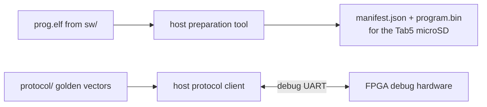

[Project README](../README.md) › **host/**

# `host/`: development-side Python tools

These Python tools run on the development computer and control the FPGA debug endpoint.
They also validate the existing software-builder manifests before sending program bytes.

> [!NOTE]
> **Status: 🚧 IN PROGRESS.** The debug protocol client (`dbglink/`, `dbglink_cli.py`) is
> tested against golden vectors and the actual CPU/packet RTL in Verilator. Typed controls,
> RAM/register access, verified loading, trace/counters, BIST and bounded faults are implemented
> for the single-cycle profile. Physical serial qualification and independent architectural
> reference tools remain pending. Status labels are defined in the
> [root README](../README.md#2-project-status).

---

## 1. What will live here

| Tool | Job | Milestone |
| --- | --- | --- |
| Protocol client | Speaks the [debug protocol](../docs/tab5/DEBUG_PROTOCOL.md) to the FPGA over a serial port, so the debug hardware can be tested before the Tab5 is involved. 🚧 Written, simulation-tested | T2 onward |
| Program preparation | Validates JSON/BIN emitted by `scripts/build_software.py`, including hashes and linker reservations; the SD launcher remains pending | T5 |
| Reference tools | Produce independent expected results for comparison tests | T12 |

The diagram shows the two jobs: preparing programs for the Tab5's microSD, and testing the FPGA
debug hardware directly over the debug UART.



### The protocol client

| File | Job |
| --- | --- |
| `dbglink/schema.py` | Loads [`protocol/schema.json`](../protocol/schema.json); name tables and payload layouts |
| `dbglink/codec.py` | CRC-32, COBS, header pack/parse with the fixed check order, bounded stream receiver with the 100 ms inter-byte timeout |
| `dbglink/device.py` | Reference model of the FPGA endpoint: discovery, session claim and lease, replay slot, HELLO/PING/STATUS. The RTL must match its reply bytes |
| `dbglink/client.py` | Blocking client: one request outstanding, three identical retries, stale replies dropped, `OutcomeUnknown` when no reply ever arrives |
| `dbglink/debugger.py` | Capability-gated typed control, memory/GPRs, loader, captures and diagnostics; uncertain mutations lock further writes |
| `dbglink/program.py` | Checks builder JSON, adjacent binary hashes, RV32I/ILP32 and RAM/BSS/scratch/stack bounds |
| `dbglink/rtl_transport.py` | Cached Verilator SoC endpoint over bounded local FIFOs; no Python CPU implementation |
| `dbglink_cli.py` | Base and typed commands over `--port` (pyserial), `--rtl-sim` (Linux/WSL) or base-only `--sim`; ordered JSON batches via `--script` |
| `tests/` | Codec, session-rule, lossy-link and C-versus-Python tests |

Try it without hardware:

```bash
python3 host/dbglink_cli.py --sim hello status ping soak
python3 host/dbglink_cli.py --rtl-sim hello status
python3 -m unittest discover -s host/tests -v
```

Build and load a real freestanding C image into the simulated FPGA RAM:

```bash
python3 scripts/build_software.py hello --output-dir build/software/hello
python3 host/dbglink_cli.py --rtl-sim --manifest build/software/hello/hello.json load run
```

Use `--help` for parameters and `--script` for an ordered JSON command list. The
[implemented profile](../docs/tab5/TAB5_SIMULATION_DEBUG.md) documents payloads and examples.
`--sim` remains a clearly simulated, base-protocol reference; it rejects advanced controls.
`--rtl-sim` executes the actual SystemVerilog CPU and RAM. Neither is physical board evidence.

After a lost mutation reply or a device `OUTCOME_UNKNOWN`, `Debugger` permits read-only
reconciliation but blocks fresh mutations. `acknowledge_uncertain()` is an explicit caller
decision after inspecting actual state; it never repeats the operation. Serial use requires
an approved dedicated debug UART, separate from the board's existing USB CPU console.

---

## 2. Ground rules

> [!IMPORTANT]
> The protocol client is an **independent** implementation checked against the shared golden
> vectors in [`protocol/`](../protocol/README.md), so the FPGA codec is never tested only
> against itself.

- Prefer the Python standard library; declare a serial-port dependency when it is introduced.
- These tools are for development and testing. The final portable demonstration must work
  without a laptop, so nothing here is required at runtime.

---

## 3. Related

| For | See |
| --- | --- |
| The protocol | [DEBUG_PROTOCOL.md](../docs/tab5/DEBUG_PROTOCOL.md) |
| Manifest rules | [TAB5_INTEGRATION.md](../docs/tab5/TAB5_INTEGRATION.md#7-program-images-loading-and-launch) |
| Build scripts (separate from these tools) | [scripts/README.md](../scripts/README.md) |

**Next step:** qualify the routed FPGA endpoint and approved physical debug link before
using `--port` for board control. The Tab5 SD launcher and offline reference tools remain pending.
