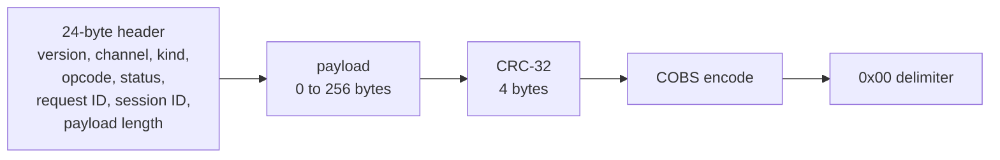

[Project README](../README.md) › **protocol/**

# `protocol/`: the shared debug-link contract

This folder holds the single definition of the debug protocol that the FPGA, the Tab5 and the
host tools all speak: one schema file and the golden vectors every implementation is tested
against. Read this page for the frame, the files and the exact receive rules; the design
reasoning is in [DEBUG_PROTOCOL.md](../docs/tab5/DEBUG_PROTOCOL.md).

> [!NOTE]
> **Status: 🚧 IN PROGRESS.** Python, C and FPGA codecs pass the version 1 golden vectors.
> The FPGA packet/session engine and single-cycle debug commands run in simulation; the
> Tab5 UART client compiles, but the physical link remains unverified. See the
> [implemented profile and evidence](../docs/tab5/TAB5_SIMULATION_DEBUG.md). Status labels are defined in the
> [root README](../README.md#2-project-status).

> [!IMPORTANT]
> Version 1 framing and base-session behavior now pass the independent Python, C and RTL
> vectors. Extend payloads through `schema.json` and the generator; preserve these wire bytes.

<details open>
<summary><b>On this page</b></summary>

1. [Files](#1-files)
2. [The frame in one picture](#2-the-frame-in-one-picture)
3. [Receive checks and their order](#3-receive-checks-and-their-order)
4. [Version 1 payloads for HELLO, PING and STATUS](#4-version-1-payloads-for-hello-ping-and-status)
5. [Session and replay rules](#5-session-and-replay-rules)
6. [Vector file formats](#6-vector-file-formats)
7. [Regenerating and testing](#7-regenerating-and-testing)
8. [Related](#8-related)

</details>

---

## 1. Files

| File | Job | Edited by |
| --- | --- | --- |
| [`schema.json`](schema.json) | Every number: limits, channels, kinds, opcodes, status codes, frame errors, capability bits, state enums, payload layouts | Hand |
| [`vectors/frames.txt`](vectors/frames.txt) | CRC, COBS, good-frame and bad-frame vectors (23 good frames, 19 bad) | Generated |
| [`vectors/sessions.txt`](vectors/sessions.txt) | 11 device scenarios: discovery, claim, lost reply, ID conflict, stale ID, BUSY, lease expiry, reset, ID wrap, typed errors | Generated |
| `../firmware/tab5/components/dbglink/include/dbglink_schema.h` | The schema as C constants, structs and unpack functions | Generated |
| `../rtl/debug/dbg_pkg.sv` | SystemVerilog constants, frame/bus types, header and CRC helpers | Generated |
| `../tb/debug/dbg_vectors.svh` | RTL parsing helpers; benches read the independent text vectors | Hand |

Nothing else may hold its own copy of an opcode or status table. Python reads `schema.json`
directly; C includes the generated header and RTL imports `dbg_pkg`.

---

## 2. The frame in one picture

The diagram shows how one packet is built, left to right, before it goes on the wire:



| Property | Version 1 |
| --- | --- |
| Physical link | Dedicated UART, 115200 baud, 8N1, no flow control |
| Framing | `COBS(header ‖ payload ‖ crc32) ‖ 0x00`; COBS removes zero bytes so `0x00` marks the end |
| Integrity | CRC-32/ISO-HDLC (check value for ASCII `123456789` is `0xCBF43926`), little-endian |
| Size limits | Payload 0–256 bytes; decoded frame at most 284 bytes; 286 encoded bytes plus the delimiter, 287 on the wire |
| Channels | 0 control, 1 CPU console, 2 observation events |
| Safe retries | One controlling session; increasing request IDs; an identical retry replays the stored reply instead of acting twice |

**COBS detail.** A block of 254 non-zero bytes uses code `0xFF` and implies no zero after it.
When such a block ends exactly at the end of the input, the encoder adds no empty trailing group
(the published Cheshire and Baker examples). The decoder accepts either form.

---

## 3. Receive checks and their order

Every implementation runs the same checks in the same order, so the same bad bytes always
produce the same error name and counter:

| Order | Error | Rule |
| ---: | --- | --- |
| 1 | `TOO_LONG` | More than 286 encoded bytes before a delimiter, or more than 284 decoded bytes. The receiver discards through the next `0x00`. |
| 2 | `COBS_INVALID` | A code byte points past the end of the frame. |
| 3 | `TOO_SHORT` | Fewer than 28 decoded bytes (header plus CRC). |
| 4 | `BAD_LENGTH` | Length field above 256, or `24 + length + 4` differs from the decoded size. |
| 5 | `BAD_CRC` | CRC over header and payload does not match. |
| 6 | `BAD_VERSION` | Version byte is not 1. |
| 7 | `BAD_RESERVED` | Flags byte or reserved field is not zero. |
| 8 | `BAD_CHANNEL` | Channel above 2. |
| 9 | `BAD_KIND` | Kind above 2. |
| — | `TIMEOUT` | A gap of more than 100 ms inside a half-received frame. A gap of exactly 100 ms is allowed. The byte that arrives after the gap starts a new frame. |

- Back-to-back `0x00` bytes are idle fill and are not errors.
- Every error increments its own counter and never reaches the dispatcher; no reply is sent.
- The receiver produces at most one event per input byte, which keeps an RTL version simple.

---

## 4. Version 1 payloads for HELLO, PING and STATUS

All three requests use channel 0. HELLO and STATUS requests have an empty payload. A PING
request carries 0–32 bytes that the reply echoes unchanged.

**HELLO reply (36 bytes, little-endian).** Also returned for read-only discovery.

| Offset | Type | Field |
| ---: | --- | --- |
| 0 | `u8` | Protocol version (1) |
| 1 | `u8` | Schema minor version (0) |
| 2 | `u16` | Descriptor bytes (36) |
| 4 | `u32` | FPGA build ID |
| 8 | `u32` | ISA flags; bit 0 = RV32I. Zero means no CPU is present |
| 12 | `u32` | CPU clock in Hz |
| 16 | `u16` | Largest payload (256) |
| 18 | `u16` | Largest load chunk (192) |
| 20 | `u32` | Capability bits (table below) |
| 24 | `u8` | Breakpoint count |
| 25 | `u8` | Trace format |
| 26 | `u16` | Trace depth |
| 28 | `u8` | CPU state |
| 29 | `u8` | Operation state |
| 30 | `u8` | Session state: 0 none, 1 yours, 2 someone else's |
| 31 | `u8` | Reserved, 0 |
| 32 | `u16` | Lease time left in ms (0 when nobody holds it) |
| 34 | `u16` | Bitmap of supported operation states |

The descriptor never reveals another client's session ID; it only says that one exists.

**STATUS reply (36 bytes).**

| Offset | Type | Field |
| ---: | --- | --- |
| 0 | `u8` | CPU state |
| 1 | `u8` | Halt reason: 0 none, 1 request, 2 step, 3 breakpoint, 4 fault, 5 reset |
| 2 | `u8` | Operation state |
| 3 | `u8` | Valid bits: 0 last PC, 1 next PC, 2 image, 3 modified |
| 4 | `u32` | Last retired PC |
| 8 | `u32` | Next PC |
| 12 | `u32` | Image ID |
| 16 | `u64` | Operation ID |
| 24 | `u32` | Frames rejected |
| 28 | `u32` | UART overruns |
| 32 | `u32` | Snapshot generation |

**Capability bits.**

| Bit | Name | Bit | Name |
| ---: | --- | ---: | --- |
| 0 | BASE_STATUS | 8 | PIPE_SNAPSHOT |
| 1 | RAM_ACCESS | 9 | RETIRE_TRACE |
| 2 | LOADER | 10 | BASE_COUNTERS |
| 3 | CONSOLE | 11 | PERF64 |
| 4 | HALT_RESUME | 12 | MEM_BIST |
| 5 | REG_ACCESS | 13 | ALU_BIST |
| 6 | STEP | 14 | FAULT_INJECT |
| 7 | BREAKPOINTS | 15 | REFERENCE_CAPTURE |

**State values.** CPU: 0 RESET_HELD, 1 HALTED, 2 RUNNING, 3 HALT_REQUESTED, 4 STEPPING,
5 BREAKPOINT, 6 TERMINATED, 7 ERROR, 255 ABSENT. Operation: 0 IDLE, 1 LOADING, 2 VERIFYING,
3 BIST, 4 INJECTING, 5 ABORTING, 6 DONE, 7 FAILED.

---

## 5. Session and replay rules

These are the exact rules the reference model in
[`host/dbglink/device.py`](../host/dbglink/device.py) follows and the RTL must match byte for
byte. Responses echo channel, opcode, request ID and session ID.

| Incoming request | Reply | Stored for replay |
| --- | --- | :---: |
| Kind is response or event | None, rejected counter +1 | No |
| Session 0, request 0, HELLO, empty payload | HELLO descriptor (read-only discovery) | No |
| Session 0 with a nonzero request ID | BAD_ARGUMENT | No |
| Session 0 with any other opcode | BAD_SESSION | No |
| HELLO with a new session, no live lease | Claims the session, descriptor | Yes |
| HELLO with a new session while another lease is live | BUSY | No |
| Any other opcode from a session that does not own the link | BAD_SESSION | No |
| Owner, request ID 0 | BAD_ARGUMENT | No |
| Owner, same ID, identical bytes | The stored reply, unchanged | — |
| Owner, same ID, different bytes | ID_CONFLICT | No |
| Owner, lower ID | STALE_REQUEST | No |
| Owner, higher ID | Executed: OK or a typed error (UNSUPPORTED, BAD_ARGUMENT) | Yes |

- The lease is 2000 ms. Every executed or replayed request from the owner renews it.
- After the lease expires, the owner's next non-HELLO request gets BAD_SESSION and the slot is
  cleared; any client may then claim with HELLO.
- After request ID `0xFFFFFFFF` the client must start a new session.
- A debug/board reset clears the session and the replay slot.
- The base T2 reference model implements HELLO, PING and STATUS only. Advanced commands are
  capability-negotiated by the [single-cycle FPGA profile](../docs/tab5/TAB5_SIMULATION_DEBUG.md);
  unsupported commands still return UNSUPPORTED.
- A typed error for a new ID is stored, so an identical retry returns the same error.

---

## 6. Vector file formats

Both files are plain text, one record per line, `#` for comments, lowercase hex.

**`frames.txt`:**

```text
crc  <name> <data|-> <crc32>
cobs <name> <raw|-> <encoded-without-delimiter>
ok   <name> <ver> <chan> <kind> <flags> <opcode> <status> <request_id> <session_id> <payload|-> <wire>
err  <name> <ERROR_NAME> <encoded-without-delimiter>
```

Header values in `ok` lines are written big-endian for reading; on the wire they are
little-endian. `<wire>` includes the final `00`.

**`sessions.txt`:** each `scenario <name>` starts a freshly reset device at 0 ms, followed by
steps:

```text
at <ms>              set the device clock
reset                debug/board reset
send <wire>          one request on the wire
expect <wire|none>   the exact reply bytes, or no reply
```

Device identity in the scenarios: build ID `0x54320001`, clock 62 500 000 Hz, CPU present.

---

## 7. Regenerating and testing

Run these commands from the repository root:

```bash
python3 scripts/gen_protocol.py            # rewrite generated C/SV definitions and vectors
python3 scripts/gen_protocol.py --check    # CI: fail if any generated file is stale
python3 -m unittest discover -s host/tests -v
python3 scripts/run_tests.py dbg_ cpu_single_debug hw_bist --jobs 1
```

| Check | What it proves |
| --- | --- |
| `host/tests/test_codec.py` | Python codec against independent anchors: `zlib.crc32`, published COBS examples, hand-built header bytes, every single-bit flip caught |
| `host/tests/test_device.py` | Session rules with hand-written expectations; 40 seeded runs over a link that drops, corrupts and duplicates frames show no request runs twice |
| `host/tests/test_c_codec.py` | C codec built with ASan/UBSan: all golden vectors, client unit tests, and 4000 random/corrupt frames plus a 1500-frame timed stream decoded identically by C and Python |

> [!IMPORTANT]
> The RTL testbench must read these files itself and compare. It must not produce its expected
> values with the Python codec at test time.

---

## 8. Related

| For | See |
| --- | --- |
| Design reasoning | [DEBUG_PROTOCOL.md](../docs/tab5/DEBUG_PROTOCOL.md) |
| Python codec, model and client | [host/README.md](../host/README.md) |
| C codec for the Tab5 | [firmware/tab5/README.md](../firmware/tab5/README.md) |
| FPGA side | [rtl/README.md](../rtl/README.md) (`rtl/debug/`) |
| Milestone | [T2 in the build plan](../docs/BUILD_PLAN.md#t2-reliable-framed-debug-communication) |

**Next step:** qualify a fitted, routed FPGA endpoint and the approved physical Tab5 UART
link. The original USB CPU console remains separate.
