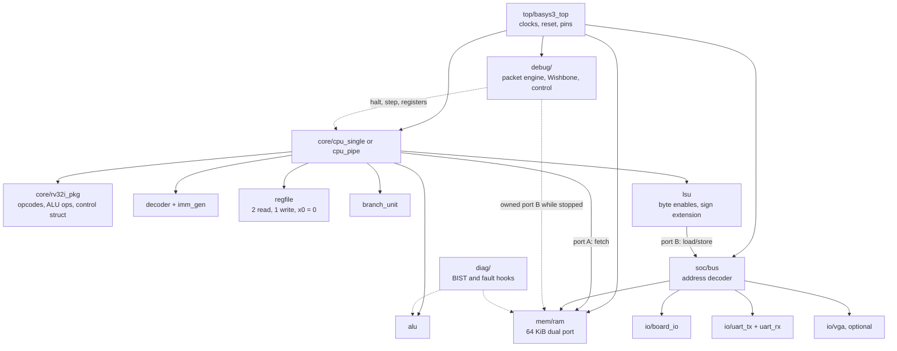
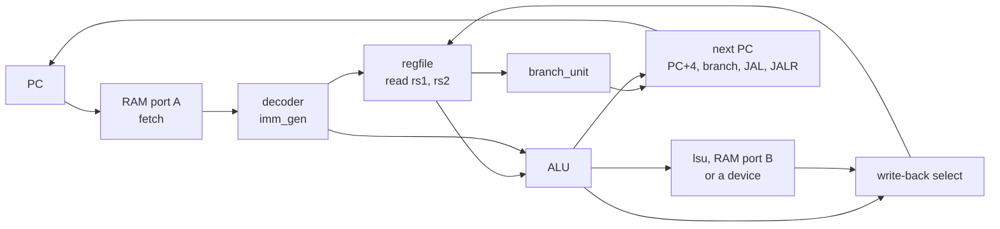

[Project README](../README.md) › **rtl/**

# `rtl/`: the hardware

This folder holds every circuit in the project, written in SystemVerilog: the processor, its
memory, its peripherals, the debug hardware the Tab5 talks to, and the board's top level. Read
this page to find where a module belongs and which rules it must follow.

> [!NOTE]
> **Status: 🚧 IN PROGRESS.** Phases 0–2 passed their recorded gates. Phase 3 adds the native
> bus, board I/O, counters, MMCM and `basys3_soc`: C runs on the board with timing met at
> 25 MHz ([evidence](../docs/phases/PHASE3_BOARD_C.md)). Phase 4 adds TX/RX, a 16-byte receive FIFO,
> UART registers and physical USB console operation ([evidence](../docs/phases/PHASE4_UART.md)).
> Phase 3 passed CI run #11, Phase 4 run #16 and Phase 5 run #18. The Phase 5 pipeline passed
> on the board at 62.5 MHz. Phase 6 adds the VGA path (simulation and routed timing pass; the
> monitor gate is unrun). The [single-cycle debug profile](../docs/tab5/TAB5_SIMULATION_DEBUG.md)
> adds packet RTL, RAM ownership, CPU controls, loader, trace/counters and actual RAM/ALU BIST.
> Pipeline debug and physical link qualification remain pending. Status labels are defined in the
> [root README](../README.md#2-project-status).

<b>On this page</b>

1. [What lives here](#1-what-lives-here)
2. [What exists now](#2-what-exists-now)
3. [Folder map](#3-folder-map)
4. [How the pieces fit](#4-how-the-pieces-fit)
5. [The CPU core, block by block](#5-the-cpu-core-block-by-block)
6. [Key interfaces and contracts](#6-key-interfaces-and-contracts)
7. [Coding rules](#7-coding-rules)
8. [Related](#8-related)

---

## 1. What lives here

**RTL** (register-transfer level) is hardware written as code. Each SystemVerilog file describes a
circuit:

- **registers** that hold values from one clock tick to the next;
- the **combinational logic** (pure gates, no memory) that computes their next values.

Two tools read these files:

| Tool | Turns the RTL into |
| --- | --- |
| Vivado | A configuration for the Basys 3's FPGA |
| Verilator | A fast C++ simulation for testing |

Everything the CPU *is* will live in this folder: the processor, its memory, its peripherals, the
debug hardware the Tab5 talks to, and the board's top level.

---

## 2. What exists now

| File | What it does | Tested by |
| --- | --- | --- |
| [core/counter.sv](core/counter.sv) | Four-bit counter that checks the simulation workflow: active-high synchronous reset, incrementing, wraparound and restart. | [tb/core/counter_tb.sv](../tb/core/counter_tb.sv), 25 checks ([smoke-test record](../docs/phases/PHASE0_SMOKE_TEST.md)) |
| [top/basys3_top.sv](top/basys3_top.sv) | Phase 0 blink. The 16 LEDs show a binary count; with the default `DIV_BITS = 24` and the 100 MHz clock, LED 0 blinks at about 3 Hz. The center button (`btnC`) is reset, through a two-flop synchronizer. | [tb/top/basys3_top_tb.sv](../tb/top/basys3_top_tb.sv); built with `scripts/vivado/build.tcl` and programmed on the board |
| [core/rv32i_pkg.sv](core/rv32i_pkg.sv) | Shared instruction encodings, typed selectors, control record and safe defaults. | Used throughout the five CPU-block benches |
| [core/alu.sv](core/alu.sv) | Ten 32-bit integer operations, signed comparisons and five-bit shift counts. | [tb/core/alu_tb.sv](../tb/core/alu_tb.sv), 11,709 checks |
| [core/regfile.sv](core/regfile.sv) | Two asynchronous reads, one synchronous write, immutable x0, optional bypass. No reset (Phase 2 decision), so it can map to LUTRAM. | [tb/core/regfile_tb.sv](../tb/core/regfile_tb.sv), 6,140 check groups |
| [core/imm_gen.sv](core/imm_gen.sv) | I/S/B/U/J immediate assembly and extension. | [tb/core/imm_gen_tb.sv](../tb/core/imm_gen_tb.sv), 10,343 checks |
| [core/decoder.sv](core/decoder.sv) | Full controls for 40 base instructions; unsupported encodings have no side effects. | [tb/core/decoder_tb.sv](../tb/core/decoder_tb.sv), 133,700 checks |
| [core/branch_unit.sv](core/branch_unit.sv) | Six signed/unsigned branch predicates; NONE disables branching. | [tb/core/branch_unit_tb.sv](../tb/core/branch_unit_tb.sv), 8,522 checks |
| [core/next_pc.sv](core/next_pc.sv) | PC + 4, branch/JAL and JALR targets, bit-0 clearing, full misaligned-target flag, reset and hold. | [tb/core/next_pc_tb.sv](../tb/core/next_pc_tb.sv), 20,023 checks |
| [core/lsu.sv](core/lsu.sv) | Store lanes and byte enables, load lane select and extension, alignment contract. | [tb/core/lsu_tb.sv](../tb/core/lsu_tb.sv), 20,184 checks |
| [mem/ram.sv](mem/ram.sv) | 64 KB dual-port block RAM: rising-edge fetch port, falling-edge (or rising-edge) data port with byte enables, `$readmemh` init. | [tb/mem/ram_tb.sv](../tb/mem/ram_tb.sv), 371 checks including the edge schedule |
| [core/cpu_single.sv](core/cpu_single.sv) | The single-cycle RV32I CPU: retirement record, ECALL/EBREAK stop, fault stops. | [tb/system/cpu_tb.sv](../tb/system/cpu_tb.sv) with 13 directed and 40 rv32ui programs |

To run every bench and CPU program, use `python3 scripts/run_tests.py` in WSL or **Ctrl+Shift+B** in
VS Code's **WSL: Ubuntu** window. See [Phase 1](../docs/phases/PHASE1_CORE_BLOCKS.md) and [Phase 2](../docs/phases/PHASE2_SINGLE_CYCLE.md) records.

> [!NOTE]
> `scripts/run_tests.py` and `scripts/vivado/build.tcl` compile **every** `rtl/**/*.sv` file, with
> `*_pkg.sv` packages first. A new module is picked up automatically; it must not break any other
> test or the bitstream build.

---

## 3. Folder map

| Folder | Contents (planned unless marked implemented) | Built in |
| --- | --- | --- |
| [`core/`](core/) | **Implemented:** `counter.sv`, `rv32i_pkg.sv`, `alu.sv`, `regfile.sv`, `imm_gen.sv`, `decoder.sv`, `branch_unit.sv`, `next_pc.sv`, `lsu.sv`, `cpu_single.sv`, `cpu_pipe.sv`, `forward.sv`, `hazard.sv` | Counter: Phase 0; blocks: Phase 1; integration: Phases 2, 5 |
| [`mem/`](mem/) | **Implemented:** `ram.sv`, 64 KiB dual-port block RAM with byte-write enables, loaded with `$readmemh`. **Planned:** optional 2 KiB boot ROM | Phases 2, 4 |
| [`io/`](io/) | **Implemented:** `board_io.sv` (LEDs, switches, buttons, 7-segment), `debounce.sv`, `perf_counters.sv`, `uart.sv` with `uart_tx.sv` and `uart_rx.sv`. **Phase 6:** `vga_timing.sv`, `vga_text.sv`, `vga_fb.sv`, `vga.sv` (simulation and routed timing verified; physical monitor unavailable) | Phases 3, 4, 6 |
| [`soc/`](soc/) | **Implemented:** `soc.sv`, the board-independent system (CPU, RAM, bus, I/O, reset interlock), and `bus.sv`, the RAM/MMIO address decoder | Phase 3 |
| [`debug/`](debug/) | **Implemented in simulation:** packet RX/TX/dispatch/UART, Classic master, native RAM arbiter/DMA, typed executor, single-cycle controls and retirement/counter observer. `dbg_system` integrates the actual SoC. CSR slaves and pipeline snapshots remain pending | T2–T9 subsets |
| [`diag/`](diag/) | **Implemented in simulation:** `hw_bist.sv` scratch March and actual CPU ALU self-test. One-use scratch read-XOR hooks live in the debug arbiter/executor; full-RAM destructive mode remains pending | T10–T11 subsets |
| [`top/`](top/) | **Implemented:** `basys3_soc.sv` (the board top: pins, MMCM clock and reset around `soc`), `clock_gen.sv` (parameterized CPU MMCM output plus fixed 25 MHz pixels) and `basys3_top.sv` (Phase 0 blink, kept as a fallback) | Blink: Phase 0; CPU top level: Phase 3 |

---

## 4. How the pieces fit

The diagram shows the planned module hierarchy. Solid arrows are normal CPU paths; dotted arrows
are debug and self-test paths that only act while the CPU is stopped.

---

## 5. The CPU core, block by block

| Block | Job | Test (implemented for Phase 1 blocks) |
| --- | --- | --- |
| `rv32i_pkg` | Opcodes, the ALU operation list and the control-signal struct, shared by every module | Used by all benches |
| `alu` | ADD, SUB, AND, OR, XOR, SLL, SRL, SRA, SLT, SLTU | Tricky values (0, −1, largest/smallest numbers, shifts of 31 and 32) plus 1,000 random inputs per operation against a reference model |
| `regfile` | 32 × 32-bit registers, 2 read ports, 1 write port, `x0` always 0. `BYPASS` parameter: off for single-cycle (on would form a loop), on for the pipeline | Every register written and read back; writes to `x0` ignored; random sequences against a model |
| `imm_gen` | Builds the sign-extended I, S, B, U and J immediates | Hand-encoded instructions per format, including negative and maximum values |
| `decoder` | Turns opcode, funct3 and funct7 into control signals: ALU op, operand sources, register write, load/store size, branch type, jump, write-back source, illegal | Representative encodings of all 40 base instructions; unknown encodings raise illegal |
| `branch_unit` | BEQ, BNE, BLT, BGE, BLTU, BGEU | Signed vs unsigned edge cases, such as −1 vs 1 |
| `lsu` | Byte, halfword and word accesses; store byte enables; load sign/zero extension; misaligned access stops with a documented error | Every size, offset and signedness; alignment contract tested explicitly |
| `next_pc` | PC + 4, branch/JAL/JALR targets, reset to 0, hold on a stop | Targets against a ripple-carry reference; misaligned targets; reset/hold priority |

### Single-cycle datapath

Implemented in Phase 2 as [`cpu_single.sv`](core/cpu_single.sv); see its [edge schedule](../docs/phases/PHASE2_SINGLE_CYCLE.md#3-clock-edge-schedule).

The diagram shows one instruction's path through the single-cycle CPU, from the PC back to the
next PC.

**Next-PC rules:**

| Instruction | Next PC |
| --- | --- |
| Normal | PC + 4 |
| Taken branch, JAL | PC + immediate |
| JALR | (rs1 + immediate) with bit 0 cleared |
| Reset | `0x0000_0000` |

### Pipeline additions (Phase 5)

**Status: implemented and passing in simulation** ([evidence](../docs/phases/PHASE5_PIPELINE.md)); not yet
built in Vivado. `soc`/`basys3_soc` select it with `PIPELINE = 1`; the default is still `cpu_single`.

The pipeline splits the datapath into IF, ID, EX, MEM and WB with a packed struct for each
pipeline register and a **valid bit** that travels with every instruction.

| Module | Rule |
| --- | --- |
| `forward` | EX/MEM → EX and MEM/WB → EX, for both source registers and for store data. The register-file bypass covers WB → ID. A write to `x0` is never forwarded. |
| `hazard` | A load followed by an instruction that uses its result stalls 1 cycle. A taken branch, JAL or JALR flushes the 2 younger instructions. |

---

## 6. Key interfaces and contracts

These contracts are shared with the debug hardware; the full versions are in the
[integration architecture](../docs/tab5/TAB5_INTEGRATION.md#6-cpu-architectural-debug-contract).

<b>Retirement record</b> (shared by tests, counters, trace and debug)

Implemented in Phase 2 as `retire_t` (`rv32i_pkg.sv`): `valid`, PC, instruction, next PC,
destination write enable / index / value, and memory read / address / byte mask / data. The
halt or error reason is the separate `stop_cause` output. The order number is still planned
(trace work, T8). See the [contract](../docs/phases/PHASE2_SINGLE_CYCLE.md#4-retirement-and-stop-contract).

- Instructions without a register write (stores, branches, NOPs) still retire.
- Flushed bubbles never retire.
- A store retires only after its single side effect is accepted.
- ECALL and EBREAK produce exactly one retirement, then halt with the separate `stop_cause`.
  A terminal trace flag and order number are future T8 fields, not current `retire_t` members.
- Illegal or misaligned operations report an error without a successful retirement.

<b>Memory ports and ownership</b>

- Port A is instruction fetch; port B serves CPU loads and stores.
- There is no third RAM port. Debug access and memory BIST borrow port B through an ownership
  adapter, only when the CPU is HALTED (drained) or held in reset, with instruction fetch
  disabled. Owners are CPU, DEBUG or BIST, exactly one at a time, and never switched in the
  middle of a transfer.
- Single-cycle (proven in Phase 2): port A reads on the rising edge at the next PC; port B reads
  and writes on the falling edge. Pipeline: normal synchronous reads on both ports.

<b>Clocking and reset</b>

- One 100 MHz board clock feeds an MMCM: 25 MHz for the single-cycle CPU and VGA pixels; the
  pipeline as fast as timing allows. Never divide clocks with counters; use clock enables.
- Reset is `rst`, active high and synchronous inside the design. The external reset button goes
  through a synchronizer; buttons are debounced.
- CPU reset must not reset the debug transport; a board/debug reset also clears sessions.
- The VGA text buffer is dual-port RAM so the CPU and pixel clocks never share logic.

> [!NOTE]
> The Phase 0 blink runs directly on the 100 MHz board clock and already synchronizes its reset
> button with two flip-flops. The separate Phase 3 SoC now uses the MMCM and debouncer below.

---

### Phase 3 implemented board system

The unchanged `cpu_single` and `ram` are connected by [soc.sv](soc/soc.sv) with
[bus.sv](soc/bus.sv), [board_io.sv](io/board_io.sv), [debounce.sv](io/debounce.sv) and
[perf_counters.sv](io/perf_counters.sv). The FPGA entry is [basys3_soc.sv](top/basys3_soc.sv),
using [clock_gen.sv](top/clock_gen.sv). Each has a matching self-checking bench. Full port,
reset, memory-hold and MMIO contracts are in [Phase 3](../docs/phases/PHASE3_BOARD_C.md).

`basys3_top` stays the original blink; select it with `-tclargs basys3_top`. The default
build now includes the CPU/C image. The simulated clock divider is guarded by `VERILATOR`;
hardware uses an MMCM/BUFG, confirmed by the routed report.

### Phase 4 console UART

[uart_tx.sv](io/uart_tx.sv), [uart_rx.sv](io/uart_rx.sv) and [uart.sv](io/uart.sv) implement
115200 8N1 with a 16-byte RX FIFO, sticky overrun/framing flags and native MMIO at
`0x8000_0010/14/18`. Each has a self-checking bench. Bus requests are accepted on the falling
edge, then UART/FIFO state updates on the next rising edge with one writer. CPU-only reset
preserves UART; the future framed debug link will use a separate instance.

The board top adds a plain synchronous reset stage, clearing `REQP-1839`. Phase 4 routed
timing is WNS +0.367 ns, WHS +0.024 ns, with zero DRC violations. The full-board hello test
checks actual serial pins and the real one-second interval. See [the contract](../docs/phases/PHASE4_UART.md).

## 7. Coding rules

From [AGENTS.md](../AGENTS.md):

- One module per file, file named after the module in `snake_case`.
- `logic` everywhere; `always_ff` for flip-flops with nonblocking assignments; `always_comb` for
  logic with every output assigned on every path. No latches.
- Implementation RTL stays synthesizable; test-only code stays in testbenches.
- Verilator `-Wall` stays clean, without suppressing warnings to hide defects.
- Make widths, signedness, extension, shift amounts and byte enables explicit, and test them.

> [!IMPORTANT]
> Every new module lands in the same commit as its self-checking testbench in `tb/`.

---

## 8. Related

| For | See |
| --- | --- |
| Tests for these modules | [tb/README.md](../tb/README.md) |
| Pins and timing constraints | [fpga/README.md](../fpga/README.md) |
| Debug and diagnostic contracts | [TAB5_INTEGRATION.md](../docs/tab5/TAB5_INTEGRATION.md) |
| Software that drives these devices | [sw/README.md](../sw/README.md) |
| Implemented interfaces and verification | [Phase 1 record](../docs/phases/PHASE1_CORE_BLOCKS.md) |
