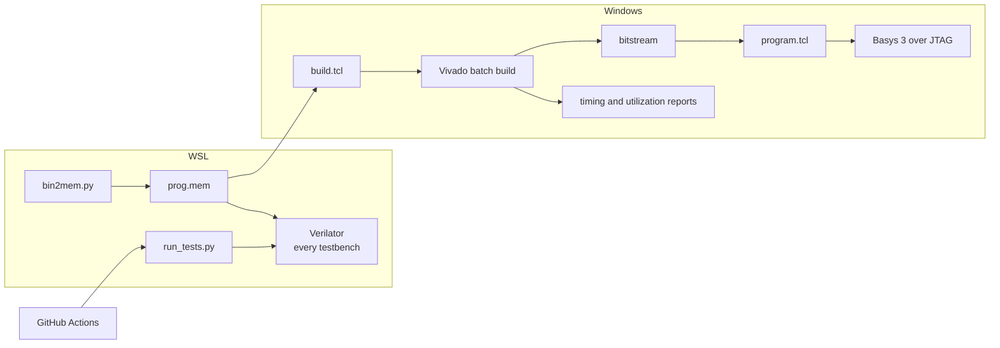

[Project README](../README.md) › **scripts/**

# `scripts/`: one command per job

This folder holds the scripts that test, build and program the design, so every routine job is a
single command that a person or CI can repeat. Read this page for each script's command,
options, expected output and common errors.

> [!NOTE]
> **Status: 🚧 IN PROGRESS.** `run_tests.py`, `build.tcl` and `program.tcl` exist and passed
> Phase 0 on November 7, 2026. `synth_blocks.tcl` (Phase 1 block synthesis check) passed in
> Vivado 2025.2 the same day. Phase 2 added `bin2mem.py` and taught `run_tests.py` to
> assemble and run CPU programs. Phase 3 adds `build_software.py` and makes the CPU/C SoC
> the default FPGA target. Its physical gate and CI (run #11) passed.
> Phase 4 adds the physical UART checker, defaults the board image to hello, and passes
> 101 regression runs plus 58 Python checks; hosted CI run #16 passed. Phase 5 and Phase 6
> extended the suite to 271 runs and 67 Python checks. Phase 7 now passes 277 regression
> runs, 80 Python/native checks, 48 lint elaborations and six routed demo builds.
> `upload.py` remains **PLANNED**. Status labels
> are defined in the [root README](../README.md#2-project-status).

<details open>
<summary><b>On this page</b></summary>

1. [Why scripts](#1-why-scripts)
2. [The scripts](#2-the-scripts)
3. [How they connect](#3-how-they-connect)
4. [Run the tests: `run_tests.py`](#4-run-the-tests-run_testspy)
5. [Build the bitstream: `build.tcl`](#5-build-the-bitstream-buildtcl)
6. [Program the board: `program.tcl`](#6-program-the-board-programtcl)
7. [Ground rules](#7-ground-rules)
8. [Phase 0 checklist](#8-phase-0-checklist)
9. [Related](#9-related)

</details>

---

## 1. Why scripts

Hardware projects drift when builds depend on clicking through a GUI. Here every routine job
gets one script, so any test run or bitstream can be rebuilt with a single command, by a person
or by CI, with no Vivado project files stored in Git.

---

## 2. The scripts

Python tools run in WSL and sit directly in `scripts/`, because they import each other.
The Vivado Tcl scripts run on Windows and live in [`vivado/`](vivado/). Unit tests for the
Python tools are in [`tests/`](tests/).

| Script | Status | Environment | Job | Phase |
| --- | --- | --- | --- | --- |
| [`run_tests.py`](run_tests.py) | ✅ Exists | WSL | Build/run every unit bench, directed and rv32ui assembly programs, and registered C/board/console fixtures; print a pass/fail table | 0–4 |
| [`build_software.py`](build_software.py) | ✅ Exists | WSL | Build freestanding C with the custom startup/linker and RV32I libgcc; validate ELF/layout and emit checked image metadata | 3 |
| [`vivado/build.tcl`](vivado/build.tcl) | ✅ Exists | Windows, Vivado | Build the default CPU/C SoC or legacy blink with matching constraints; validate timing before writing the bitstream | 0, 3 |
| [`vivado/program.tcl`](vivado/program.tcl) | ✅ Exists | Windows, Vivado | Load the selected bitstream onto the Basys 3 over USB (JTAG); default `basys3_soc` | 0, 3 |
| [`vivado/synth_blocks.tcl`](vivado/synth_blocks.tcl) | ✅ Exists | Windows, Vivado | Synthesize each CPU block (Phase 1 blocks, `next_pc`, `lsu`, `ram`, `cpu_single`) on its own; fail on a latch; write per-block utilization reports | 1, 2 |
| [`bin2mem.py`](bin2mem.py) | ✅ Exists | WSL | Convert a compiled `.bin` into a `.mem` file for `$readmemh` (one little-endian word per line) | 2 |
| [`uart_check.py`](uart_check.py) | ✅ Exists | Windows | Check the physical greeting, increasing counter and exact text/binary echo; pyserial is isolated in a host venv | 4 |
| [`gen_protocol.py`](gen_protocol.py) | ✅ Exists | WSL | Generate the debug-protocol C header, SV package and golden vectors from [`protocol/schema.json`](../protocol/schema.json); `--check` fails on stale files | T2 |
| [`vivado/synth_debug.tcl`](vivado/synth_debug.tcl) | ✅ Exists | Windows, Vivado | Synthesize the single-cycle `dbg_system` out of context; save area/hierarchy/checkpoints and reject LUT overuse before timing. No board pins, routing or programming | T2–T11 simulation profile |
| `upload.py` | 📋 Deferred | Windows or WSL | Optional ROM recovery loader; skipped for current Phase 4 | 4 optional |

C image builder and converter usage (WSL, from the repository root):

```bash
python3 scripts/build_software.py fib                 # build/software/fib/ by default
python3 scripts/build_software.py runtime_smoke --output-dir /tmp/rvc-runtime
python3 scripts/bin2mem.py prog.bin prog.mem          # rejects images over 64 KiB
```

The C builder emits `.elf`, `.bin`, `.mem`, `.map`, `.dump` and `.json` together. It verifies
entry 0, RV32I-compatible ELF flags, actual image length, BSS and scratch/stack reservations,
then records CRC-32/SHA-256. The typed host loader validates this metadata and its adjacent
binary; a Tab5 SD package/launcher remains pending. Use
`--help` for output options; `RISCV_PREFIX` overrides automatic toolchain detection.
[Phase 3](../docs/phases/PHASE3_BOARD_C.md#4-c-startup-linker-and-image-metadata)
describes the contracts; `run_tests.py c/` verifies both current C programs before hardware.

CPU programs need RISC-V GCC: `sudo apt install gcc-riscv64-unknown-elf`. The prefix is found
automatically, or set `RISCV_PREFIX=riscv64-unknown-elf-`. GCC, objcopy and objdump must all be
present. Fetch the pinned suite once with `git submodule update --init sw/riscv-tests`.
The runner rejects an absent, empty or partial official suite instead of silently skipping it.

`bin2mem.py --size N` requires a positive multiple of four bytes. It checks the image bound
before writing, pads the last word with zero bytes, writes ASCII with LF line endings, and
rejects an output that aliases the binary input.

In a **WSL: Ubuntu** VS Code window, **Ctrl+Shift+B** runs the complete regression through
the shared [task file](../.vscode/tasks.json). **Terminal > Run Task > Smoke: build and run
counter** still selects the original counter-only task. Its 25 passing checks and deliberate
failure check are recorded in [PHASE0_SMOKE_TEST.md](../docs/phases/PHASE0_SMOKE_TEST.md).

---

## 3. How they connect

The diagram shows which environment runs each script and what it produces. Dashed boxes are
planned.



---

## 4. Run the tests: `run_tests.py`

From WSL, at any directory:

```bash
python3 scripts/run_tests.py
```

Expected result: a version line, one `running <name> ... PASS` line per bench, a results table
and the final line `277/277 passed` (32 unit benches and 245 program runs). The exit status is
nonzero if any test fails. Verify utility and harness failure paths separately:

```bash
python3 -m unittest discover -s scripts/tests -v
```

This runs 58 tests using only Python's standard library. It builds the real `cpu_tb` and
`board_c_tb` in a temporary native directory, then checks deliberately bad results, malformed
expectations, timeouts, both halt causes, side-effecting instructions immediately after halt,
and a board image that ignores the switches. It also builds the real C programs and checks
their linker bounds, metadata and stale-output cleanup. CI runs
both commands. It also checks UART stream failures and the host parser without pyserial.
The expected failure cases pass only when the simulator/checker rejects them.

| Option | What it does | Default |
| --- | --- | --- |
| `PATTERN` | Only run tests whose name contains `PATTERN`, for example `counter` | All tests |
| `-v`, `--verbose` | Print every test's output | Off |
| `--list` | List benches/programs and exit; does not validate dependencies | |
| `--build-dir DIR` | Where Verilator writes its files | `$HOME/.cache/risc-v-computer/tests`, or `RVC_BUILD_DIR` if set |
| `-j N`, `--jobs N` | Parallel compile jobs | Up to 4 |
| `--timeout SECONDS` | Kill a simulation that runs longer | 60; 180 for full-board UART's real one-second test |

How it decides:

- **Discovery:** every `tb/**/<name>_tb.sv` is one test, and its top module must be `<name>_tb`.
  `cpu_tb`, `board_c_tb` and `board_uart_tb` are program benches: each is built once and then run once per
  program case, so their rows are named `<bench>:<suite>/<case>`.
- **Sources:** every `rtl/**/*.sv` file is compiled with each test, with `*_pkg.sv` packages
  first so later files can import them.
- **Flags:** `--binary --timing --assert -Wall`.
- **Verdict:** a test passes only when Verilator builds it, the simulation exits with status 0
  within the timeout, its output contains a line starting with `PASS:`, and neither output
  stream contains a `FAIL:` line. Otherwise it is
  reported as `FAIL`, `BUILD` or `TIMEOUT`.
- **Detail column:** for a pass, the bench's `PASS` line; for a failure, the first `%Fatal`
  line (the failed check's own message), else the first `%Error` or `%Warning`.

> [!IMPORTANT]
> A bench that finishes without printing `PASS:` is treated as a failure, so a missing `$display`
> cannot hide a test that checked nothing.

| Problem | Fix |
| --- | --- |
| `verilator not found on PATH (run this from WSL)` | Open a WSL terminal; Verilator is installed in Ubuntu, not Windows. |
| `No testbenches found in tb/` | Check the bench file name ends in `_tb.sv`. |
| A test shows `BUILD` | Rerun with `-v` to see Verilator's error. |

---

## 5. Build the bitstream: `build.tcl`

From a Windows terminal at the repository root, with Vivado on `PATH`:

```bash
vivado -mode batch -nojournal -nolog -source scripts/vivado/build.tcl
```

To build a different top module, add `-tclargs TOP_MODULE`. Replace `TOP_MODULE` with the module
name; the default is `basys3_soc`. The original blink remains `-tclargs basys3_top`.

What it does:

1. Reads every `rtl/**/*.sv` file (packages first), using `fpga/basys3.xdc` for the SoC or
   `fpga/basys3_blink.xdc` for the original blink.
2. For the default SoC, builds the hello C image through WSL and passes its `.mem`
   path to RAM. Verify C programs with `run_tests.py c/` before board execution.
3. Runs synthesis, placement and routing for part `xc7a35tcpg236-1`.
4. Validates the generated 40 ns CPU clock, 16 RAMB36s and setup/hold slack before bitstream
   generation, then writes into `build/vivado/`:

   | File | Contents |
   | --- | --- |
   | `<top>.bit` | The bitstream |
   | `timing_summary.rpt` | Check that `WNS` is not negative |
   | `utilization.rpt` | LUTs, flip-flops, BRAM, DSP used |
   | `drc.rpt`, `post_synth_*.rpt` | Extra detail for debugging |

Expected result: `== TIMING MET`. Phase 4's routed SoC has WNS +0.367 ns, WHS +0.024 ns,
with zero DRC violations. Use `-tclargs basys3_soc fib` to rebuild the earlier C demo.
The build removes its old target bitstream first, so failure cannot leave a stale target.
The [Phase 4 record](../docs/phases/PHASE4_UART.md#5-verification-record) saves the current reports.
The blink recorded +7.066 ns and +0.268 ns. [Reviewed reports](../docs/phases/PHASE3_BOARD_C.md#6-recorded-verification--november-7-2026)
keep the two designs' evidence separate.

Vivado also writes scratch files (`clockInfo.txt`, `.Xil/`, `dfx_runtime.txt`) into its working
directory. The script changes into `build/vivado/` before building. Some startup files can be
written before Tcl runs; `.gitignore` also excludes those scratch names at the repository root.

> [!NOTE]
> Synthesis only includes modules reachable from the top level. The default `basys3_soc`
> includes the CPU/RAM/peripherals. Selecting `basys3_top` builds only the original blink.

### Check the CPU blocks: `synth_blocks.tcl`

This check synthesizes `alu`, `branch_unit`, `decoder`, `imm_gen`, `regfile`, `next_pc`, `lsu`,
`ram` and `cpu_single` one at a time, out of context (no board pins or timing closure):

```bash
vivado -mode batch -nojournal -nolog -source scripts/vivado/synth_blocks.tcl
```

Expected result: one summary line per block with its LUT/DMEM cell, flip-flop, BRAM and latch counts,
then `== ALL BLOCKS SYNTHESIZED, NO LATCHES`. Per-block reports go to `build/vivado/blocks/`.
The script exits nonzero if a block fails to synthesize, infers a latch, or the default 64 KB
RAM fails to infer 16 RAMB36s. Summary cell counts include hierarchical memory cells and are
not packed LUT-site counts; use the utilization reports for physical resource estimates.
These numbers describe each block alone, not the board system. November 7, 2026 results are in
[PHASE2_SINGLE_CYCLE.md](../docs/phases/PHASE2_SINGLE_CYCLE.md#synthesis-evidence); the
[Phase 1 record](../docs/phases/PHASE1_CORE_BLOCKS.md#6-synthesis-evidence) preserves the reset-enabled version.

> [!TIP]
> You can also run it from the Vivado GUI's Tcl Console: `cd` to the repository root (use
> forward slashes), then `source scripts/vivado/synth_blocks.tcl`. If a block fails, the script's
> `exit 1` closes the GUI, so use the batch command above when you expect a failure.

> [!WARNING]
> If setup or hold slack is negative, the script prints `== TIMING FAILED: negative slack…` and
> exits nonzero. Do not program that bitstream; the design may fail on real hardware even though
> it passed in simulation.

---

## 6. Program the board: `program.tcl`

Building and programming are separate steps. Plug in the Basys 3, switch it on, then run:

```bash
vivado -mode batch -nojournal -nolog -source scripts/vivado/program.tcl
```

Add `-tclargs TOP_MODULE` to program a bitstream other than the default `basys3_soc`.

Expected result: `== Programmed <device> with <bitstream>`, and the board starts running the
design.

> [!NOTE]
> This loads volatile configuration: the design is lost at power-off. Flash programming comes
> later (see [HARDWARE_CHECKLIST.md](../docs/tab5/HARDWARE_CHECKLIST.md#5-fpga-configuration-and-offline-startup)).

| Problem | Fix |
| --- | --- |
| `missing …bit: run scripts/vivado/build.tcl first` | Build the bitstream first. |
| `no xc7a35t found: is the Basys 3 connected and on?` | Check the USB cable and the power switch. |

---

## 7. Ground rules

- Generated output goes in ignored `build/` or another documented output location. The test
  runner uses `$HOME/.cache/risc-v-computer/tests`; the VS Code smoke task uses Ubuntu's local
  `$HOME/.cache/risc-v-computer/smoke`.
- Prefer the Python standard library for small utilities; declare any dependency when it is
  introduced.
- A test runner's verdict must come from assertions and process exit status.
- Building a bitstream and programming the board are separate actions.

> [!CAUTION]
> Never report a command as passing while its script is absent.

---

## 8. Phase 0 checklist

- [x] Repository skeleton, `.gitignore`, `.gitattributes`
- [x] Verilator smoke test in WSL: counter and testbench pass 25 checks through the default VS Code task; intentional failure detected
- [x] `run_tests.py`
- [x] `build.tcl`
- [x] Blink rebuilt through `build.tcl` and programmed onto the board
- [x] GitHub Actions workflow running `run_tests.py`, with a status badge in the README

The authoritative checklist is [Phase 0 in the build plan](../docs/BUILD_PLAN.md#phase-0-fresh-start).

---

## 9. Related

| For | See |
| --- | --- |
| What the tests check | [tb/README.md](../tb/README.md) |
| What the build constrains | [fpga/README.md](../fpga/README.md) |
| The C-to-image flow | [sw/README.md](../sw/README.md#4-from-c-to-the-board) |
| The CI workflow | [.github/workflows/tests.yml](../.github/workflows/tests.yml) |

**Physical console check:** Windows setup and `uart_check.py COM8 --all-bytes` are in
[Phase 4](../docs/phases/PHASE4_UART.md#4-build-and-run). Close the terminal before using the checker.
Phases 4–5 passed their recorded local/board gates and hosted CI. Phase 6 display and
Phase 7 local demos are implemented; their physical acceptance remains unrun.


## Phase 6 entry points

`python3 scripts/font2mem.py --check` verifies the pinned public-domain font. `python3 scripts/run_tests.py vga --jobs 1` runs the VGA unit and full-board C simulations on both CPUs; utilities include native sanitized C tests. The builder accepts `--cpu-hz`; Vivado passes it along and supplies an absolute font path. [Phase 6](../docs/phases/PHASE6_VGA.md) records the new synthesis/timing results and still-unrun monitor check.


The Phase 6 integrated results are 271/271 regression, 67/67 Python checks and 42/42
`-Wall` elaborations. Single-cycle 25 MHz and pipeline 62.5 MHz FPGA builds pass timing/DRC.
`build.tcl` accepts an optional fifth argument selecting a directory under ignored `build/`;
`program.tcl` continues to select `build/vivado/`. The display BRAMs use a documented
`set_power_opt -exclude_cells` exception to prevent unsafe reset-derived enable insertion;
no DRC severity is waived. `vga_preview.py` converts actual board-bench PPM captures into PNG
without extra packages. Monitor testing and hosted CI are unrun.

## Phase 7 entry points

`build_software.py` compiles main plus program-local `*.c` and the shared freestanding
runtime. `run_tests.py primes`, `life` and `snake` each run two full-board profiles:
single 25 MHz and pipeline 62.5 MHz. `--evidence-dir build/phase7/simulation` saves
actual decoded UART bytes / RGB PPM frames and per-run simulation result records.
Use `vga_preview.py` to convert a complete PPM to PNG. CI discovers all six profiles.

`primes_check.py --port COM8` is an optional Windows/pyserial checker for a later
physical primes run; substitute the board's actual port. `--capture-file <file>`
validates saved bytes without serial or third-party packages. It checks every prime
by independent trial division, count, formatting and measured CPI. It never programs
or resets hardware. Reports begin as incomplete/failed, so stale PASS evidence cannot
survive a failed attempt.

The font check now includes `--c-header sw/common/vga_font8x8.inc`. All helper/engine C
code is covered by native sanitizer tests. See the [Phase 7 record](../docs/phases/PHASE7_DEMOS.md)
for build paths, performance and the pending gates.
