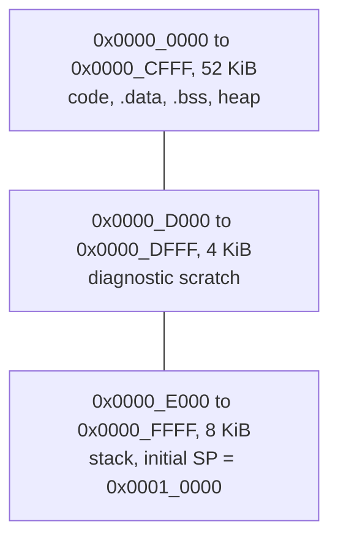
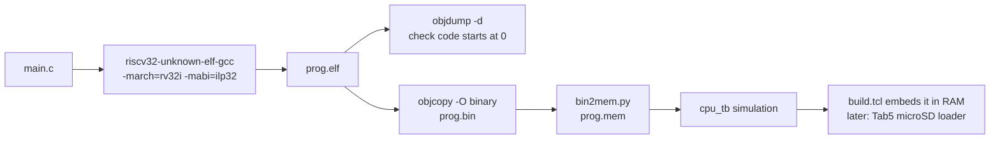

[Project README](../README.md) › **sw/**

# `sw/`: software that runs on the CPU

This folder holds the programs that run **on the custom CPU**, not on your computer. Read
this page to see what memory a program gets, how a C file becomes a memory image, and which demo
programs are planned.

> [!NOTE]
> **Status: 🚧 IN PROGRESS.** The assembly environment and official tests passed Phase 2.
> Phase 3 implements `common/` startup/linker/MMIO definitions, C Fibonacci and the C runtime
> smoke test. Both run in `cpu_tb`; Fibonacci also runs on the physical Basys 3
> ([evidence](../docs/phases/PHASE3_BOARD_C.md)). Phase 4 adds the UART/printf library, hello/echo and
> formatting smoke programs. The physical USB console gate passed, and hosted CI run #16
> passed ([evidence](../docs/phases/PHASE4_UART.md)). Phase 6 adds VGA; Phase 7 adds
> [primes, Life and Snake](../docs/phases/PHASE7_DEMOS.md), locally simulated on both
> CPUs and built in Vivado. Physical graphics and cold-power acceptance remain unrun.
> Status labels are defined in the [root README](../README.md#2-project-status).


<details open>
<summary><b>On this page</b></summary>

1. [What lives here](#1-what-lives-here)
2. [The memory a program sees](#2-the-memory-a-program-sees)
3. [Devices are addresses](#3-devices-are-addresses)
4. [From C to the board](#4-from-c-to-the-board)
5. [Program manifests (milestone T5)](#5-program-manifests-milestone-t5)
6. [Planned demo programs](#6-planned-demo-programs)
7. [Limits to know](#7-limits-to-know)
8. [Related](#8-related)

</details>

---

## 1. What lives here

Programs are compiled on a development machine with the RISC-V GCC cross-compiler, turned into a
memory image, and placed in the CPU's RAM.

They are **bare-metal** and **freestanding**: there is no operating system and no C standard
library. The project supplies its own minimal startup code and memory layout, with compatible
`libgcc` arithmetic helpers. The UART library and small `printf` are implemented in Phase 4.

| Folder | Planned contents | Phase |
| --- | --- | --- |
| [`common/`](common/) | ✅ Startup/linker/MMIO, UART/printf, VGA, button-edge, RNG and BCD helpers | 3–7 |
| [`tests/`](tests/) | ✅ Hand-written assembly tests. [`tests/isa/`](tests/isa/): one per group (register ALU, immediate ALU, loads and stores, branches, jumps, LUI/AUIPC, FENCE/EBREAK) plus Fibonacci in assembly. [`tests/faults/`](tests/faults/): illegal instruction and the four misaligned-access stops, each with its `.expect` file. `tests/env/` holds the custom environment header (the stock one uses CSR instructions this CPU does not implement), check macros and linker script. Later: the pipeline hazard zoo | 2, 5 |
| [`riscv-tests/`](riscv-tests/) | ✅ The official suite as a Git submodule; its `isa/rv32ui` programs run against `tests/env/` | 2 |
| [`programs/`](programs/) | ✅ `fib`, `runtime_smoke`, `hello`, `printf_smoke`, `cpi_bench`, `cpi_report`, `vga_demo`, `primes`, `life`, `snake` | 3–7 |

---

## 2. The memory a program sees

All code, data and stack share the single 64 KiB RAM starting at address 0. The diagram shows
the implemented software layout, enforced by assertions in `common/link.ld`:



---

## 3. Devices are addresses

A load or store to a device address reaches the device instead of RAM, so a device register
looks like a variable at a fixed address. This illustrative sketch uses the implemented LED
and switch addresses; real programs use `mmio_read32`/`mmio_write32` from `common/mmio.h`:

```c
/* Illustration only: real programs include sw/common/mmio.h. */
#define LEDS      (*(volatile unsigned int *)0x80000000u)
#define SWITCHES  (*(volatile unsigned int *)0x80000008u)

int main(void) {
    for (;;)
        LEDS = SWITCHES;   /* one load from the switches, one store to the LEDs */
}
```

`volatile` tells the compiler that every read and write matters, so it cannot cache the value
or remove the loop body. The full list of device addresses is in the
[memory map](../docs/BUILD_PLAN.md#6-memory-map).

---

<a id="from-c-to-the-board"></a>

## 4. From C to the board

> [!NOTE]
> ✅ **Implemented in Phase 3:** custom startup/linker/MMIO definitions and the C builder.
> Startup sets GP/SP/TP, clears BSS and calls main. ELF metadata and linker assertions
> enforce scratch/stack reservations. Phase 4 now supplies UART and `printf.c`; see its
> [console contract](../docs/phases/PHASE4_UART.md#3-c-interface-and-programs). See the
> [current build flow](../docs/phases/PHASE3_BOARD_C.md#5-build-simulate-and-program).

The diagram shows each file a program passes through, from source to simulation and the board:



1. Write `main.c` in `sw/programs/<name>/`, using the names from `mmio.h`.
2. Compile/link with the existing builder. It uses RV32I/ILP32, custom startup/linker,
   no hosted library, and compatible `libgcc` software multiply/divide helpers:

   ```bash
   python3 scripts/build_software.py fib
   ```

3. Inspect `build/software/fib/fib.dump`, `.map` and `.json`. The builder verifies ELF flags,
   entry 0, image/BSS/reservation bounds and emits the binary plus `.mem` automatically.
4. The builder already converts the image. For a manual ELF named `prog.elf`:

   ```bash
   riscv32-unknown-elf-objcopy -O binary prog.elf prog.bin
   python3 scripts/bin2mem.py prog.bin prog.mem
   ```

5. Simulate with `python3 scripts/run_tests.py c/`. The real board Fibonacci ELF runs at
   23 switch inputs; the runtime test also returns through startup. New C programs need
   explicit expected tests in the runner before board execution.
6. Build/program using the Windows commands in [Phase 4](../docs/phases/PHASE4_UART.md).
   `build.tcl` now defaults to hello; `-tclargs basys3_soc fib` selects Fibonacci. From T5, checked binary
   images/manifests will be loaded from the Tab5 microSD without rebuilding a bitstream.

> [!TIP]
> If the toolchain was installed as `riscv64-unknown-elf-*`, the same flags work with that
> prefix, provided it was built with 32-bit (multilib) support.

---

## 5. Program manifests (milestone T5)

Programs loaded from the Tab5 carry a manifest generated from the real ELF and linker output,
never typed by hand. It holds:

- schema version, name and description;
- ISA `rv32i` and ABI `ilp32`;
- binary path and byte count;
- load and entry address;
- CRC-32;
- `.bss` bounds and stack bounds;
- required FPGA capabilities and a build identifier.

The loader rejects an image that:

- is out of bounds;
- overlaps the scratch or stack region;
- has a bad entry point;
- has a checksum mismatch.

Details: [TAB5_INTEGRATION.md](../docs/tab5/TAB5_INTEGRATION.md#7-program-images-loading-and-launch).

---

## 6. Planned demo programs

| Program | Shows | Phase |
| --- | --- | --- |
| Fibonacci (assembly) | fib(1)–fib(20) written to memory and checked by the testbench | 2 |
| Fibonacci (C) | Reads the switches, shows the result on the 7-segment; fib(20) = 6765 = `0x1A6D` | 3 |
| hello, world | UART output, a live counter and echo | 4 |
| [Prime sieve](programs/primes/README.md) | Implemented: 1,229 primes through 10,000, cycles/instructions/CPI and exact UART tests | 7 |
| [Game of Life](programs/life/README.md) | Implemented: four patterns, restart, timed/manual steps and full VGA-pin tests | 7 |
| [Snake](programs/snake/README.md) | Implemented: controls, HUD, score, pause, collisions, restart and full VGA-pin tests | 7 |

---

## 7. Limits to know

| Limit | Detail |
| --- | --- |
| No C standard library | Custom startup/linker, UART/printf and compatible libgcc |
| No operating system | Programs run bare-metal from address 0 |
| No floating point hardware | |
| No multiply/divide instructions | Handled by `libgcc` |
| Misaligned loads and stores | Stop the CPU with an error |
| ECALL and EBREAK | Halt the CPU (project policy) |
| Memory | 64 KiB total for code, data and stack |

---

## 8. Related

| For | See |
| --- | --- |
| How the CPU executes these instructions | [rtl/README.md](../rtl/README.md) |
| How they are tested | [tb/README.md](../tb/README.md) |
| Conversion and build scripts | [scripts/README.md](../scripts/README.md) |
| Device addresses | [Build plan: memory map](../docs/BUILD_PLAN.md#6-memory-map) |

**Next acceptance step:** physical Phase 6/7 display and cold-power demonstrations, plus
an independent rebuild. Phases 0–5 passed; Phase 7 local changes have not run on hosted CI.
The assembly environment remains separate.


## Phase 6 VGA library and demo

The [vga.h](common/vga.h)/[vga.c](common/vga.c) library provides text formatting, scrolling, mode selection and packed pixels with readback. [vga_demo](programs/vga_demo/) shows text/pixels/bars. Build with `python3 scripts/build_software.py vga_demo --cpu-hz 25000000`; see [Phase 6](../docs/phases/PHASE6_VGA.md).
