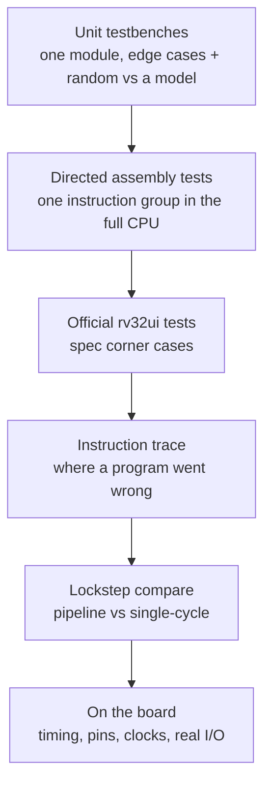
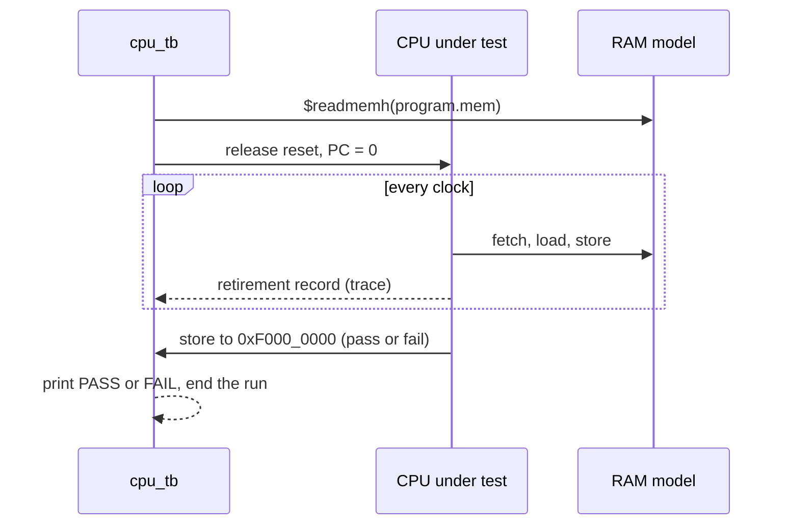
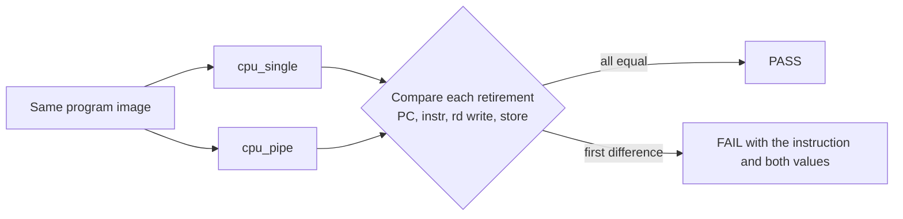

[Project README](../README.md) › **tb/**

# `tb/`: testbenches and verification

This folder holds the testbenches: SystemVerilog that checks the hardware in simulation and is
never built into the FPGA. Read this page to run the tests, to see which layer of testing
catches which kind of bug, and for the rules every new test must follow.

> [!NOTE]
> **Status: 🚧 IN PROGRESS.** The current regression has 25 unit benches and 236 program runs,
> all passing locally, plus 59 Python checks. Phase 5 adds the pipeline runner, lockstep,
> forwarding/hazard units and the hazard zoo ([evidence](../docs/phases/PHASE5_PIPELINE.md)); Phase 4
> added UART units and full-board serial simulation ([evidence](../docs/phases/PHASE4_UART.md)).
> Hosted CI for these changes is unrun; Phase 3 passed run #11 on `main`. Debug and
> diagnostic suites remain planned. Status labels are defined in the
> [root README](../README.md#2-project-status).


<details open>
<summary><b>On this page</b></summary>

1. [Run the tests](#1-run-the-tests)
2. [What exists now](#2-what-exists-now)
3. [Why testbenches matter](#3-why-testbenches-matter)
4. [Test layers](#4-test-layers)
5. [The CPU program runner, `cpu_tb.sv`](#5-the-cpu-program-runner-cpu_tbsv)
6. [The lockstep test (Phase 5)](#6-the-lockstep-test-phase-5)
7. [Debug and diagnostics suites](#7-debug-and-diagnostics-suites)
8. [Rules for every test](#8-rules-for-every-test)
9. [Related](#9-related)

</details>

---

## 1. Run the tests

From a WSL terminal at the repository root, run every testbench:

```bash
python3 scripts/run_tests.py
```

Expected result: 32 unit-bench rows and 245 program rows, ending in `277/277 passed`
(Phase 5 added the pipeline, lockstep, first-pass and pipeline-wrapper benches; see
[PHASE5_PIPELINE.md](../docs/phases/PHASE5_PIPELINE.md#3-tests); Phase 6 added VGA and Phase 7 the three demo profiles).
The Python suite has 80 checks.
Also run `python3 -m unittest discover -s scripts/tests -v` for 80 utility, software and
CPU harness tests. The CI workflow runs both commands on every push.

| To | Run |
| --- | --- |
| Run only matching benches | `python3 scripts/run_tests.py counter` |
| See each bench's output | `python3 scripts/run_tests.py -v` |
| List benches without running | `python3 scripts/run_tests.py --list` |

In VS Code's **WSL: Ubuntu** window, **Ctrl+Shift+B** defaults to **Tests: run all testbenches**.
**Terminal > Run Task > Smoke: build and run counter** selects just the original counter.
Every runner option is described in
[scripts/README.md](../scripts/README.md).

> [!TIP]
> The runner finds every `tb/**/<name>_tb.sv` by itself. A new bench needs no registration, but
> its top module must be named `<name>_tb` and it must print a line starting with `PASS:`.

---

## 2. What exists now

Unit benches sit in the same subfolder as the module they test, so `rtl/io/uart.sv` is checked
by `tb/io/uart_tb.sv`. Benches that run whole programs live in `system/`.

| Folder | Benches | Tests the code in |
| --- | --- | --- |
| [`core/`](core/) | `alu`, `branch_unit`, `counter`, `decoder`, `imm_gen`, `lsu`, `next_pc`, `regfile` | [`rtl/core/`](../rtl/core/) |
| [`mem/`](mem/) | `ram` | [`rtl/mem/`](../rtl/mem/) |
| [`io/`](io/) | `board_io`, `debounce`, `perf_counters`, `uart`, `uart_rx`, `uart_tx` | [`rtl/io/`](../rtl/io/) |
| [`soc/`](soc/) | `bus`, `soc` | [`rtl/soc/`](../rtl/soc/) |
| [`top/`](top/) | `basys3_soc`, `basys3_top`, `clock_gen` | [`rtl/top/`](../rtl/top/) |
| [`system/`](system/) | `cpu_tb` and `cpu_pipe_tb` (program runners), `lockstep_tb`, `pipe_first_pass_tb`, `board_c_tb`, `board_uart_tb` and their `_pipe` versions (full board top) | Compiled programs from [`sw/`](../sw/) |
| [`data/`](data/) | `ram_tb.mem`, `soc_tb.mem` memory images | Shared fixtures |
| `debug/`, `diag/` | Placeholders for the Tab5 milestones | [`rtl/debug/`](../rtl/debug/), [`rtl/diag/`](../rtl/diag/) |

| Bench | Checks | Evidence |
| --- | --- | --- |
| [counter_tb.sv](core/counter_tb.sv) | Initial and held reset, twenty increments including wraparound, reset asserted between clock edges, reset at the next rising edge, counting afterward. A timeout guard fails a stuck run; `+force_failure` proves a failed check exits nonzero. | 25 checks pass ([smoke-test record](../docs/phases/PHASE0_SMOKE_TEST.md)) |
| [basys3_top_tb.sv](top/basys3_top_tb.sv) | The blink top level with `DIV_BITS = 2`, so the LEDs step every 4 clocks: reset, counting steps, the 16-bit wrap and a reset in the middle of a count. A 10 ms timeout guards the run. | Passes in `run_tests.py` and CI |
| [alu_tb.sv](core/alu_tb.sv) | Ten operations, signed and unsigned edges, wraparound and overflow, all edge pairs, shift-count masking and 1,000 random pairs/operation, against a bit-by-bit ripple-carry model. | 11,709 local checks |
| [regfile_tb.sv](core/regfile_tb.sv) | Both BYPASS settings, before/after-edge reads, every read-address pair, x0, the no-reset contract (unwritten registers are not compared), write enable, back-to-back writes and random modelled cycles. | 6,140 local check groups |
| [imm_gen_tb.sv](core/imm_gen_tb.sv) | Literal encodings, one-hot wiring, sign limits, random encode/decode round trips and reserved formats. | 10,343 local checks |
| [decoder_tb.sv](core/decoder_tb.sv) | All control fields for 40 instructions, exhaustive opcode/funct3/funct7 combinations and invalid-instruction side-effect rejection. | 133,700 local checks |
| [branch_unit_tb.sv](core/branch_unit_tb.sv) | All conditions, equal operands, signed-vs-unsigned extremes, subtraction overflow, edge pairs, random data and disabled selectors. | 8,522 local checks |
| [next_pc_tb.sv](core/next_pc_tb.sv) | Sequential and wrap, branch/JAL/JALR targets, bit-0 clearing, both low target bits checked for alignment, reset/hold priority, random cases against a ripple-carry model. | 20,023 WSL checks |
| [lsu_tb.sv](core/lsu_tb.sv) | Every size, offset and signedness; reserved sizes; simultaneous enables; store lanes byte by byte; alignment contract; random cases. | 20,184 WSL checks |
| [ram_tb.sv](mem/ram_tb.sv) | `$readmemh`, all byte enables in both B clock modes, disabled ports, read-first, and the functional fetch / dependent-load / store edge schedule. Uses [data/ram_tb.mem](data/ram_tb.mem). | 371 WSL checks |
| [cpu_tb.sv](system/cpu_tb.sv) | Original program/fault runner, board-I/O expectations and real-pin UART stream checks. | 13 directed + 40 rv32ui + 26 C input/runtime/console runs |
| [board_c_tb.sv](system/board_c_tb.sv) | The compiled Fibonacci image on the complete `basys3_soc` top (clock model, lock reset, `soc` fetch path, bus, I/O). Switches change while the program runs; LEDs, the hex register and every scanned digit's segment pins must follow. The centre button must restart only the CPU. | 1 run: gate case plus 8 live steps |
| [uart_tx_tb.sv](io/uart_tx_tb.sv) | Independent serial decoder, every byte, busy rejection, bit/frame timing and reset | 256 frames |
| [uart_rx_tb.sv](io/uart_rx_tb.sv) | TX loopback, baud mismatch, mid-bit sampling point, false start, bad stop, sustained break and reset | All byte values at nominal, ±2% and ±4.5% baud; ±4.5% fails if sampling drifts to a quarter bit |
| [uart_tb.sv](io/uart_tb.sv) | Registers, lanes, 16-byte FIFO, overflow/drop-newest, wrap, simultaneous pop/push, sticky-error priority and seeded random traffic | 1,327 MMIO checks (seed `da7a2026`) plus serial assertions |
| [board_uart_tb.sv](system/board_uart_tb.sv) | Real hello image on complete board top; greeting, one-second counter, exact echo, concurrent paste and receive during CPU reset | 1 full-board run with actual baud/clock/program |

The five original Phase 1 benches use deterministic seeds and expected values computed a
different way from the RTL. Their historical bug-injection check used 24 single-line RTL
changes in the reset-enabled implementation. Current Phase 2 evidence and the seven audit
mutations are in [the audit](../docs/phases/PHASE2_AUDIT.md). A failing check prints the operation and operands; the decoder bench also names each
mismatching control field. Commands, interfaces, counts, the injected bugs and the CI
result are recorded in [PHASE1_CORE_BLOCKS.md](../docs/phases/PHASE1_CORE_BLOCKS.md#5-recorded-verification-november-7-2026).

---

Phase 3 adds `clock_gen_tb`, `debounce_tb`, `board_io_tb`, `bus_tb`, `perf_counters_tb`,
`soc_tb`, `basys3_soc_tb` and the program bench `board_c_tb`. They check filtered inputs, all
hex glyphs/digits, write lanes, MMIO read timing, counter wrap, reset separation, quiet memory
hold, fresh restart fetch, and the real C image running on the complete board top.
The clock model is functional; hardware clock/timing proof comes from Vivado.
See [the module/bench map](../docs/phases/PHASE3_BOARD_C.md#1-what-now-exists).

## 3. Why testbenches matter

A **testbench** wraps a module, drives its inputs and checks its outputs. In this project every
testbench is **self-checking**: it computes the expected answer independently and fails by
itself on any mismatch, so nobody has to stare at waveforms to know whether a test passed.

> [!IMPORTANT]
> **Catch each bug at the cheapest layer that can catch it.** A wrong ALU result found by a unit
> test takes minutes to fix; the same bug found on the board can take a day.

---

## 4. Test layers

The diagram shows the order in which the layers come into use. Each one catches bugs the layer
before it cannot.



| Layer | What it catches | How | Starts in |
| --- | --- | --- | --- |
| Unit testbenches | Wrong logic inside one block | Edge cases plus random inputs against a reference model | Phase 1 |
| Directed assembly tests | An instruction behaving wrong in the full CPU | Small programs that write pass/fail to `0xF000_0000`; `cpu_tb` runs them | Phase 2 |
| Official riscv-tests (rv32ui) | Spec corner cases nobody thought of | About 40 programs, one per instruction, with a custom environment header | Phase 2 |
| Instruction trace | Where exactly a program went wrong | `cpu_tb` prints PC, instruction, destination register and value per instruction | Phase 2 |
| Lockstep compare | Missed forwarding, bad stalls and flushes | Single-cycle and pipeline run side by side; every retirement is compared | Phase 5 |
| On the board | Timing, pins, clocks, real I/O | Timing report with no negative slack, LEDs, 7-segment, serial terminal, ILA | Phase 3 |
| Continuous integration | Old features breaking | GitHub Actions runs every test on every push (✅ running since Phase 0) | Phase 0 |

---

## 5. The CPU program runner, `cpu_tb.sv`

✅ Implemented in Phase 2. It loads any program image, runs until the program halts or a timeout
expires, checks the pass/fail word, and can print an instruction trace (`+trace`) and dump
waveforms for GTKWave (`+vcd=<file>`). Every cycle it also checks the
[retirement contract](../docs/phases/PHASE2_SINGLE_CYCLE.md#4-retirement-and-stop-contract). Its
plusargs are listed at the top of the file; `run_tests.py` runs it once per program.
Phase 3 board mode requires expected LED/display values and actual writes. `+observe_io`
checks the running Fibonacci image after a retired display write without injecting a fake
halt into the board binary. Normal assembly result/fault/stop checks remain the default;
the C runtime program returns to the startup EBREAK.

Phase 4 `+uart_console` requires a nonempty `+uart_expect` text file, whose LF line endings
represent CR LF on the wire. The checker decodes actual TX start/data/stop bits; wrong,
missing or extra bytes fail. `+uart_input` types one real RX byte, and `+uart_observe` checks
a running program's prefix without fabricating a halt. The separate `board_uart_tb` checks
the complete system and real one-second interval; its default wall timeout is 180 seconds.

The bench compares falling-edge data accesses against retirement, rejects the first failing
result, and checks four quiet cycles after halt. RAM is poisoned before loading the image,
so tests must initialize every guard or partial-write destination they rely on. Expectation
files permit blank lines and otherwise require exactly two hex values per line.

The sequence shows one run from loading the image to the verdict:



> [!IMPORTANT]
> The pass/fail address `0xF000_0000` is simulation-only and must be preserved.

---

## 6. The lockstep test (Phase 5)

The single-cycle CPU is kept as the **reference model** for the pipeline. Both run the same
program and the testbench compares their ordered retirement streams:

- PC and instruction;
- register writes;
- memory side effects, including instructions that write no register.

The first mismatch points at the failing instruction. Comparing stores matters, because an
incorrect store can otherwise pass unnoticed.

**Implemented (Phase 5):** [lockstep_tb.sv](system/lockstep_tb.sv) also compares every data-bus access
each CPU issues and, at the stop, the cause, PC, registers and all RAM. It runs 65 programs.
[cpu_pipe_tb.sv](system/cpu_pipe_tb.sv) runs every `cpu_tb` program on the pipeline alone.
[hazard_zoo.S](../sw/tests/pipeline/hazard_zoo.S) and [pipe_mmio.S](../sw/tests/pipeline/pipe_mmio.S) run on all
three CPU benches.



The **hazard zoo** test exercises:

- dependencies at distances 1, 2 and 3;
- load-use;
- a load then a store of the same register;
- a branch on a just-computed value;
- JAL/JALR with the return address used immediately;
- `x0` as a destination.

---

## 7. Debug and diagnostics suites

`tb/debug/` and `tb/diag/` are reserved for the Tab5 milestones. The planned work packages are
defined in the [verification matrix](../docs/tab5/VERIFICATION_MATRIX.md#3-verification-work-packages):

| Folder | Work packages |
| --- | --- |
| `tb/debug/` | V-LINK (packet codec, sessions), V-WB (Wishbone bridge), V-OWNER (RAM ownership), V-HALT, V-STEP, V-BREAK, V-STATE, V-LOAD, V-CONSOLE, V-SNAPSHOT, V-TRACE, V-PERF |
| `tb/diag/` | V-BIST (memory and ALU self-test), V-FAULT (controlled fault injection) |
| Cross-cutting | V-CORE (original regression always passes), V-IDLE (debug present but idle changes nothing) |

---

## 8. Rules for every test

- [ ] Add a self-checking testbench with each new RTL module, in the same commit.
- [ ] Keep the expected result independent of the block under test; do not generate expected
      and observed values with the same code.
- [ ] Tie the runner's verdict to assertions and process exit status.
- [ ] Simulate every C program before it goes near the board.
- [ ] Report exactly which checks ran.

> [!WARNING]
> Simulation success, synthesis success, timing closure and observed board behavior are four
> different claims. Never report one as another.

---

## 9. Related

| For | See |
| --- | --- |
| Modules under test | [rtl/README.md](../rtl/README.md) |
| Test programs | [sw/README.md](../sw/README.md) |
| The test runner's options | [scripts/README.md](../scripts/README.md) |
| Requirement traceability | [VERIFICATION_MATRIX.md](../docs/tab5/VERIFICATION_MATRIX.md) |
| First simulation evidence | [PHASE0_SMOKE_TEST.md](../docs/phases/PHASE0_SMOKE_TEST.md) |

**Next acceptance step:** physical Phase 6/7 display and cold-power observations.
Phases 0–5 passed their recorded gates; hosted CI for the Phase 7 local changes is unrun.


## Phase 6 VGA verification

`vga_timing_tb`, `vga_text_tb`, `vga_fb_tb`, `vga_tb` and `vga_pipe_tb` check timing, memories, byte masks, readback, modes and CDC. `board_vga_tb` and `board_vga_pipe_tb` run the actual C demo and compare text plus every framebuffer pixel on the full top. `clock_gen_fast_tb` checks CPU 50 MHz/pixels 25 MHz in the functional model. `vga_text_tb` renders a distinct glyph in every one of the 2400 cells, and `vga_tb` checks that STATUS bit 0 changes only after the output pins enter or leave vertical blank, within two synchronizer flops plus one bus read. See [Phase 6](../docs/phases/PHASE6_VGA.md); no monitor gate is claimed.


Integrated Phase 6 verification: **271/271** regression rows and **67/67** Python checks.
All **42** benches elaborate with `--lint-only --timing --assert -Wall`.
`board_vga_fast_tb` runs the real C demo with a 62.5 MHz pipeline and 25 MHz pixels;
`clock_gen_62mhz_tb` checks the corresponding functional clock model.
The optional `+frames=<existing-directory>` argument to the VGA board bench captures the
actual simulated RGB pins. `scripts/vga_preview.py` converts these captures to PNG.

## Phase 7 demo verification

`primes_tb`, `life_tb` and `snake_tb` run the real C images on `basys3_soc`.
Their `*_pipe_tb` wrappers use the pipeline at 62.5 MHz; base benches use single-cycle
25 MHz. Pixels stay at 25 MHz. `demo_board.svh` shares only board wiring, capture,
input taps and pin comparison, while each game supplies its independent expected image.

The sieve checks every UART byte, all 1,229 primes, the dynamic counter/CPI line and
normal EBREAK. Life compares a naive rule oracle and canonical RLE gun across four
whole frames; Snake uses a deque oracle across six. Input tests cover held/queued/
reversed directions, restarts, pause, food/score and wall death. Both test real timer
periods and the C redraw-overrun diagnostics; no shortened timing constants are used.
Life also measures every 2,400-store redraw on the bus and fails if one spans more than
the 1.44 ms vertical blank, independent of the program's own overrun flag.

Native ASan/UBSan checks additionally exercise Life's packed boundaries/finite edges,
Snake ring wrapping/legal tail entry/self-collision/full-board win, clipping and every
printable pixel-font glyph. `--evidence-dir` on the runner saves RGB/UART simulation
artifacts. See [Phase 7](../docs/phases/PHASE7_DEMOS.md); captures do not pass a physical gate.
